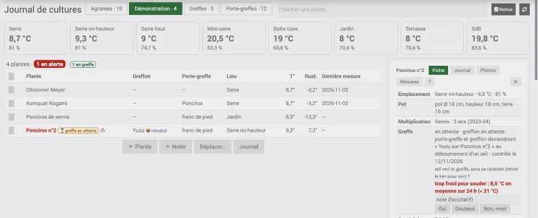

# Journal de cultures — plugin Jeedom

Plugin [Jeedom](https://www.jeedom.com) pour tenir le journal des plantes de la maison et du jardin, **agrumes** en tête :
fiches botaniques, emplacement suivi (serre, intérieur, terrasse…), alerte de froid selon la rusticité, l'âge et le pot,
rappels d'engrais, mesures et courbes, photos, identification par [Pl@ntNet](https://plantnet.org), suivi des greffes.

## Fonctions
- **Collections** (une tuile par collection) et **plantes** rangées dedans, déplaçables d'un emplacement à l'autre.
- **Alerte froid** : rusticité de la plante corrigée par l'âge et la taille du pot, comparée à la température des sondes de l'emplacement.
- **Engrais** : plan par plante selon les produits que vous avez, la saison et le volume du pot ; rappels sur la tuile.
- **Greffes** : marche à suivre par type, contrôle à J+21 et J+42.
- **Journal unique** des travaux, utilisable dans les scénarios ; commandes info pour chaque plante.
- **Notice intégrée** : prise en main, botanique et multiplication, greffe, santé des agrumes, fertilisation, identification, origine des noms (481 entrées).

## Installation
Jeedom 4.4 ou plus récent. Installer depuis GitHub (source GitHub activée dans la configuration des mises à jour ; Plugins → Gestion des plugins → ＋ → GitHub : `flab75`, `plugin-journalcultures`, branche `master`),
puis activer le plugin et suivre la [prise en main](docs/fr_FR/index.md#prise-en-main).
La clé Pl@ntNet (gratuite) est facultative ; sans elle, l'identification par photo est désactivée.

## Documentation
- [Notice](docs/fr_FR/index.md) · [Changelog](docs/fr_FR/changelog.md)
- [Santé des agrumes](docs/fr_FR/sante.md) · [Greffe](docs/fr_FR/greffe.md) · [Fertilisation](docs/fr_FR/fertilisation.md) · [Botanique](docs/fr_FR/guide.md) · [Identification](docs/fr_FR/identification.md) · [Noms des plantes](docs/fr_FR/noms.md)

## Licence
Code sous licence [MIT](LICENSE). Les images de `docs/images` ont leur propre licence (domaine public, CC0, CC BY, CC BY-SA, Licence Ouverte Etalab 2.0) : voir [LICENCES.md](docs/images/LICENCES.md).
