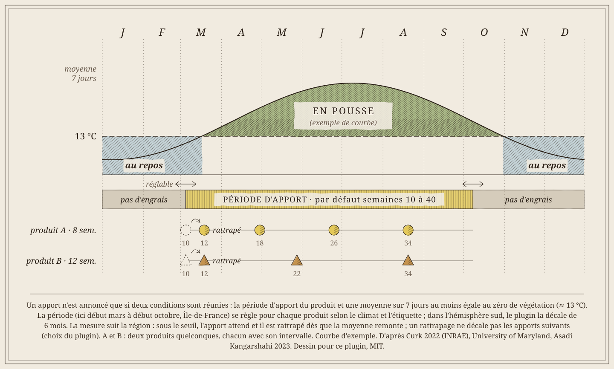
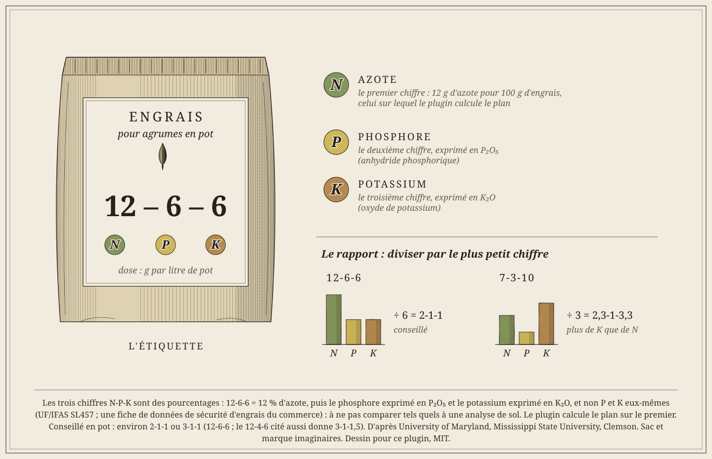
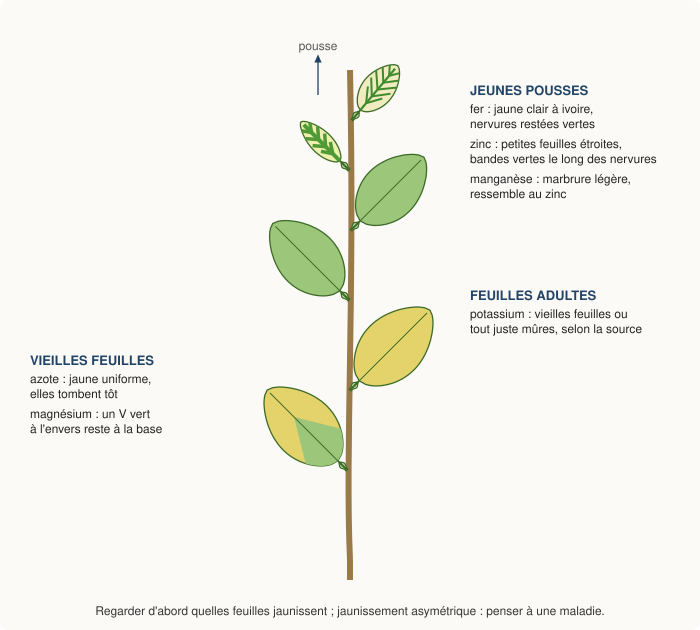
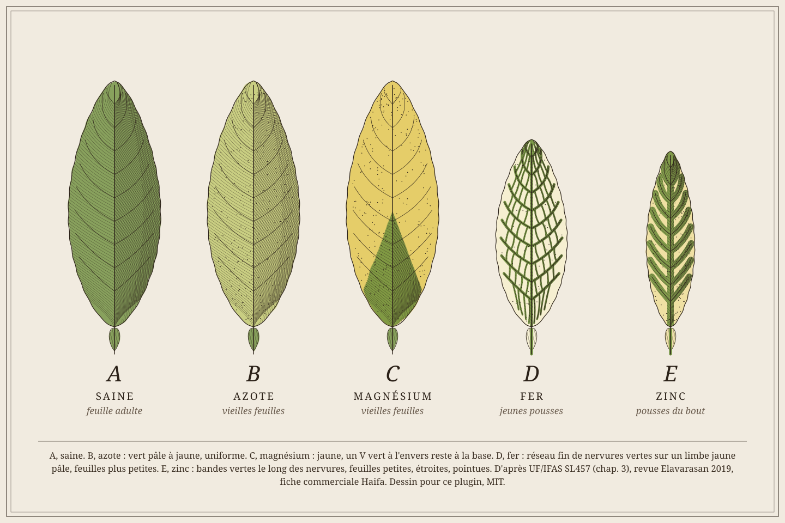

# Fertilisation des agrumes en pot

Comment nourrir des agrumes **en pot**, rentrés l'hiver sous une serre ou une véranda (rédigé pour l'Île-de-France ; ailleurs, voir [La saison](#la-saison)), et comment le plugin calcule le plan d'engrais.
Presque toutes les études portent sur des **vergers en pleine terre** : leurs doses par hectare ou par arbre ne se transposent pas au pot, seuls leurs principes le font.

Règle suivie : un fait n'est retenu que si **deux organismes indépendants** le donnent ; sinon il est marqué **une seule source**.
Toutes les fiches de l'université de Floride (UF/IFAS) comptent pour un seul organisme.
Les sources sont nommées entre parenthèses ; les références complètes sont à la fin ([Sources](#sources)).
Ce qui vient du plugin lui-même (choix, déduction) est écrit comme tel.

## Dans le plugin
- **Configuration du plugin**, *Produits en stock* : la liste des engrais et correcteurs, une ligne par produit (voir [Ajouter un engrais ou un produit](#ajouter-un-engrais-ou-un-produit)).
- **Configuration**, *Azote par litre de pot* : le besoin, 0,07 g par litre et par semaine par défaut (voir [la dose](#combien--la-dose-en-pot)).
- **Fiche d'une plante**, *Plan d'engrais* : cocher les produits que reçoit cette plante et la part d'azote de chacun (en %, total 100).
  Pour un produit à dose d'étiquette, le % sert seulement à le cocher et compte dans le total de 100.
  Seuls les produits qui ont un % d'azote **et** un intervalle peuvent être cochés : le sang séché (ponctuel) n'entre pas dans le plan.
  Le plugin calcule la dose de chaque apport, arrondie au gramme (1 g au moins) ; elle peut être corrigée à la main (la correction l'emporte).
  Un produit qui a une **dose d'étiquette** (7e champ) garde cette dose ; l'azote qu'il apporte est retiré du besoin et le reste va aux autres produits cochés, selon leurs parts. La corne seule ne couvre qu'environ 15 % du besoin d'une plante adulte : cocher aussi un engrais calculé (Ferti Agrumes).
- **Écrire dans le calendrier** (administrateurs) : rien n'est écrit dans le calendrier de la plante sans ce bouton ; les lignes des produits du plan sont remplacées,
  les autres (fer, magnésium, lignes à la main) gardées, et l'écriture est notée au journal.
- **Fiche**, partie *Engrais* : des **pistes de carence** d'après la dernière mesure des feuilles, puis volume du pot et besoin, calendrier actuel, plan proposé
  (couleur, feuilles touchées, forme), avec les produits en stock qui apportent l'élément.
  Un substrat noté « détrempé » **dans la même mesure** est signalé d'abord : il faut arroser moins avant tout apport.
- Le volume du pot vient de ses mesures (diamètre ou côté, hauteur de terre, sinon hauteur du pot) : saisir le pot dans la fiche, ou dans les **Mesures** (Racines / pot) au rempotage.

## Ajouter un engrais ou un produit

- **1.** Ouvrir **Plugins → Gestion des plugins → Journal de cultures** (administrateur), cadre *Configuration*.
- **2.** Dans **Produits en stock**, ajouter une ligne en bas : un produit par ligne, les champs séparés par `|`.
- **3.** Cliquer sur **Sauvegarder**. Le produit apparaît dans la partie *Engrais* de chaque fiche ; une plante ne le reçoit que s'il est **coché dans son plan**.

Les champs, dans l'ordre :

| Champ | Exemple | À savoir |
|---|---|---|
| Nom | `Ferti Agrumes 7-3-10` | tel qu'il sera écrit dans le calendrier |
| % d'azote | `7` | le premier chiffre du « N-P-K » de l'étiquette ; `0` pour un correcteur sans azote |
| toutes les n semaines | `8` | l'intervalle entre deux apports ; `0` = produit ponctuel, hors plan |
| période d'apport | `10-40` | numéros de semaine, **hémisphère nord** (10 = début mars, 40 = début octobre) ; vide = 10-40 ; décalée de 6 mois si Jeedom est dans l'hémisphère sud |
| éléments apportés | `N P K` | parmi N P K Mg Fe S Zn Mn, séparés par des espaces : sert aux pistes de carence |
| note | `granulés à enfouir` | remarque libre (étiquette, mode d'emploi) |
| dose de l'étiquette | `1` | **facultatif** : grammes par litre de pot et par apport ; le plan suit alors l'étiquette au lieu de calculer |

Exemples :
- un engrais de fond calculé : `Ferti Agrumes 7-3-10 | 7 | 8 | 10-40 | N P K | granulés à enfouir`
- un engrais à dose d'étiquette : `Corne broyée | 13 | 12 | 10-40 | N | 3 apports de 1 g par litre de terreau | 1`
- un correcteur ponctuel (pistes de carence seulement) : `Kélafer racinaire | 0 | 0 | 6-44 | Fe | au pied, si besoin reconnu`

Seuls les produits qui ont un % d'azote **et** un intervalle entrent dans le plan d'azote ; les autres ne servent qu'aux pistes de carence.
Pour retirer un produit, effacer sa ligne : les plans qui le cochaient le perdent (vérifier le plan des plantes concernées).
Le champ **dose de l'étiquette** est à remplir quand l'étiquette donne une dose **par litre de pot** : le plugin la suit à la lettre.
Si elle donne une dose par sujet ou par m², laisser vide : le plugin calcule d'après le besoin en azote ([la dose](#combien--la-dose-en-pot)).

## Choisir sa fertilisation

Aucune étude ne traite des agrumes **adultes en pot sous climat tempéré** : les essais en pot portent sur des plants de pépinière, les guides sur des vergers.
La méthode ci-dessous assemble ce qui s'accorde entre eux. Elle suit le cadre des « 4R » : **bon produit, bonne dose, bon moment, bon endroit**, à juger ensemble (Mikkelsen 2011, **résumé seul**).

### 1. Observer avant de décider
- En verger, on décide d'après l'**analyse des feuilles**, avec celle du sol : chaque résultat du sol renvoie à vérifier la teneur des feuilles (UF/IFAS SL454 ; CDFA, Californie). Pour un particulier en pot, elle ne sert guère (voir [Reconnaître une carence](#reconnaître-une-carence)) :
  on la remplace par l'**observation** : quelles feuilles jaunissent, comment pousse la plante, le substrat est-il détrempé (déduction du plugin).
- Noter ce qu'on voit dans les **Mesures** de la fiche : le plugin en tire les pistes de carence.

### 2. Le bon produit
- **En pot, un engrais à libération lente** (granulés organiques ou engrais enrobé) : les arrosages fréquents lessivent les éléments nutritifs (Mississippi State University, Clemson, University of Maryland).
  Autre possibilité : un engrais **liquide à chaque arrosage** pendant la saison (University of Maryland ; Rutgers, qui reprend Mississippi).
- Un engrais riche en **azote**, d'un rapport N-P-K d'environ **2-1-1 ou 3-1-1** : par exemple 12-6-6 (2-1-1) ou 12-4-6 (3-1-1,5) (University of Maryland ; Mississippi State University et Clemson donnent 12-6-6 ou 12-4-6).
  Notre Ferti Agrumes 7-3-10 contient plus de potassium que d'azote : rien ne dit qu'il nuise ; le plan est calculé sur son azote, le potassium en plus est sans effet sur le froid (voir [plus bas](#le-potassium-ne-protège-pas-du-froid)).
- Un engrais qui contient des **oligo-éléments** (Mississippi State University, **une seule source**). Le Ferti Agrumes n'en déclare aucun : le fer et le magnésium se donnent à part, seulement si les feuilles le montrent.
- Les produits « spécial agrumes » conviennent (University of Maryland, Mississippi State University).
- Un engrais **organique** doit vraiment apporter de l'azote : en pépinière, un humate de lombricompost seul n'a pas couvert le besoin en azote d'un porte-greffe, contrairement à un engrais enrobé (Machado 2011, **une seule source**).
  Ce résultat ne vaut pas pour un engrais organique dosé à 7 % d'azote comme le Ferti Agrumes (déduction du plugin).

### 3. La bonne dose
- Pas plus que nécessaire, surtout pour un **jeune plant** : voir [Pas plus que nécessaire](#pas-plus-que-nécessaire) et la mise en garde de [la dose en pot](#combien--la-dose-en-pot).
- Le **cuivre en excès** freine aussi la croissance : en pépinière, recul net à 20 mg/L de cuivre dans l'eau d'arrosage, meilleur résultat à 5-10 mg/L (Mattos 2010, **une seule source**).
  Attention donc aux traitements cuivrés répétés en pot (voir [Santé](sante.md)).

### 4. Le bon moment
- Seulement **pendant la pousse**, du printemps à la fin de l'été ; **au moins 3 apports** : printemps, début d'été, fin d'été ; arrêter au début de l'automne (période d'apport du plugin : jusqu'à début octobre), rien l'hiver (University of Maryland ; voir [La saison](#la-saison) pour les autres sources).
  Le plan du plugin (semaines 10, 18, 26, 34) suit ce rythme.
  Un engrais **enrobé** libère en continu : un seul apport au début de la saison peut suffire (voir [L'engrais enrobé](#lengrais-enrobé)).

### 5. Le bon endroit : le substrat et l'eau
- Au pied, sur un substrat **humide** et drainé (voir [Arroser juste](#arroser-juste)).
- Le **pH** du substrat décide de la disponibilité des oligo-éléments : en pot, au-dessus de pH 7 dans l'eau de drainage, les jeunes orangers ont montré plus de carences et moins poussé ; ajouter de la chaux au terreau a fait monter le pH et baisser le fer, le zinc et le manganèse des feuilles (Labanauskas 1967 ; même sens : UF/IFAS SL456, « un pH élevé réduit la disponibilité du calcium, du magnésium, du fer, du zinc et du manganèse », voir [pH et eau du robinet](#ph-et-eau-du-robinet)).
  Ne pas chauler le substrat d'un agrume (déduction du plugin).

*Fig. F1 – Où mettre l'engrais : A, granulés répartis en surface sur substrat humide, sans toucher la tige, puis griffés ; B, certains enrobés se mélangent au substrat, au rempotage seulement (lire l'étiquette) ; C, un arrosage en excès lessive l'azote par le fond. Détail et sources sur le dessin. Dessin façon gravure coloriée pour ce plugin, MIT.*

### Le Ferti Agrumes face à ces critères

Bilan du plugin (déduction à partir des critères ci-dessus et de l'étiquette) :

| Critère | Ce que demande la notice | Ferti Agrumes 7-3-10 | Verdict |
|---|---|---|---|
| Forme | libération lente en pot | granulés organiques, effet 2 mois | conforme |
| Rapport N-P-K | riche en azote, environ 2-1-1 ou 3-1-1 | 7-3-10 = 2,3-1-3,3 : plus de potassium que d'azote | à l'envers du rapport conseillé ; rien ne dit que ça nuise, le plan est calculé sur l'azote |
| Oligo-éléments | un engrais qui en contient (une seule source) | aucun déclaré | manque : fer et magnésium à part, seulement si les feuilles le montrent |
| « Spécial agrumes » | convient | oui | conforme |
| Organique qui apporte vraiment de l'azote | pas un simple humate | 7 % d'azote | conforme |
| Dose | pas plus que nécessaire, fourchette de l'étiquette | 80 à 240 g par sujet ; le calcul du plugin tombe dedans | conforme |
| Moment | pendant la pousse, au moins 3 apports, rien l'hiver | tous les 2 mois de mars à octobre (semaines 10, 18, 26, 34) | conforme |
| Endroit | au pied, substrat humide, pas de chaulage | enfoui par léger griffage | conforme |

En somme : bon engrais de fond ; deux réserves, le rapport N-P-K inversé (trop de potassium plutôt que pas assez d'azote, sans conséquence connue) et l'absence d'oligo-éléments, qui oblige à surveiller les feuilles.
Un 12-6-6 ou 12-4-6 avec oligo-éléments collerait mieux à la lettre des sources ; aucune ne montre que le Ferti Agrumes fait moins bien.

**Et si on ajoute la corne broyée ?** Elle n'apporte que de l'azote (13 %, organique, lent) : ni phosphore, ni potassium, ni oligo-éléments.
- Elle ne compense donc **pas** l'absence d'oligo-éléments.
- Elle **rapproche un peu** le rapport de celui conseillé : à la dose de l'étiquette, elle couvre environ 15 % de l'azote du plan, et le Ferti le reste ; l'ensemble passe d'environ 2,3-1-3,3 à 2,7-1-3,3 (calcul du plugin), le potassium reste au-dessus de l'azote.
  Aucune part de corne ne mène à 2-1-1 : sans phosphore ni potassium, elle laisse le rapport P-K du Ferti (1-3,3) et ne fait que monter l'azote (deux tiers de corne : environ 7-1-3,3).
- Elle allonge la libération (effet 3 à 4 mois contre 2) : apport plus régulier, sans source qui en montre l'intérêt pour un agrume en pot.
Bref, la corne est un complément d'azote à libération lente, pas un correctif des deux réserves ci-dessus.

### Rééquilibrer le rapport N-P-K

Le défaut d'un engrais « spécial agrumes » du commerce (7-3-10, 3-2-5, 5-4-9…) n'est pas un manque d'azote : le plan est calculé sur l'azote, la plante le reçoit.
C'est un **excès de potassium**. On ne le réduit qu'en confiant une part de l'azote à des produits **sans potassium** et **lents** (corne) **à la place** d'une part de l'engrais de fond, jamais en plus : la dose en pot est déjà 3 à 6 fois le besoin réel (voir [la dose en pot](#combien--la-dose-en-pot)).
Le sang séché ne compte pas : azote rapide (effet en 3 à 4 jours, étiquette), il ne remplace pas une part de l'azote d'une saison ; c'est un coup de fouet ponctuel, hors plan.

Calculs du plugin pour un pot de 17,7 L (besoin de 1,24 g d'azote par semaine), corne à 1 g par litre, 3 apports (dose de son étiquette, environ 15 % de l'azote du plan) :

| Engrais de fond | Compléments | Rapport obtenu | Remarque |
|---|---|---|---|
| spécial agrumes 7-3-10 seul | — | 2,3-1-3,3 | potassium au-dessus de l'azote |
| spécial agrumes 7-3-10 (85 % de l'azote) | corne 15 % | 2,7-1-3,3 | le potassium reste au-dessus de l'azote |
| engrais équilibré 2-1-1 (12-6-6) seul | — | 2-1-1 | le rapport des sources ; vérifier la libération (voir ci-dessous) |
| engrais 2-1-1 (85 %) | corne 15 % | 2,4-1-1 | entre 2-1-1 et 3-1-1 ; azote lent en plus |
| organo-minéral 3-1-2 + Mg, libération 100 jours (85 %) | corne 15 % | 3,5-1-2 | forme et rapport conformes, magnésium compris |
| n'importe quel fond (70 %) | liquide 2-1-1,7 à oligo-éléments chélatés (30 %), à chaque arrosage en saison | ≈ 2,1 à 2,9-1-1,2 à 2,7 | seule façon d'apporter Cu, Mn, Zn, Mo sans produit « oligo » à part |

Conclusions :
- avec la gamme de produits qu'on a (engrais 7-3-10, corne), le potassium reste au-dessus de l'azote ; pour atteindre 2-1-1, il faut **changer** l'engrais de fond, pas le compléter ;
- le fer (chélate) et le magnésium (sel d'Epsom) **ne font pas partie d'un plan** : la notice les réserve au signe observé (voir [Reconnaître une carence](#reconnaître-une-carence)) ;
- le manque le plus courant des engrais lents trouvés en Europe, ce sont les **oligo-éléments** (zinc, manganèse, cuivre) : parmi les engrais lents, seuls certains enrobés en déclarent (voir [L'engrais enrobé](#lengrais-enrobé)), sinon un engrais liquide ; les donner sur signe, ou par un liquide léger en saison ;
- aucune source ne montre qu'un engrais riche en potasse nuise à un agrume en pot : ce rééquilibrage suit la lettre des sources, pas un problème observé.

**Avant d'acheter un engrais 2-1-1 ou 3-1-1**, lire sur le sac (ces produits sont souvent vendus pour la pelouse) :
1. la **libération** : formes d'azote (ammoniacal, uréique = rapide ; organique, enrobé = lente) ; si rapide, fractionner en pot (apports toutes les 4 semaines à demi-dose, intervalle réglable dans le plugin) ;
2. la présence de **magnésium** et d'**oligo-éléments** (le bore seul ne compte pas) ;
3. l'absence de **désherbant** ou d'**anti-mousse**, fréquents dans les gammes pelouse ;
4. la forme du potassium : sulfate plutôt que chlorure (sensibilité des agrumes au chlore : notion courante en verger, **aucune de nos sources ne la traite**, et rien en pot).

Tout cela se saisit dans le plugin : la part d'azote de chaque produit découle de sa dose d'étiquette, le reste va à l'engrais de fond.

### L'engrais enrobé

Des granulés d'engrais minéral entourés d'une fine enveloppe de résine : l'eau la traverse, dissout l'engrais, qui ressort peu à peu. C'est l'une des deux formes « à libération lente » conseillées en pot (voir [Le bon produit](#2-le-bon-produit)).
Ce qu'en disent les étiquettes des fabricants :
- la **durée** (3, 6, 8 à 9 mois…) est donnée pour une température fixe, souvent 21 °C : elle s'allonge au frais et raccourcit au chaud (pour un « 6 mois » : 6-7 mois à 15 °C, 5-6 mois à 21 °C, 4-5 mois à 27 °C, fiche d'un revendeur, **une seule source** ; la fiche ICL de l'Osmocote donne ses durées à 16, 21 et 26 °C) ; en serre l'été, il peut être épuisé avant la fin de la saison ;
- certains se **mélangent** au substrat au rempotage seulement, d'autres se posent **en surface** et se griffent : lire l'étiquette ;
- un **fer** chélaté en EDTA n'est stable qu'entre pH 4 et 6,5 (fiche technique d'un enrobé) : au-dessus (eau dure, substrat calcaire), il devient peu disponible, et le fer EDDHA sur signe reste utile (voir [pH et eau du robinet](#ph-et-eau-du-robinet)) ;
- la **dose** est donnée en grammes par litre de substrat pour toute la durée : pour des plantes en pot, 2-3 g/L en dose faible, **3-4 g/L en dose moyenne**, 4-5 g/L en dose forte (un 6 mois à environ 16 % d'azote : 0,5 à 0,6 g d'azote par litre en dose moyenne) ; elle vaut pour un substrat sans engrais et des plantes adultes : **demi-dose pour un jeune plant** ; c'est bien en dessous de ce que calcule le plugin pour une saison (0,07 g par litre et par semaine sur 30 semaines ≈ 2 g par litre) ; ces doses visent les plantes en pot et les pépinières en conteneur ; l'écart va dans le sens de la mise en garde de [la dose en pot](#combien--la-dose-en-pot) (déduction du plugin, aucune source ne compare).

Dans le plugin (choix du plugin) :
- saisir la dose de l'étiquette en 7e champ et une période d'apport courte, pour un seul apport en début de saison : `Engrais enrobé 16-8-12 6 mois | 16 | 30 | 10-12 | N P K Mg S Fe Mn Zn | enrobé 6 mois, en surface | 3` (pour un second apport, période `10-36` et intervalle 26) ;
- un **jeune plant** : le plugin ne réduit pas une dose d'étiquette ; diviser la dose par deux à la main dans le plan (dose ajustable) ;
- le cocher **seul** dans le plan : un engrais de fond coché en même temps reçoit le reste de l'azote calculé, et le rapport repart vers celui de cet engrais ;
- ne pas baisser « Azote par litre de pot » pour lui : ce réglage vaut pour tous les produits et toutes les plantes ;
- si la plante pâlit en fin d'été (enrobé épuisé par la chaleur), un apport d'azote lent en plus (corne) plutôt qu'un second enrobé tardif.

Avant d'acheter, mêmes points que pour un 2-1-1 (ci-dessus), plus : azote sans urée de préférence (libération plus régulière, notion d'étiquette), fer chélaté et oligo-éléments déclarés. Parmi les engrais lents vus pour ce plugin, seuls des enrobés déclarent à la fois un rapport proche de 2-1-1, du magnésium, du fer et les oligo-éléments.

### L'engrais organo-minéral en granulés

Des granulés d'origine végétale ou animale (tourteaux, guano, vinasse) avec un peu d'azote minéral : la norme NF U 42-001 les range parmi les « organo-minéraux ». C'est l'autre forme « à libération lente » conseillée en pot (voir [Le bon produit](#2-le-bon-produit)).
Ce qu'en disent l'étiquette et la fiche d'un 8-5-5 « utilisable en agriculture biologique » :
- l'**azote** est surtout organique (6,5 % sur 8) : environ un cinquième d'azote minéral, qui agit vite (déduction du plugin), le reste attend que les microbes le libèrent, lentement dans un pot froid (voir [Organique ou minéral](#organique-ou-minéral)) ;
- la **durée** (« nourrit jusqu'à 3 mois ») n'est pas l'intervalle : la même étiquette dit de réappliquer **après 5 semaines** ; c'est l'intervalle qu'on saisit ;
- la **dose** est en **poignées** (« 2 à 5 selon la plante ») : imprécis ; peser une fois sa poignée, ou laisser le plugin calculer les grammes ; une étiquette « agrumes » de la même gamme donne **5 g par litre de pot sous 10 L, 3 g/L au-dessus**, toutes les 5 semaines de mars à septembre ;
- un 8-5-5 fait **1,6-1-1** : proche du 2-1-1 conseillé, avec un peu plus de phosphore ; **ni magnésium ni oligo-éléments** déclarés : fer et magnésium à part, sur signe seulement ;
- « **utilisable en agriculture biologique** » renvoie à la liste des engrais autorisés en bio (règlement (UE) 2021/1165, annexe II) : les engrais azotés de synthèse n'y sont pas ; un engrais enrobé (azote minéral de synthèse, voir [L'engrais enrobé](#lengrais-enrobé)) ne l'est donc pas.

Le plugin, pour un 8 % d'azote toutes les 5 semaines, calcule environ **4,4 g par litre** et par apport (0,07 × 5 ÷ 0,08) : l'étiquette agrumes (3 g/L au-dessus de 10 L) donne environ 70 % du calcul (l'enrobé est bien plus bas), dans le sens de la mise en garde de [la dose en pot](#combien--la-dose-en-pot) (déduction du plugin, aucune source ne compare).

Dans le plugin (choix du plugin) :
- saisir **sans dose d'étiquette** (pas de 7e champ : le plugin calcule depuis l'azote), intervalle 5 semaines, période de mars à début septembre : `Organo-minéral 8-5-5 | 8 | 5 | 10-36 | N P K | granulés, bio, réappliquer après 5 semaines` ;
- un jeune plant est réduit tout seul (dose calculée) ;
- pour suivre l'étiquette plutôt que le calcul, corriger la dose à la main dans le plan (3 g/L, 5 g/L sous 10 L).
### En pratique

| Ce qu'on voit | Que faire |
|---|---|
| Feuillage vert franc, pousses normales | garder le plan ; ne rien ajouter |
| Substrat détrempé, quelle que soit la couleur | arroser moins **avant** tout engrais |
| Feuillage pâle, vieilles feuilles d'abord, pendant la période d'apport | vérifier que le plan est écrit dans le calendrier et suivi ; pas d'apport en plus l'hiver |
| Jeunes feuilles jaunes, nervures vertes | chercher d'abord la cause (eau calcaire, substrat détrempé, cuivre) ; puis chélate de fer au pied |
| « V » vert à l'envers sur les vieilles feuilles | magnésium (sel d'Epsom) |
| Pousse très luxuriante, acariens ou mineuse | baisser la dose (corriger le plan à la main) |
| Plante qui végète malgré l'engrais | penser aux racines (substrat détrempé, gommose) avant d'en remettre |

Ce tableau est une **déduction du plugin** à partir des parties de cette page ; chaque ligne renvoie à une règle sourcée plus bas ou dans [Santé](sante.md).

## La saison

Dans le plugin, un apport n'est annoncé qu'à **deux conditions**, les deux à remplir :
1. **la période d'apport du produit** : par défaut **semaine 10 à semaine 40**, soit **de début mars à début octobre** dans l'hémisphère nord ; en dehors, pas d'engrais.
   Si la latitude de Jeedom (Réglages → Système → Configuration) est au sud, la période d'apport est **décalée de 6 mois** (semaines 36 à 14) au moment où le plan est écrit (choix du plugin).
   La période d'apport d'un produit se saisit **toujours en semaines de l'hémisphère nord** ; un plan déjà écrit garde ses semaines : après un changement de latitude, le réécrire (la fiche le signale) ;
2. **la saison de pousse**, d'après la température mesurée : la moyenne sur 7 jours de la sonde de l'emplacement doit atteindre le **zéro de végétation** des agrumes,
   environ 13 °C (Curk 2022, INRAE ; ≈ 12,5 °C pour Aubert 1969, IFAC ; même filiation, IFAC puis Cirad : **une seule source**, à confirmer ; 13 °C par défaut : choix du plugin).
   Les porte-greffes Poncirus, la satsuma et le kumquat Nagami ne poussent qu'au-dessus d'environ 15 °C (Tuzcu 1984, **une seule source**) : régler le seuil plus haut si la collection en est faite.
   En dessous, l'arbre ne pousse pas : la fiche affiche « au repos » et l'apport prévu **attend** ; il est **rattrapé** la première semaine où la moyenne remonte,
   tant que la période d'apport du produit court, que rien n'a été donné depuis (ce produit, ou un apport noté sans précision) et qu'on est dans la première moitié de l'intervalle (3 semaines au plus pour le Ferti, 5 pour la corne) ;
   plus tard, on attend l'apport suivant, pour ne pas donner deux doses rapprochées (choix du plugin).
   Moyenne sur 7 jours et seuil réglable (configuration, « Zéro de végétation ») : choix du plugin. Sans sonde historisée, seule la période d'apport compte (pas de rattrapage) ; une sonde muette depuis 7 jours, elle, fait attendre les apports (la fiche le dit).

**Deux jours chauds en plein hiver** : rien ne se passe. Hors de la période d'apport du produit (au nord, d'octobre à février), pas d'engrais, quelle que soit la température (sauf emplacement marqué chauffé, voir plus bas).
Et pendant la période d'apport, deux jours chauds pèsent peu dans une moyenne de 7 jours : 5 jours à 9 °C et 2 jours à 20 °C font 12,1 °C, sous le seuil.
Une semaine entière de douceur début mars, elle, ouvre la saison de pousse : c'est voulu (l'arbre reprend sa pousse).
Limite : la moyenne est celle des mesures enregistrées ; une sonde muette depuis quelques jours garde la moyenne de ses dernières mesures (au-delà de 7 jours, les apports attendent).

Ainsi un printemps froid, un hiver doux ou une région plus chaude ou plus fraîche que l'Île-de-France sont pris en compte par la mesure ;
la mesure **raccourcit** la saison de pousse, elle ne l'allonge jamais au-delà de la période d'apport du produit (une serre chauffée l'hiver ne reçoit pas d'engrais en janvier, choix du plugin), **sauf** emplacement marqué « chauffé » dans la configuration :
hors période d'apport, apports au même rythme à **demi-dose** (l'annonce donne la dose divisée par 2) tant que la moyenne atteint le seuil (choix du plugin, aucune de nos sources ne traite de l'hiver en pièce chauffée).
Un jeune plant (moins d'un an, ou greffe en cours de suivi) n'en reçoit pas non plus hors période d'apport. Une plante cochée « **Repos hivernal au frais** » n'en reçoit jamais hors période d'apport ; de novembre à février, elle est signalée si elle est dans un emplacement chauffé ([Géographie](index.md#géographie)).
Climat très différent (tropiques, saison sèche) : adapter la période d'apport de chaque produit à la main.
Dans la période d'apport par défaut, les apports tombent à partir de la semaine 10, tous les n semaines : le Ferti Agrumes (8 semaines) en semaines 10, 18, 26 et 34, donc **le dernier dans la seconde quinzaine d'août** (mi-septembre au plus tard s'il est rattrapé) ;
la corne (12 semaines) en semaines 10, 22 et 34, soit les 3 apports de son étiquette.

**Pourquoi** :
- au printemps, les nouvelles pousses et les fleurs vivent d'abord sur **l'azote mis en réserve** dans le bois et les vieilles feuilles (Asadi Kangarshahi 2023, Vannière et Marchal 1992 III) ;
- l'arbre absorbe très peu d'azote en hiver et au tout début de la saison de pousse (Asadi Kangarshahi 2023, **une seule source**) ;
- peu ou pas d'engrais en automne et en hiver (Asadi Kangarshahi 2023 ; UF/IFAS SL457, pour une raison propre à la Floride) ;
- les étiquettes disent « de mars à octobre » (Ferti Agrumes) ou de mars à septembre (Fertiligène Performance Organics).

**Limites connues** :
- l'étude iranienne conseille **au plus 10 à 15 % de la dose annuelle avant la floraison**, puis une montée progressive (Asadi Kangarshahi 2023, **une seule source**) ;
  le plugin, lui, donne la dose pleine dès le premier apport de la saison. À corriger à la main si on veut suivre ce conseil (réduire le premier apport).
- La date de fin n'est pas tranchée : le CIRAD juge « vraisemblable » que la répartition habituelle (75 % au printemps, 25 % en été) ne soit pas la plus efficace et propose des apports plus tardifs et mieux étalés (Vannière 1992 IV, hypothèse non testée, verger de Corse) ;
  l'étude iranienne baisse ou arrête au milieu du 2e stade de croissance du fruit, vers la fin de l'été selon le cultivar (Asadi Kangarshahi 2023).
  Début octobre est un choix du plugin, réglable produit par produit (champ période d'apport).

*Fig. F2 – La saison d'engrais : période d'apport du produit et moyenne sur 7 jours de la sonde ; courbe d'exemple. Détail et sources sur le dessin. Dessin façon gravure coloriée pour ce plugin, MIT.*

## Combien : la dose en pot

**Retenu** : en pleine saison, environ **0,10 à 0,16 g d'azote par litre de pot toutes les 2 semaines**
(Boaretto 2024, azote minéral en fertirrigation sur écorce de pin, pot de 12 L, dose d'essai et pas un optimum testé ; étiquettes Diggers et Fertiligène Performance Organics).
Aucune source **scientifique** ne fait varier la dose selon la taille de la plante en pot ; l'étiquette Ferti Agrumes, elle, donne 80 à 240 g par sujet « en fonction de la taille », sans règle propre au pot.
Le plugin ne retient que le volume de terre.

**Le calcul du plugin** : 0,07 g d'azote par litre et par semaine (= 0,14 g toutes les 2 semaines, réglable), puis

dose d'un apport (g) = litres × 0,07 × semaines entre deux apports × part du produit (%) ÷ % d'azote du produit × facteur jeune plant (voir plus bas, 1 pour une plante adulte)

Exemple : pot de Ø 30 cm avec 25 cm de terre = 17,7 L ; Ferti Agrumes (7 % d'N) seul, tous les 2 mois (8 semaines) : 17,7 × 0,07 × 8 × 100 ÷ 7 ≈ **142 g**,
dans la fourchette de l'étiquette (80 à 240 g par sujet tous les 2 mois).
Au-delà d'environ 30 L, le calcul dépasse le maximum de l'étiquette (240 g) : s'en tenir à l'étiquette.

**La corne broyée suit son étiquette** : en pot, 3 apports de 1 g par litre dans la saison (17,7 L : 18 g par apport).
Calculée d'après le besoin, elle aurait reçu environ 6 fois plus (114 g si elle était seule) : c'est pourquoi elle a une dose d'étiquette (7e champ `1`).
Elle ne couvre alors qu'environ 15 % du besoin en azote (plante adulte) : le plugin compte par semaine, 18 g × 13 % = 2,3 g d'azote toutes les 12 semaines, soit 0,19 g par semaine sur un besoin de 1,24 g (sur une saison de 36 semaines : 6,9 g sur 44,6 g ; rapportés aux ≈ 40 g des 32 semaines du seul Ferti, ce serait 17 %) ; le reste va aux autres produits cochés (Ferti Agrumes).

**Pourquoi plus que ce que l'arbre garde** : en verger bien conduit, l'arbre n'absorbe que **40 à 60 %** de l'azote apporté (50 % dans les exemples de Morgan et Hanlon) ; le reste est lessivé ou perdu
(Morgan et Hanlon 2006, Asadi Kangarshahi 2023).
Ordre de grandeur (calcul du plugin, à prendre avec prudence) : d'après Morgan et Hanlon, un jeune arbre stocke environ 32 g d'azote (arbre entier) par m³ de frondaison gagné, et les fruits environ 1,1 g par kg, avec une efficacité de 50 % (chiffres de pleine terre) ;
une plante en pot de 18 L qui gagne 0,05 à 0,15 m³ par an, plus 2 kg de fruits, demanderait 7 à 14 g d'azote apporté par an, contre environ 40 g avec la dose du plugin, soit **3 à 6 fois moins**.
Dans un pot drainé, la perte est sans doute plus forte qu'au verger. La dose en pot est donc une **dose de pratique**, pas une mesure du besoin : en cas de doute, viser le bas de la fourchette et régler à l'usage (réglage « Azote par litre de pot » : 0,05 pour le bas de la fourchette, 0,07 par défaut, le milieu).

**Mise en garde, jeunes plants** : en Chine, des orangers greffés d'un an, en pot de 25,5 × 30 cm (environ 15 L, 8 kg de terre) dehors, ont reçu de mars à octobre 14 apports d'urée, soit **0,8 g d'azote en tout** (dose N100) ou **3,2 g** (N400).
Avec 3,2 g, les plants ont perdu **la moitié de leur masse** (14,2 → 7,0 g) par **réduction des racines**, et n'ont gardé que 4 % de l'azote donné, contre 57 % avec 0,8 g (Niu 2024, **une seule source**).
Le plugin donnerait environ **34 g** dans la saison à ce volume, soit 10 fois la dose qui a nui.
Ce n'est pas le même substrat (vraie terre, qui retient l'azote, contre terreau drainé et engrais organique lent) et l'étude n'a pas cherché l'optimum entre 0,8 et 3,2 g : le calcul du plugin n'est pas démenti pour autant,
mais pour un **jeune plant** il faut viser nettement **sous** la dose calculée (déduction du plugin).

**Ce que fait le plugin pour un jeune plant** (chiffres = **choix du plugin**, aucune source ne donne de courbe) :

- Plante **semée, greffée, bouturée ou marcottée avec sa date** : besoin en azote réduit à **25 %** à 0 an, puis remontée linéaire jusqu'à **100 % à 3 ans** (greffe d'un an → 50 %). Réglable dans la configuration (« Engrais d'un jeune plant »).
- La fiche l'indique à côté du besoin : « jeune plant : dose réduite à … % ».
- Pas de réduction pour une plante achetée ou sans date, ni pour les doses d'étiquette et les doses corrigées à la main. Avec les réglages par défaut, la corne (dose d'étiquette) couvre 31 % du besoin d'une greffe d'un an (62 % à 0 an) ; si un réglage plus bas lui fait dépasser le besoin, les autres produits cochés ne sont plus écrits (ou 1 g si le besoin est à peine dépassé) : les décocher.
- La réduction s'applique quand le plan est **calculé** : une dose déjà au calendrier reste telle quelle. Vider la case dose du produit (elle se recalcule) puis « Écrire dans le calendrier », et le refaire chaque printemps : la part remonte avec l'âge. Recocher le produit marche aussi, mais remet des parts égales et recalcule **toutes** les doses, y compris celles corrigées à la main.
- Même réduite, la dose reste au-dessus de celle qui a nui dans l'essai (greffe d'un an : environ 17 g dans la saison à 15 L, calcul du plugin) : surveiller la plante.

*Fig. F3 – Lire une étiquette N-P-K : pourcentages d'azote, de phosphore exprimé en P₂O₅ et de potassium exprimé en K₂O (pas P et K eux-mêmes) ; le plugin calcule le plan sur l'azote ; rapport conseillé en pot. Détail et sources sur le dessin. Dessin façon gravure coloriée pour ce plugin, MIT.*

## Bonnes pratiques

### Fractionner
- Plusieurs petits apports valent mieux qu'un gros : à dose égale, fractionner (printemps + été) a donné plus de fruits qu'un seul apport au printemps
  (Guardiola 1975, mesuré ; même conclusion : Zekri et Obreza 2013, UF/IFAS SL456 et SL457, Vannière 1992 IV, Asadi Kangarshahi 2023).
- En pot, chez de jeunes porte-greffes, la **fréquence** compte peu à quantité égale : apports tous les 3, 6, 12 ou 24 jours, même croissance ; seuls des apports quotidiens très dilués ont réduit l'efficacité de l'azote (Melgar 2010, pots de 4 L de sable, en fertirrigation, **une seule source**).
  Le gain du fractionnement mesuré en verger porte sur les **fruits**, pas sur la croissance.
- Le plugin suit l'intervalle de chaque produit (8 semaines pour le Ferti Agrumes, 12 pour la corne).

### Pas plus que nécessaire
- Au-delà d'un optimum, plus d'azote n'apporte rien (Vannière 1992 IV, Asadi Kangarshahi 2023, UF/IFAS SL457, Guardiola 1975) et peut même **réduire la récolte** (UF/IFAS SL457, Guardiola 1975).
- **En pot**, un excès d'azote freine les jeunes plants au lieu de les accélérer, d'abord en **réduisant les racines** (Niu 2024, **une seule source**, voir la [mise en garde](#combien--la-dose-en-pot)).
- Un excès d'azote ne se voit pas dans l'analyse des feuilles : même teneur qu'un arbre bien nourri (Guardiola 1975, **une seule source**).
- Une pousse trop luxuriante attire les ravageurs : acariens (BSV PACA 2020), mineuse et psylle (UF/IFAS SL457) ; deux sources, chacune pour des ravageurs différents.

### Arroser juste
- L'eau qui sort par le fond du pot emporte l'azote (nitrate) : un arrosage en excès gaspille l'engrais
  (Zekri et Obreza 2013, UF/IFAS SL456 et SL457, Asadi Kangarshahi 2023 ; le pot est une déduction du plugin). Le potassium part presque aussi facilement en sol sableux (UF/IFAS SL457, **une seule source**).
- Un substrat **détrempé** asphyxie les racines : le fer n'est plus absorbé (UF/IFAS SL457, Haifa) et l'azote se perd en gaz (Zekri et Obreza 2013, **une seule source**).
  Il favorise aussi la gommose (voir [Santé](sante.md#gommose-et-pourriture-des-racines-phytophthora)).
- Donner l'engrais sur un substrat **humide**, pas sec (précaution du plugin ; rien trouvé dans les sources).

**Quand arroser**
- **En pot** : quand le substrat est sec sur les premiers centimètres, par temps chaud et sec parfois tous les jours, dans un pot qui draine très bien (Rutgers 2026 : 2,5 à 5 cm ; Greffeur d'agrumes : 2 cm, site commercial).
- **Pleine terre, vérifier avant d'arroser** : enfoncer le doigt à 10-15 cm **dans la zone des racines, sous le bord de la frondaison**, et arroser quand c'est sec à cette profondeur (AZ1151 : laisser sécher environ 15 cm ; UC Master Gardeners : vérifier dans la zone des racines). **Pas au pied du tronc** : il n'y a pas de racines qui absorbent l'eau, et l'humidité contre le tronc favorise les champignons (UC Master Gardeners, **une seule source** ; voir la [gommose](sante.md#gommose-et-pourriture-des-racines-phytophthora)).
- **Au goutte-à-goutte** : arrosages plus fréquents qu'au tuyau (AZ1151, **une seule source**) ; garder à peu près la même quantité par semaine, en 2 ou 3 fois, est un choix du plugin.

**Les moments sensibles**
- **De la floraison à la chute de juin, ne pas laisser manquer d'eau** : la floraison est très sensible au manque d'eau, et un manque pendant la nouaison fait tomber les petits fruits en juin (FAO) ; sur clémentinier, le printemps est la période la plus critique, avec une forte baisse de récolte (González-Altozano et Castel). Deux sources. Une étude contraire existe : sur mandarinier, un manque d'eau à la floraison a donné plus de fruits (Conesa 2018).
- **Le moment le moins risqué pour économiser l'eau est le plein été, au début de la croissance du fruit** (González-Altozano et Castel ; la FAO dit seulement que l'arbre est moins sensible après la chute de juin). **Pas la fin de l'été** : un manque en fin d'été et au début de l'automne donne des fruits plus petits et déformés (González-Altozano et Castel, **une seule source**).

**Le paillage** (pleine terre) : les sources divergent.
- UC Master Gardeners conseille 7 à 10 cm de paillis, tenu à environ 15 cm du tronc.
- AZ1151 ne le recommande plus, sauf les feuilles tombées de l'arbre : un paillis épais favorise les maladies du sol.
- Les deux s'accordent sur un **tronc dégagé** : pas de paillis contre le tronc (UC Master Gardeners), pas de terre buttée contre lui (AZ1151).
- Écarter le paillis du pied à la fin de l'automne : précaution du plugin contre la [gommose](sante.md#gommose-et-pourriture-des-racines-phytophthora), aucune source trouvée.

**Combien, en pleine terre : ordres de grandeur**
- L'arbre perd chaque jour **l'évaporation de référence × un coefficient de l'agrume**.
  - L'évaporation de référence : Météo-France publie chaque jour une ETP calculée par la formule de Penman-Monteith, sur une grille d'environ 12 km (data.gouv.fr).
  - Le coefficient : environ 0,65 à 0,75 pour un verger où les arbres couvrent environ 70 % du sol, désherbé ; 0,45 à 0,55 quand ils n'en couvrent que 20 % (FAO). On prend 0,70, plutôt 0,65 en juillet d'après la FAO.
  - Ce coefficient vaut pour **toute la surface d'un verger**. L'appliquer au seul disque sous la frondaison d'un arbre isolé est un choix du plugin, qui sous-estime sans doute l'eau consommée.
- La terre garde de l'eau selon sa nature : environ 90 mm par mètre de profondeur pour un sable, 110 à 125 pour une argile, 143 pour un limon (AFES, d'après Al Majou 2008) ; 120 pour un limon sableux, 150 pour une terre franche (LibreTexts). **130 mm par mètre** est un choix pour une terre moyenne : la vôtre peut être différente.
- On arrose quand **la moitié** de cette réserve est partie (FAO) ; de la floraison à la chute de juin, plus tôt, quand **40 %** est parti (FAO, **une seule source**).
- La profondeur des racines : 1,2 à 2 m dans un verger (FAO). Les exemples ci-dessous supposent 0,4 m pour un jeune plant et 0,7 m pour un adulte : choix du plugin.
- **Exemple en juillet ordinaire**, sans pluie (évaporation d'environ 4,6 mm par jour, l'arbre en perd environ 3,2) :
  - jeune plant, 80 cm de large (0,50 m²), racines sur 40 cm : réserve à vider 130 × 0,4 × 0,5 = 26 mm, soit **13 L tous les 8 jours** ;
  - adulte, 2 m de large (3,14 m²), racines sur 0,7 m : 130 × 0,7 × 0,5 ≈ 45 mm, soit **141 L tous les 14 jours**.
  - Mêmes chiffres chez Greffeur d'agrumes (site commercial), recalculés ici. La pluie tombée se retire du besoin.

### Organique ou minéral
- Les engrais azotés en stock sont **organiques** (Ferti Agrumes, corne, sang séché).
- Pour nourrir l'arbre, l'organique **ne fait pas mieux** que le minéral : un essai de 20 ans (Winnik, cité par Bar-Akiva 1966) n'a montré aucune différence de récolte ;
  une revue indienne trouve l'organique seul moins productif (Barooah 2022). Les deux s'accordent seulement sur ce point : il ne fait pas mieux.
- L'organique agit **lentement** (UF/IFAS SL457, Barooah 2022) : les microbes doivent d'abord le décomposer, plus vite au chaud et à l'humidité (UF/IFAS SL457, **une seule source**).
  Un pot froid au printemps libère donc peu d'azote (déduction du plugin ; aucun seuil de température trouvé).
  Le sang séché est l'exception, « coup de fouet » visible en 3 à 4 jours (étiquette).
- Un broyat non composté **mélangé** au substrat peut prendre l'azote de la plante (UF/IFAS SL456, **une seule source**).

### pH et eau du robinet
- Un pH trop élevé rend les oligo-éléments moins disponibles : retenu, deux sources (UF/IFAS SL456, SL457 sur les sols de Floride ; Labanauskas 1967 en pot, au-dessus de pH 7).
- pH idéal **6,0 à 6,5** (UF/IFAS SL456, pour des racines affaiblies par le HLB ou une eau à bicarbonates ; la même fiche vise 5,5 à 6,5 quand on chaule un sol acide ; **une seule source**) ; plus haut, le fer, le manganèse, le zinc, le calcium et le magnésium deviennent moins disponibles ;
- une eau d'arrosage calcaire fait **monter lentement le pH** ; le porte-greffe **Swingle** est le plus sensible aux bicarbonates (vergers de Floride) (UF/IFAS SL456, **une seule source** : « l'eau des aquifères profonds de Floride contient souvent du calcaire dissous qui fait lentement monter le pH du sol » ; « tous les porte-greffes n'y sont pas aussi sensibles ; Swingle est le plus sensible »).

L'eau du robinet d'Île-de-France est souvent calcaire (à vérifier, non sourcé) : c'est une cause possible de jaunissement des jeunes feuilles par manque de fer (déduction du plugin).
Le chélate EDDHA reste efficace jusqu'à pH 12 (étiquette Kélafer).

### Sur les feuilles
- La pulvérisation sur les feuilles corrige vite, mais n'apporte que de petites quantités : elle ne remplace pas l'engrais au pied, sauf en sol calcaire (UF/IFAS SL457, **une seule source**).
- Le magnésium peut se donner en pulvérisation quand le sol est calcaire (UF/IFAS SL457 : le magnésium fait partie des éléments qu'on peut pulvériser, « surtout utile quand un pH élevé bloque la disponibilité », et la voie foliaire ne doit pas être la seule « sauf si le sol est calcaire » ; Haifa).
- Le Kélafer, au contraire : **jamais sur les feuilles**, il les tache (étiquette).

### Le potassium ne protège pas du froid
Beaucoup de potassium n'augmente pas la rusticité au froid (UF/IFAS SL457, **une seule source**).

## Reconnaître une carence

Toujours **regarder d'abord quelles feuilles** sont touchées : les vieilles ou les adultes (azote, magnésium, potassium) ou les jeunes pousses (fer, zinc, manganèse).

*Fig. F4 – Où se voit une carence, d'après le tableau ci-dessous : fer, zinc, manganèse sur les jeunes pousses ; azote et magnésium sur les vieilles feuilles ; potassium sur les feuilles adultes (les vieilles pour Haifa, celles de la pousse de printemps tout juste mûres pour UF/IFAS SL457). Regarder d'abord quelles feuilles jaunissent ; jaunissement asymétrique : penser au HLB (marbrure) (UF/IFAS PP328, **une seule source**). Schéma dessiné pour ce plugin, MIT.*

*Fig. F5 – À quoi ressemble chaque carence, d'après le tableau ci-dessous (UF/IFAS SL457, chapitre 3 ; fiche commerciale Haifa ; revue Elavarasan 2019) : A saine ; B azote, vert pâle à jaune uniforme, vieilles feuilles ; C magnésium, V vert à l'envers à la base, vieilles feuilles ; D fer, réseau fin de nervures vertes sur limbe jaune pâle, jeunes pousses aux feuilles plus petites ; E zinc, bandes vertes le long des nervures, feuilles petites, étroites et pointues. Dessin façon gravure coloriée pour ce plugin, MIT.*

**Retenu** pour l'azote, le magnésium, le fer, le zinc et le manganèse : trois sources décrivent les mêmes signes, mais elles n'ont pas le même poids. UF/IFAS SL457 (chapitre 3 de *Nutrition of Florida Citrus Trees*) est la référence ; Elavarasan 2019 est une revue de synthèse sans observations propres (sa bibliographie est indienne, californienne et chinoise, sans travail de Floride) ; Haifa est une fiche commerciale de fabricant d'engrais. Le potassium est décrit par Haifa et UF/IFAS SL457, qui ne placent pas les symptômes sur les mêmes feuilles (voir le tableau).

| Carence | Feuilles touchées d'abord | Aspect | Que faire |
|---|---|---|---|
| Azote (N) | vieilles feuilles d'abord, puis tout le feuillage ; les vieilles tombent tôt | vert pâle à jaune uniforme, feuillage clairsemé ; manque ancien : les vieilles feuilles sont tombées, l'intérieur de la ramure est dégarni et les feuilles restantes peuvent rester presque vertes (UF/IFAS SL457) | un apport d'azote ; le manque de soufre donne le même aspect (UF/IFAS, Haifa) ; sur quelles feuilles d'abord, les sources ne s'accordent pas (HS1373 : vieilles ; d'autres : jeunes), le plugin ne propose donc pas de piste soufre |
| Magnésium (Mg) | vieilles feuilles, près des fruits | jaune des deux côtés de la nervure, un **V vert à l'envers** reste à la base ; puis bronze et chute | sulfate de magnésium (sel d'Epsom : en stock, mais sans dose pour les plantes, voir plus bas) ; en pulvérisation si le sol est calcaire |
| Fer (Fe) | **jeunes pousses** | jaune clair à ivoire, **nervures restées vertes**, feuilles plus petites | chélate de fer au pied ; d'abord chercher la cause : substrat détrempé, pH élevé, excès de cuivre |
| Zinc (Zn) | pousses du bout | bandes vertes le long des nervures sur fond jaune pâle ; **feuilles petites, étroites, pointues**, en rosette | sulfate de zinc en pulvérisation (Elavarasan 2019, **une seule source** ; aucun produit en stock) |
| Manganèse (Mn) | jeunes feuilles | marbrure légère, bandes vert foncé le long des nervures ; ressemble au zinc | rien si c'est passager : ne corriger que si ça dure (UF/IFAS SL457) |
| Potassium (K) | feuilles adultes : vieilles feuilles pour Haifa, feuilles de la pousse de printemps tout juste mûres, en fin d'été, pour UF/IFAS (SL457) | jaune puis bronze, bout brun, feuilles qui s'enroulent | sulfate ou nitrate de potassium |
| Molybdène (Mo) | feuilles adultes | taches jaunes entre les nervures (« yellow spot ») | rare ; aucun produit en stock (UF/IFAS SS618, **une seule source**) |

- Manganèse et zinc, parfois le fer, manquent ensemble sur sol calcaire (« marl chlorosis », UF/IFAS SL457) ; le manque de fer se voit aussi en sol alcalin ou gorgé d'eau (SL457).
- Le manque de magnésium avancé peut se confondre avec celui d'azote (Zekri et Obreza 2013, **une seule source**).
- Un jaunissement **pareil des deux côtés** de la nervure centrale est une carence ; asymétrique, penser au HLB (marbrure) (UF/IFAS PP328, **une seule source** ; voir [Santé](sante.md#hlb-greening-absent)).
- Doses de correction : celles de l'**étiquette** de chaque produit. Les doses en kg pour 100 L d'Elavarasan 2019 sont faites pour des vergers indiens.

L'**analyse des feuilles** en laboratoire ne sert guère à un particulier : ses normes sont établies en verger, sur des feuilles de printemps de 4 à 6 mois prises sur des rameaux sans fruits
(Zekri et Obreza 2013, oranger) ou de 6 à 7 mois (Vannière et Marchal 1992 III, clémentinier) ; et une seule analyse peut tromper, il faut la tendance sur plusieurs années (Guardiola 1975).

## Les produits en stock

D'après leurs étiquettes et fiches (relevées le 2 novembre 2026).

| Produit | Azote | Étiquette | Dans le plugin |
|---|---|---|---|
| Ferti Agrumes 7-3-10 (Agro Sens), granulés | 7 %, organique | 80 à 240 g par sujet « en fonction de la taille », tous les 2 mois, de mars à octobre, enfoui par léger griffage, en pot comme en pleine terre | engrais de fond, toutes les 8 semaines, semaines 10-40 ; le calcul tombe dans la fourchette |
| Corne broyée (Agro-Sens Pro) | 13 %, organique | effet sur 3 à 4 mois ; en pot, 3 apports de 1 g par litre de terreau dans la saison | toutes les 12 semaines, semaines 10-40, **dose de l'étiquette** (1 g par litre) ; l'azote restant va aux autres produits |
| Sang séché (Agro Sens) | 12 %, organique | « coup de fouet », effet en 3 à 4 jours ; 1 à 2 apports par an, printemps et été ; aucune dose en grammes | ponctuel (hors plan) ; semaines 10-30 dans le plugin : fin juillet, plus tôt que l'été de l'étiquette (choix du plugin) |
| Kélafer racinaire (fer EDDHA 6 %) | — | au pied seulement ; dilué dans l'arrosage (étiquette : 10 à 40 g par litre d'eau, c'est la **concentration** de la solution ; la dose par pied ci-après reste la limite, lecture du plugin) ou griffé ; « horticulture » 1 à 3 g par pied, jeunes plantations 5 à 15 g ; « seulement en cas de besoin reconnu » | fer, seulement si les jeunes feuilles le montrent ; en pot, la dose « horticulture » est la plus proche |
| Sel d'Epsom (sulfate de magnésium) | — | vendu pour le bain : **aucune dose pour les plantes** (9,9 % de Mg par la chimie) ; **aucune dose sourcée** : le plugin n'en propose pas, ne pas improviser | magnésium, seulement si les vieilles feuilles le montrent |

Ni Mg, ni fer, ni oligo-éléments ne sont déclarés dans le Ferti Agrumes (fiche de données de sécurité).

## Erreurs à éviter
- Donner de l'engrais **l'hiver** ou très tôt au printemps : l'arbre vit sur ses réserves (voir [La saison](#la-saison)).
- **Forcer la dose** pour « rattraper » : rien de plus, parfois moins de fruits, plus de ravageurs.
- Mettre de l'engrais sur une plante au substrat **détrempé** qui jaunit : c'est l'eau qu'il faut corriger d'abord.
- Prendre une carence en fer pour un manque d'azote : regarder **quelles feuilles** jaunissent.
- Pulvériser le Kélafer sur les feuilles.
- Appliquer une dose « par arbre » ou « par hectare » lue dans une étude de verger à un pot.

## Sources
Lues en entier, sauf mention.
- **AFES** : Association française pour l'étude du sol, fiche technique « Réserve utile », d'après Al Majou et al. 2008 (afes.fr) ; vérifiée par extraits.
- **AZ1151** : Wright G., *Irrigating Citrus Trees*, University of Arizona Cooperative Extension, AZ1151, 2021 ; vérifiée par extraits.
- **Conesa 2018** : Conesa M. R. et al., *Spanish Journal of Agricultural Research* 16(3) (mandarinier) ; vérifiée par extraits.
- **FAO** : Land & Water, *Crop information : Citrus* (besoins en eau, d'après les guides FAO-56 et FAO-66) ; le tableau 12 de FAO-56 lui-même n'a pas été relu.
- **González-Altozano et Castel** : *Regulated deficit irrigation in 'Clementina de Nules' citrus trees*, *Spanish Journal of Agricultural Research* (4 ans d'essai) ; vérifiée par extraits.
- **Greffeur d'agrumes** : page « arrosage » et climat de Noisy-le-Sec du site de la pépinière (Lévy, commercial, sous droits : faits seulement).
- **LibreTexts** : *Tabulated Values of Typical Soil Properties*, cours *Irrigation Systems Management* (AET 021) ; vérifiée par extraits.
- **Météo-France ETP** : données ETP spatialisées quotidiennes, data.gouv.fr (Licence Ouverte 2.0) ; la variante exacte de Penman-Monteith n'est pas précisée.
- **UC Master Gardeners** : programme du comté de Contra Costa, *Growing a happy, healthy Meyer lemon* (ucanr.edu) ; vérifiée par extraits.
- **Asadi Kangarshahi 2023** : Asadi Kangarshahi A., Akhlaghi Amiri N., gestion de l'azote dans les vergers d'agrumes, *Land Management Journal* 11(2):209-228, doi 10.22092/lmj.2023.362505.333 (Iran ; **résumé seul**, texte en persan).
- **Aubert 1969** : Aubert B., synthèse sur le froid et les agrumes, *Fruits* 24(3), IFAC ; seuil de croissance ≈ 12,5 °C.
- **Bar-Akiva 1966** : Bar-Akiva A., problème de la fumure organique en orangeraie, *Fruits* 21(7):343-346 (Israël) ; l'essai de Winnik y est cité de seconde main.
- **Barooah 2022** : Barooah A., Chakravarty M., Hazarika B., *Response of nutrient management on growth, yield and quality of citrus crop: A review*, *Journal of Pharmacognosy and Phytochemistry* 11(5):291-297 (Inde).
- **Boaretto 2024** : Boaretto R. M. et al., *Revista Brasileira de Fruticultura* 46:e-218, doi 10.1590/0100-29452024218 (IAC, Brésil).
- **BSV PACA 2020** : Bulletin de santé du végétal, zones non agricoles, PACA, novembre 2020.
- **Curk 2022** : Curk F., Luro F., Minuto G., Nieddu G., *Les agrumes du Nord de la Méditerranée*, Alain Piazzola, 2022 (HAL hal-04646466) ; seuils de croissance (zéro de végétation ≈ 13 °C).
- **Diggers** : étiquette Fruit & Citrus Fertiliser, Diggers (Australie, vendeur).
- **Elavarasan 2019** : Elavarasan K., Premalatha A., revue de synthèse, *Journal of Pharmacognosy and Phytochemistry* 8(4):1705-1708 (Inde ; 14 références, aucune de Floride).
- **Étiquettes** : Ferti Agrumes, Sang séché, Corne broyée, Kélafer (Agro Sens / Comptoir des Jardins), sel d'Epsom GiDe ; fiche de données de sécurité Ferti Agrumes (Comptoir des Jardins, 2026).
- **Engrais enrobé** : fiche technique d'un engrais enrobé 16-8-12 « 6 mois » (revendeur italien, 2026) : durée selon la température, doses en pot, demi-dose pour un jeune plant, chélate EDTA stable entre pH 4 et 6,5.
- **ICL Osmocote** : fiche technique du fabricant (ICL Growing Solutions) : durées de libération données à 16, 21 et 26 °C.
- **Fertiligène Performance Organics** : étiquette engrais agrumes (fiche du vendeur Truffaut) ; engrais universel 8-5-5 (fiche du vendeur Truffaut, norme NF U 42-001, poignées, réappliquer après 5 semaines) et sa fiche de données de sécurité (Evergreen Garden Care, 2023).
- **Règlement (UE) 2021/1165** : annexe II, engrais et amendements autorisés en agriculture biologique.
- **Guardiola 1975** : Guardiola J. L., Vivas S., González-Sicilia E., efficacité de l'analyse foliaire de l'azote, *Fruits* 30(2):113-118 (INIA, Espagne).
- **Labanauskas 1967** : Labanauskas C. K., Nauer E. M., Roistacher C. N., *Hilgardia* 38(15), Université de Californie (semis d'oranger Valencia en pot).
- **Haifa** : Haifa Group (Israël, fabricant d'engrais), fiche commerciale « Deficiency Pro: Citrus », haifa-group.com.
- **Machado 2011** : Magalhães Machado D. L. et al., *Revista Ceres* 58(3):359-365 (Brésil ; limettier Rangpur en pépinière).
- **Mattos 2010** : Mattos Jr. D. et al., *Bragantia* 69(1):135-147 (IAC, Brésil ; plants d'oranger en sacs, fertirrigation).
- **Melgar 2010** : Melgar J. C., Schumann A. W., Syvertsen J. P., *Fertigation frequency affects growth and water and nitrogen use efficiencies of Swingle citrumelo citrus rootstock seedlings*, *HortScience* 45(8):1255-1259 (UF/IFAS, Floride ; lu en ligne).
- **Mikkelsen 2011** : Mikkelsen R. L., *The « 4R » nutrient stewardship framework for horticulture*, *HortTechnology* 21(6):658-662 (**résumé seul**).
- **Mississippi State University** : *Growing Citrus in Containers in Mississippi*, P2542 ; **Rutgers** : *Growing Citrus in Containers*, maître jardinier du comté de Hunterdon, 2026 (reprend Mississippi : même lignée).
- **Clemson** : Home & Garden Information Center, fiche agrumes en pot (Caroline du Sud).
- **University of Maryland** : Extension, *Growing Dwarf Citrus*.
- **CDFA** : California Department of Food and Agriculture, FREP, *Fertilization Guidelines: Citrus*.
- **Morgan et Hanlon 2006** : Morgan K. T., Hanlon E. A., *Improving Citrus Nitrogen Uptake Efficiency: Understanding Citrus Nitrogen Requirements*, UF/IFAS SL-240, avril 2006.
- **Niu 2024** : Niu R. et al., *Root reduction caused directly or indirectly by high application of nitrogen fertilizer…*, *Plants* 13(7):938, doi 10.3390/plants13070938 (Université du Sud-Ouest, Chongqing ; lu en ligne).
- **Tuzcu 1984** : *Fruits* 39(9), croissance de 14 porte-greffes à basse température ; Poncirus, satsuma et Nagami ne poussent qu'au-dessus de ≈ 15 °C.
- **UF/IFAS SL454** : interprétation des analyses de sol pour les agrumes (EDIS SS667, 2020).
- **UF/IFAS SL456, SL457** : *Nutrition of Florida Citrus Trees*, 3e éd. (UF/IFAS SL253, dir. Morgan et Kadyampakeni, février 2020) ; SL456 = chapitre 2, « Production Areas, Soils, and Land Preparation » (Obreza, Collins, Morgan, Graham, Alferez ; EDIS SS669) ; SL457 = chapitre 3, « General Soil Fertility and Citrus Tree Nutrition » (Obreza, Zekri, Futch ; EDIS SS670).
- **UF/IFAS SS618** : *Molybdenum (Mo) and Nickel (Ni) for Citrus Trees* (fiche EDIS, 2014, revue en 2025), https://edis.ifas.ufl.edu
- **UF/IFAS PP328** : test du stylo, carence ou HLB (University of Florida).
- **Vannière et Marchal 1992 III** : *Fruits* 47(1):45-49 ; **Vannière 1992 IV** : *Fruits* 47(1):50-54 (INRA-CIRAD, Corse, clémentinier).
- **Zekri et Obreza 2013** : Zekri M., Obreza T., *Nitrogen (N) for Citrus Trees*, UF/IFAS SL378.
