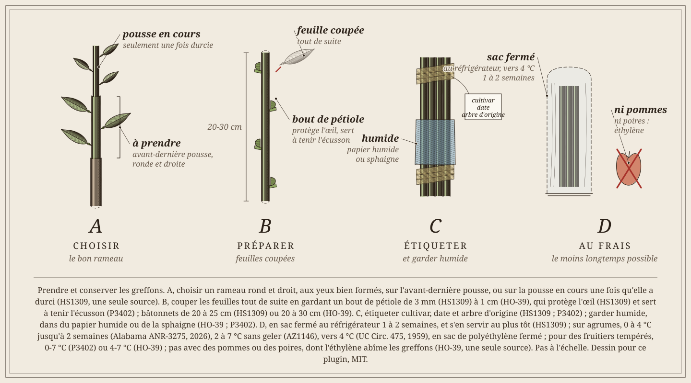
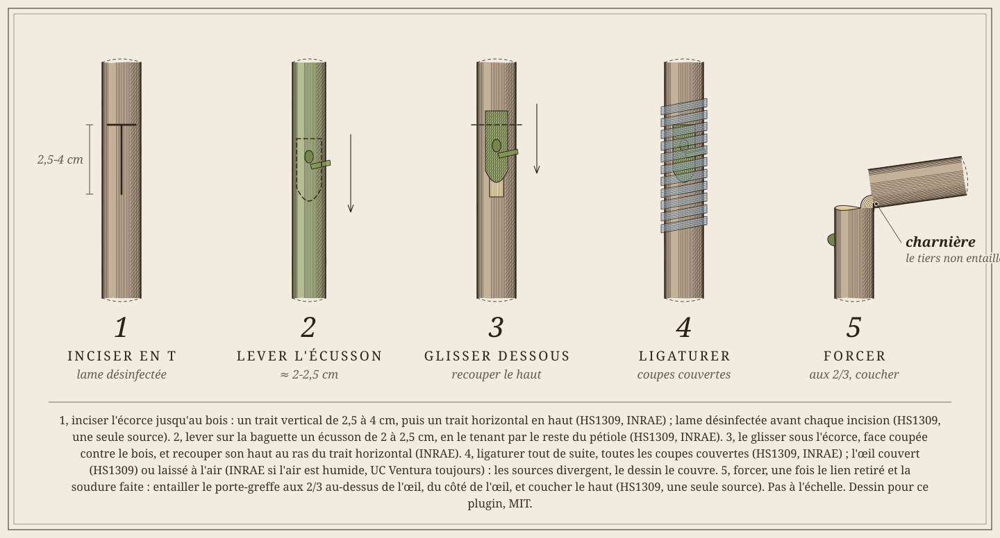
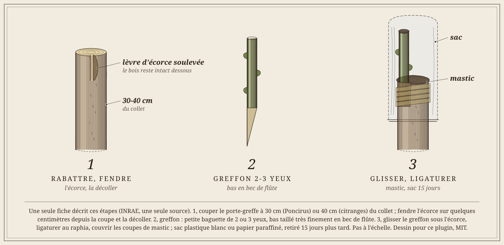
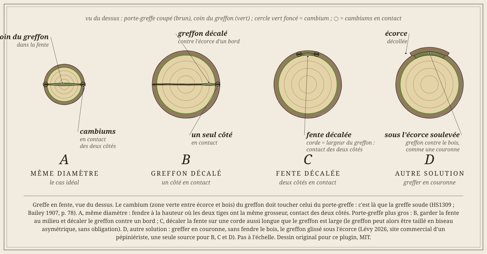
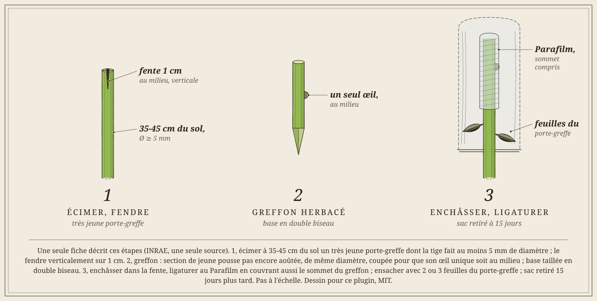
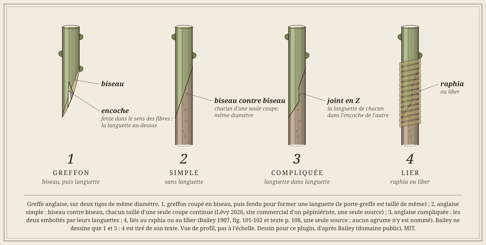
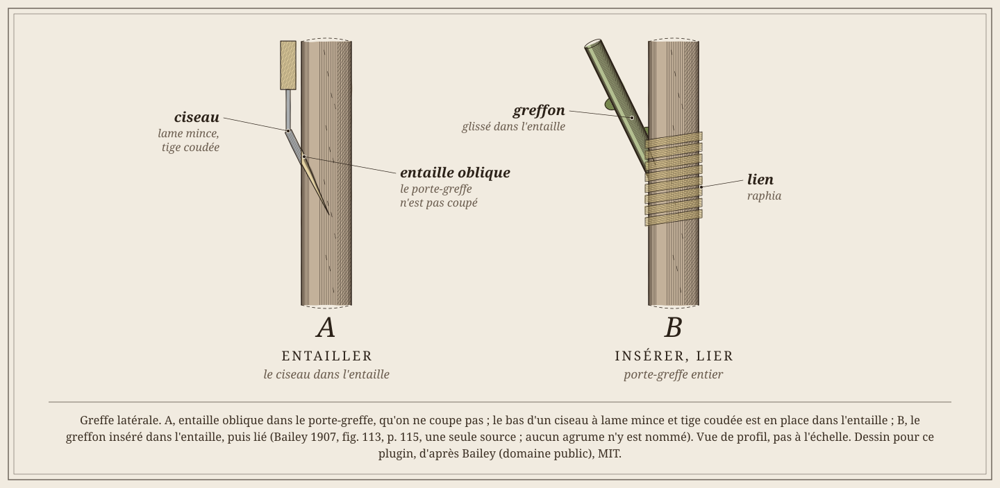
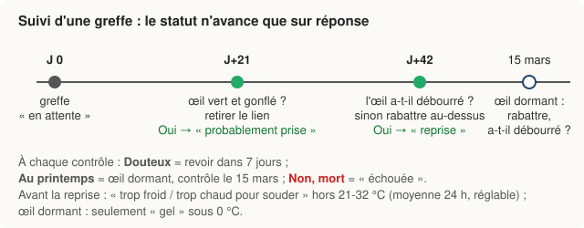
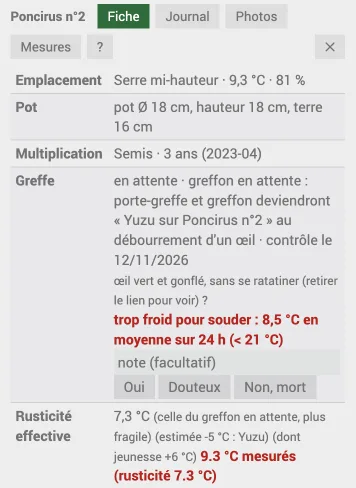

# Greffe des agrumes

Choisir un type de greffe, savoir quand la faire, puis la suivre jusqu'au bout : chaque contrôle pose une question, le statut n'avance que sur réponse.

Règle suivie : un fait n'est retenu que si **deux sources indépendantes** le donnent ; sinon il est marqué **une seule source**.
Curk 2022 et les fiches INRAE-Cirad viennent de la même équipe (Corse) : ensemble, elles comptent pour **une** source.
Ce qui vient du plugin lui-même est écrit **choix du plugin**. Références complètes : [Sources](#sources).

## En bref

1. **Choisir le type** selon le but (multiplier, changer de cultivar, réparer) et l'écorce du porte-greffe ([Choisir sa greffe](#choisir-sa-greffe), [Types de greffe](#types-de-greffe)).
2. **Greffer à la bonne saison** : porte-greffe sorti du repos, œil du greffon pas encore débourré ; le printemps de préférence ([Quand greffer](#quand-greffer)).
3. **Saisir la greffe** : « Greffer… » sur le porte-greffe, ou « ＋ Plante » avec la multiplication « greffe » ([Dans le plugin](#dans-le-plugin)).
4. **Répondre aux contrôles** à J+21, J+42 puis 4 semaines après le « Oui » qui confirme le débourrement d'un œil ([Suivi et points de contrôle](#suivi-et-points-de-contrôle)).
5. **Tenir au chaud** jusqu'à la soudure (21-32 °C), puis seulement **hors gel** ; pas d'engrais hors période d'apport ([Température, hiver, engrais](#température-hiver-engrais)).

Liens, greffoir et le reste : [Le matériel](#le-matériel). Produire ses propres porte-greffes : [Semer ses porte-greffes](#semer-ses-porte-greffes).

## Types de greffe

Le type se choisit dans « Greffer… », « ＋ Plante » ou la page de l'équipement. Si la multiplication est vide, choisir un type la passe à « greffe » ;
avec une autre multiplication (semis, bouture…), le type est effacé.

| Type | Description |
|---|---|
| **Greffes d'un œil** | *pour multiplier en pépinière* |
| Écusson en T inversé | Un œil prélevé avec un peu d'écorce, glissé sous l'écorce du porte-greffe incisée en T à l'envers (⊥). Avec le chip, la plus employée en Floride pour les jeunes plants (HS1309, **une seule source**) ; plus simple, elle demande moins d'habileté que le chip (HS1309). |
| Écusson en T | Même chose avec une incision en T droit. Convient aussi, moins employée. |
| Chip budding (œil en copeau) | Un copeau de bois portant l'œil, posé dans une entaille de même forme. Quand l'écorce ne se décolle plus (hors sève) ou est trop épaisse pour l'écusson. Demande plus d'habileté (HS1309). |
| Chip inversé | Variante du chip, courante sur agrumes, quand l'écorce ne se décolle pas. |
| Placage d'œil | Plaque d'écorce portant l'œil, appliquée à la place d'une plaque identique retirée du porte-greffe. Pour les écorces épaisses. À ne pas confondre avec le « placage » de la fiche INRAE-Cirad, qui est le chip. |
| **Greffes de rameau** | *pour changer de cultivar (surgreffage) ou réparer un arbre* |
| Fente | Le porte-greffe coupé est fendu, un greffon taillé en biseau y est inséré. Sur les charpentières, pour surgreffer. |
| Sous écorce (couronne) | Greffons glissés entre l'écorce et le bois d'une branche coupée, en sève. Surgreffage. |
| Anglaise | Porte-greffe et greffon de même diamètre, coupés en biseau et emboîtés. Peu utilisée pour les agrumes (Curk 2022 p. 194). |
| Pont | Greffons qui enjambent une plaie du tronc pour rétablir la sève. Réparation : la plante garde son nom et sa fiche (souvent inutile si le bois n'est pas atteint, voir les [dessins d'après Bailey](#autres-types--daprès-bailey)). |
| Incrustation | Greffon inséré dans une entaille en V du porte-greffe. Renforcer ou réparer. |
| En approche | Deux plantes enracinées soudées côte à côte, séparées après la reprise. Renforcer ou réparer (ex. nouveau porte-greffe au pied d'un arbre). |
| Latérale | Greffon inséré sur le côté du porte-greffe, sans le couper d'abord. |
| Sur souche | Sur une souche recépée, pour repartir d'un vieil arbre. |
| **Laboratoire et pépinière spécialisée** | |
| Microgreffe d'apex in vitro | Pointe de pousse de quelques dixièmes de mm greffée en tube : assainit un cultivar porteur de virus (Corse : > 80 % de reprise après regreffage, **une seule source**). |
| Minigreffe en fente | Fente sur porte-greffe de 6 mois : 75 % de réussite contre 38 % pour l'écusson en T (un essai sur orange 'Valencia', **une seule source**). |

Descriptions : relues dans HS1309 et la fiche INRAE-Cirad « Greffage » quand elles sont citées ; le reste est une synthèse de sources **non relues**
(Cirad, revue *Fruits* 1982, guide du développement rural de Polynésie française, Carimi 2001, essai colombien 2022).

## Choisir sa greffe

Le choix dépend surtout du **but** (multiplier, changer de variété, assainir, réparer) et de l'**écorce** du porte-greffe. Aucun article ne compare les techniques entre elles sur agrumes :
ce tableau vient de fiches d'universités et de services agricoles (HS1309 compte pour une seule source).

| But | Technique | Pourquoi | Sources |
|---|---|---|---|
| **Multiplier** en pépinière, sur un jeune porte-greffe | [Écusson en T inversé](#écusson-t-et-t-inversé) | la plus courante et la plus simple, si l'écorce se décolle ; tige de 6 à 10 mm, d'avril à novembre en Floride | HS1309, **une seule source** |
| Même but, écorce qui **ne se décolle pas** ou trop épaisse | [Chip budding](#chip-budding) | pas besoin de décoller l'écorce ; demande plus d'habileté | HS1309, **une seule source** |
| **Très jeune** porte-greffe, tige encore verte | [Fente herbacée](#fente-herbacée-minigreffe) | sur une jeune pousse pas encore aoûtée | INRAE-Cirad, **une seule source** |
| **Changer la variété** d'un arbre en place (surgreffage) | [couronne](#couronne-sous-écorce), fente ou écussons sur les charpentières | les racines déjà installées font repartir l'arbre vite : récolte normale en 3 à 5 ans | NSW DPI 2007 ; HS1309 ; UC ANR |
| Même but, charpentières de **plus de 15 cm** | éviter de les couper | une grosse coupe met des années à cicatriser | NSW DPI 2007, **une seule source** |
| Porte-greffe **plus gros** que le greffon | [fente décalée, ou couronne](#fente-sur-un-porte-greffe-plus-gros) | garder le contact des cambiums | Lévy 2026, **une seule source** |
| **Assainir** : plante saine à partir d'un arbre malade | microgreffage in vitro de l'apex | pointe de pousse avec 2 ébauches de feuilles, greffée en T inversé sur un semis de Poncirus de 16 jours ; élimine de 60 à 100 % des maladies transmises par greffe selon le pathogène | Navarro et al. 1975 d'après Carimi et al. 2001, **une seule source** |
| **Réparer** un tronc rongé | [pont, approche](#autres-types--daprès-bailey) | aucune source sur agrumes : HS261 (gommose) ne donne que la prévention, porte-greffe résistant et greffe haute | Bailey 1907 et 1920, **une seule source** |

**Ce qui guide le choix** :
1. **L'écorce se décolle-t-elle ?** Oui : écusson en T ou couronne. Non : chip budding ou fente (HS1309 ; NSW DPI 2007).
2. **La taille du porte-greffe** : un jeune plant reçoit un écusson ; un arbre adulte se surgreffe sur ses charpentières ou sur sa souche (synthèse des sources du tableau).
3. **L'économie de greffons** : l'écusson n'utilise qu'un œil, la fente un rameau entier (UC ANR, page sans auteur ni date, **une seule source**).
4. **La santé** : greffons pris sur des arbres certifiés sains ; c'est ce qui justifie le microgreffage chez les obtenteurs (HS1309 ; Carimi et al. 2001).

Pas trouvé : une comparaison chiffrée de l'écusson en T et du chip budding sur agrumes.
Tableau d'après une synthèse fournie par l'utilisateur ; NSW DPI 2007, UC ANR, Carimi 2001 et HS261 n'ont pas été relus ici (voir [Sources](#sources)).

## Le matériel

HO-39 et P3402 parlent d'arbres fruitiers tempérés (pommier, poirier, pêcher), pas d'agrumes : leurs faits valent pour le geste, pas pour les températures ou les dates.

**Les liens**

| Lien | Ce qu'il fait | Sources |
|---|---|---|
| Ruban de polyéthylène (transparent ou vert), bandes d'environ 1,3 × 15-25 cm | serre et empêche le dessèchement ; transparent, il laisse voir la soudure ; **à couper** | HS1309 ; HO-39 (le meilleur pour le chip, il scelle mieux) |
| Film étirable qui se dégrade (type Parafilm) | serre et scelle, se défait seul : rien à couper | P3402 ; sur agrumes, Oliveira et al. 2004 : même reprise (99,6 %) qu'avec le polyéthylène, pousse du greffon nettement meilleure (quand le lien a été retiré : pas dit dans le résumé) |
| Ruban qui se dégrade à la lumière (type Buddy Tape) | se laisse en place : rien à retirer ; il en reste des débris noirs sur la tige, sans dégât pour l'écorce ; plus long à poser | sur agrumes, Hayashi et al. 2012 (durée de dégradation non donnée) ; « il éclate tout seul » (Sage Horticultural, revendeur : non retenu comme source) |
| Bande élastique (caoutchouc) | se relâche et tombe d'elle-même en 3 à 5 semaines ; sinon la couper | HO-39, fruitiers en général ; sur agrumes, AZ1146 la retire avec le ruban, à 2-3 semaines |
| Raphia, ficelle cirée | nœud du côté opposé à l'œil ; aucun délai de retrait trouvé sur agrumes : le couper avant qu'il n'entaille l'écorce (UC Circ. 475) ; ficelle cirée coupée au bout de 3 mois (HO-39, fruitiers en général) | INRAE (raphia) ; HO-39 (ficelle cirée) |

- **Couvrir l'œil ou non : les sources divergent.** HS1309 et AZ1146 couvrent tout l'écusson, œil compris (d'où le ruban transparent) ; Alabama ANR-3275, UC Ventura, HO-39 (chip) et INRAE (si l'air est humide) laissent l'œil à l'air.
  Sur agrumes, Hayashi et al. 2012 ('Valência', 2009), part des yeux débourrés :

| Porte-greffe | Délai | Ruban polyéthylène (ôté à 15 j) | Buddy Tape, œil couvert | Buddy Tape, œil à l'air |
|---|---|---|---|---|
| Limettier Rangpur | 15 jours | 2,1 % | 54,2 % | 64,6 % |
| Limettier Rangpur | 49 jours | 93,8 % | 98,0 % | 95,5 % |
| Citrumelo Swingle | 15 jours | 6,3 % | 16,7 % | 35,4 % |
| Citrumelo Swingle | 49 jours | 93,8 % | 66,7 % | 95,8 % |

Le ruban qui se dégrade fait débourrer plus tôt ; à la fin, le ruban polyéthylène rattrape. Sur citrumelo Swingle, avec le Buddy Tape, laisser l'œil à l'air.

- **Retirer le ruban de polyéthylène vers 3 semaines** : 14 à 21 jours, jamais plus de 30 (HS1309) ; 2 à 3 semaines, ruban ou élastique, puis regarder si l'œil est vert (AZ1146) ; 3 à 4 semaines (Alabama ANR-3275) ; 15 jours dans l'essai de Hayashi et al. 2012 : c'est le contrôle J+21 du plugin. Film qui se dégrade (Parafilm, Buddy Tape) : rien à retirer, seulement regarder l'œil (P3402 ; Hayashi et al. 2012). Seul le ruban polyéthylène a des délais de retrait sourcés pour les agrumes. Sur une greffe de rameau, P3402 fend le lien sur deux côtés 6 à 8 semaines après le départ et le laisse tomber.
  Dans tous les cas, un lien oublié étrangle la tige (HO-39 ; P3402 ; UC Circ. 475).

*Fig. G1 – Les liens : A, ruban de polyéthylène, 3-4 tours sous l'œil puis au-dessus, œil couvert (HS1309) ; B, œil laissé à l'air : les sources divergent ; C, film qui se dégrade ; D, à J+21, ruban coupé et ôté (contrôle du plugin) ; E, lien oublié : il entaille l'écorce, un bourrelet se forme au-dessus.*

**Le greffoir**

- Une lame **très affûtée**, entretenue à la pierre (à huile, ou diamant sans huile) (HS1309 ; HO-39), désinfectée avant chaque incision (HS1309, **une seule source**).
- Un cutter à lame fine dépanne : lame changée quand elle s'émousse, mais trop fragile sur du gros bois (P3402, **une seule source**).
- Pour la fente sur une branche : une serpette à fendre (ou une hachette) et un maillet, un coin ou un tournevis pour tenir la fente ouverte (HO-39 ; P3402) ; pour la couronne, de petites pointes peuvent tenir le greffon (HO-39, **une seule source**).

**Le reste, étape par étape**

| Étape | Matériel | Sources |
|---|---|---|
| Prendre les greffons | sécateur ; rameaux ronds et droits, aux yeux bien formés, de l'avant-dernière pousse ou d'une pousse qui a durci (HS1309) ; feuilles coupées tout de suite en gardant un bout de pétiole qui protège l'œil (HS1309 ; HO-39 ; P3402) ; bâtonnets de 20 à 30 cm (HS1309 ; HO-39) ; une glacière au champ (P3402) | HS1309 ; HO-39 ; P3402 |
| Préparer le porte-greffe | zone à greffer nettoyée des épines et des brindilles | HS1309, **une seule source** |
| Les conserver | sac plastique au réfrigérateur 1 à 2 semaines (HS1309) ; sur agrumes : 0 à 4 °C jusqu'à 2 semaines, avec un essuie-tout humide (pas ruisselant), en sac de polyéthylène fermé (Alabama ANR-3275) ; 2 à 7 °C jusqu'à 3-4 semaines dans du papier humide, sans geler (AZ1146) ; vers 4 °C, en sac fermé sans ajouter d'eau, ou dans de la tourbe ou de la vermiculite humides (UC Circ. 475) ; pour des fruitiers tempérés, au frais et humide (sphagnum, papier humide) à 0-7 °C (P3402) ou 4-7 °C (HO-39) ; étiqueter cultivar, date, arbre d'origine (HS1309 ; P3402) ; pas avec des pommes ou des poires, leur éthylène abîme les greffons (HO-39, **une seule source**) | HS1309 ; ANR-3275 ; AZ1146 ; UC Circ. 475 ; HO-39 ; P3402 |
| Greffer | greffoir, lien, étiquettes | voir plus haut |
| Après | mastic sur les plaies d'une fente ou d'une couronne (émulsion appliquée à froid ; une cire trop chaude brûle les tissus) (HO-39) ; sac plastique blanc ôté au bout de 15 jours (INRAE) ou sac et papier aluminium (P3402) ; tuteur et attaches (HS1309) ; badigeon blanc contre le coup de soleil des arbres rabattus (HS1309, **une seule source**) | HO-39 ; P3402 ; INRAE ; HS1309 |

*Fig. G2 – Prendre et conserver les greffons : A, l'avant-dernière pousse, ou la pousse en cours une fois durcie ; B, feuilles coupées en gardant un bout de pétiole, bâtonnets de 20-30 cm ; C, étiquetés, gardés humides ; D, en sac fermé au réfrigérateur, vers 4 °C sur agrumes (UC Circ. 475), 1 à 2 semaines, loin des pommes et des poires.*

Non retenu : bandes Flexibande (pages de vendeurs), greffoir à double lame et pince à greffer en oméga (FAO ; Jakab-Ilyefalvi 2013), Salih 2007, *Grafting Terminology* de l'UF/IFAS : **non relus ici**.
Le pinceau d'hormone (BA) cité par HS1309 pour faire débourrer l'œil est un usage de pépinière professionnelle ; son autorisation pour un amateur en France n'a pas été vérifiée.
Tableaux d'après une synthèse fournie par l'utilisateur, vérifiée dans HS1309, HO-39, P3402, Oliveira et al. 2004 et Hayashi et al. 2012 (texte complet), puis complétée par une seconde synthèse sur le retrait des liens, vérifiée dans Hayashi et al. 2012, Alabama ANR-3275 et AZ1146.

## Comment greffer

Schémas dessinés pour ce plugin d'après le texte des deux fiches (pas à l'échelle). Pour les photos, voir HS1309 (fig. 5 à 8) ;
pour les dessins d'origine, la fiche INRAE-Cirad (fig. 5 à 8). Les autres types n'ont pas de marche à suivre dans nos sources relues : voir les [dessins d'après Bailey](#autres-types--daprès-bailey).

Pour tous : lame désinfectée avant chaque incision (HS1309, **une seule source**) ; point de greffe à 25-40 cm du collet, contre le *Phytophthora* (INRAE) ; 15-20 cm en Floride (HS1309) : les sources divergent, le plugin garde la plus haute.

### Écusson (T et T inversé)

*Fig. G3 – Greffe en écusson.*

1. **Inciser** l'écorce jusqu'au bois, dans une partie lisse entre deux nœuds : un trait vertical de 2,5 à 4 cm (HS1309), puis un trait horizontal en haut (T : HS1309, INRAE)
   ou en bas (⊥, T inversé : HS1309). Tige d'au moins 8 mm (INRAE ; 6 à 10 mm pour HS1309), porte-greffe en sève : l'écorce se soulève (INRAE).
2. **Lever l'écusson** sur la baguette : lame presque parallèle, depuis environ 1,3 cm au-dessus de l'œil jusque sous lui (HS1309) ; 2 à 2,5 cm de long (HS1309, INRAE).
   Bois : une mince lame (HS1309) ou aucun (INRAE) — les deux fiches divergent ; ne pas creuser l'œil. Tenir l'écusson par le reste du pétiole, sans toucher la face coupée (HS1309).
   Une épine sous l'œil : garder une languette de bois, ou la rabattre sans la couper au ras de l'œil (INRAE, **une seule source**).
3. **Glisser** l'écusson tout de suite sous l'écorce, face coupée contre le bois, entièrement dans l'incision (HS1309, INRAE) ; en T, recouper son haut au ras du trait horizontal (INRAE).
4. **Ligaturer** tout de suite, ferme sans trop serrer, toutes les coupes couvertes : ruban (HS1309) ou raphia, nœud du côté opposé à l'œil (INRAE).
   Sens : du bas vers le haut ou l'inverse (HS1309), par le haut pour ne pas faire glisser l'écusson (INRAE). Œil couvert (HS1309), laissé à l'air si l'air est humide (INRAE) ou toujours laissé à l'air (UC Ventura) : les sources divergent.
5. **Forcer**, une fois le lien retiré (vers J+21) et la soudure faite : entailler le porte-greffe aux 2/3 au-dessus de l'œil (du côté de l'œil, 2,5 à 4 cm au-dessus)
   et coucher le haut (ou le courber en boucle) ; une fois que l'œil pousse (quelques centimètres), couper le porte-greffe à environ 1,3 cm au-dessus de l'œil ;
   à défaut, une coupe en biais à 2,5 cm au-dessus de l'œil (HS1309, **une seule source**). Le plugin pose la question à J+42 (choix du plugin, voir [Suivi](#suivi-et-points-de-contrôle)).

### Chip budding

*Fig. G4 – Chip budding : 1, entailler ; 2, le copeau du greffon ; 3, poser et ligaturer ; 4, rabattre au-dessus de l'œil parti. Détail et sources sur le dessin. Dessin pour ce plugin, MIT.*

1. **Entailler** le porte-greffe entre deux nœuds : une coupe d'environ 2 à 2,5 cm juste dans le bois (HS1309, INRAE), terminée par une base en biseau,
   pas plus de 2 mm d'épaisseur (INRAE, **une seule source**).
2. **Prélever le copeau** portant l'œil sur la baguette, de même forme et de même taille (HS1309, INRAE).
3. **Poser** le copeau dans l'entaille, écorce contre écorce : des deux côtés quand c'est possible (HS1309), au moins sur le bord inférieur et un côté,
   jamais centré (INRAE). **Ligaturer** toutes les coupes (HS1309), ferme, l'œil peut rester en partie couvert (INRAE), mais le lien qui serre ne passe pas sur lui (Lévy 2026, **une seule source**).
   Lien coupé du côté opposé à l'œil vers J+21 (INRAE). Couper presque parallèlement à l'axe de la tige : plus l'angle est faible, plus le contact de cambium est grand (Lévy 2026, **une seule source**).
4. **Rabattre** le porte-greffe en biais au-dessus de l'œil, une fois qu'il a démarré : 2 à 3 cm (Lévy 2026), environ 2 cm (NSW DPI 2015), environ 2,5 cm (HS1309 ; Arizona AZ1146) ;
   aucune de ces sources ne donne le sens de la pente (le dessin la fait descendre à l'opposé de l'œil : usage courant, non sourcé). Puis ôter les pousses nées sous la greffe.

### Couronne (sous écorce)

*Fig. G5 – Greffe en couronne : 1, rabattre et fendre l'écorce ; 2, le greffon de 2 ou 3 yeux ; 3, glisser et ligaturer ; 4, deux ou trois greffons sur un gros porte-greffe. Détail et sources sur le dessin. Dessin pour ce plugin, MIT.*

Une seule fiche décrit ces étapes (INRAE, **une seule source**) :
1. **Couper** le porte-greffe à 30 cm (Poncirus) ou 40 cm (citranges) du collet ; fendre l'écorce sur quelques centimètres depuis la coupe et la décoller.
2. **Greffon** : petite baguette de 2 ou 3 yeux, bas taillé très finement en « bec de flûte » ; retailler légèrement ses bords.
3. **Glisser** le greffon sous l'écorce, ligaturer au raphia, couvrir les coupes de mastic ; sac plastique blanc ou papier paraffiné, retiré 15 jours plus tard.

Sur un **très gros porte-greffe** (plus de 4 cm par exemple) : poser deux ou trois greffons d'au moins 3 yeux, entre le bois et l'écorce soulevée ; après chaque pousse,
rabattre le moins vigoureux à 1 œil : il fait du cal et referme la plaie plus vite (Lévy 2026, **une seule source**).

### Fente sur un porte-greffe plus gros

Le cambium du greffon doit toucher celui du porte-greffe : c'est là que la greffe soude (HS1309 ; Bailey 1907, p. 78). Avec deux tiges de même grosseur, fendre là où elles
ont le même diamètre : contact des deux côtés. Si le porte-greffe est plus gros (Lévy 2026, **une seule source**) :
- garder la fente au milieu et **décaler le greffon** contre un bord : un seul côté en contact ;
- ou **décaler la fente** sur une corde aussi longue que le greffon est large : contact des deux côtés (le greffon peut alors être taillé en biseau asymétrique) ;
- ou ne pas fendre : greffer [en couronne](#couronne-sous-écorce), le greffon glissé sous l'écorce.

*Fig. G6 – Greffe en fente vue du dessus : A, même diamètre ; B, greffon décalé ; C, fente décalée ; D, autre solution, la couronne. Détail et sources sur le dessin. Dessin pour ce plugin, MIT.*

### Fente herbacée (minigreffe)

*Fig. G7 – Greffe en fente herbacée.*

Une seule fiche décrit ces étapes (INRAE, **une seule source**) :
1. **Écimer** à 35-45 cm du sol un très jeune porte-greffe dont la tige fait au moins 5 mm de diamètre ; le fendre verticalement sur 1 cm.
2. **Greffon** : section de jeune pousse pas encore aoûtée, de même diamètre, coupée pour que son œil unique soit au milieu ; base taillée en double biseau.
3. **Enchâsser** dans la fente, ligaturer au Parafilm en couvrant aussi le sommet du greffon ; ensacher avec 2 ou 3 feuilles du porte-greffe ; sac retiré 15 jours plus tard.

### Autres types : d'après Bailey

Dessins refaits pour ce plugin d'après les gravures de L. H. Bailey (domaine public) : vigne, plantes en pot, arbres fruitiers ; l'espèce est rarement précisée et **aucune n'est présentée comme un agrume**. Ils montrent le geste et ne remplacent pas une marche à suivre ; les dessins seuls ne comptent pas comme source, le texte de Bailey quand il est cité compte comme **une seule source** (voir [Sources](#sources)).
Légendes traduites de l'ouvrage ; dessins pas à l'échelle. *The Nursery-Book*, 11ᵉ éd., 1907 ; *The Nursery-Manual*, 1920 (scans Cornell et Internet Archive).

**Anglaise** — 1 : le greffon coupé en biseau, puis fendu pour former une languette (le porte-greffe taillé de même) ; 2 : anglaise **simple**, biseau contre biseau, chacun taillé d'une seule coupe continue (Lévy 2026, **une seule source**) ; 3 : anglaise **compliquée**, les deux emboîtés par leurs languettes ; 4 : liés au raphia ou au liber. Bailey ne dessine que 1 et 3 : 4 est tiré de son texte, 2 de Lévy.

*Fig. G8 – Greffe anglaise : 1, le greffon ; 2, simple ; 3, compliquée ; 4, liée. Détail et sources sur le dessin. Dessin façon gravure fine pour ce plugin d'après Bailey 1907 et Lévy 2026, fig. 101-102, [p. 108](https://archive.org/details/cu31924097691087/page/108), domaine public ; MIT.*

**Placage de rameau** (*veneer-grafting*, variante de la latérale selon Bailey ; à ne pas confondre avec le placage d'œil) — A : porte-greffe entaillé à travers l'écorce, une petite languette d'écorce à la base ;
à côté, le greffon coupé en biais, une plaque d'écorce retirée sur le grand côté ; B : greffon posé et lié au raphia ; C : la soudure faite (D chez Bailey).
Selon Bailey, inutile de couper le haut du porte-greffe avant que le greffon ne débourre.

*Fig. G9 – Placage de rameau : A, l'entaille et le greffon ; B, posé et lié ; C, soudé. Détail et sources sur le dessin. Dessin façon gravure fine pour ce plugin d'après Bailey 1907, fig. 111, [p. 114](https://archive.org/details/cu31924097691087/page/114), domaine public ; MIT.*

**Latérale** — A : entaille oblique dans le porte-greffe, qu'on ne coupe pas, le bas d'un ciseau à lame mince et tige coudée en place dans l'entaille ; B : le greffon inséré dans l'entaille, puis lié.

*Fig. G10 – Greffe latérale : A, l'entaille et le ciseau ; B, le greffon inséré et lié. Détail et sources sur le dessin. Dessin façon gravure fine pour ce plugin d'après Bailey 1907, fig. 113, [p. 115](https://archive.org/details/cu31924097691087/page/115), domaine public ; MIT.*

**Incrustation** — A : porte-greffe coupé (ici une vigne), une rainure en V taillée dans la coupe (une ou deux selon le texte) ; B : greffon taillé à la même forme, pour s'y encastrer.

*Fig. G11 – Greffe en incrustation : A, la rainure en V ; B, le greffon taillé à sa forme. Détail et sources sur le dessin. Dessin façon gravure fine pour ce plugin d'après Bailey 1907, fig. 116, [p. 117](https://archive.org/details/cu31924097691087/page/117), domaine public ; MIT.*

**Fente** — A : porte-greffe coupé net et fendu, un greffon en coin de chaque côté de la fente ; B : le greffon, trois yeux, le plus bas juste au-dessus du coin.

*Fig. G12 – Greffe en fente : A, deux greffons dans la fente ; B, le greffon taillé en coin. Détail et sources sur le dessin. Dessin façon gravure fine pour ce plugin d'après Bailey 1907, fig. 118-119, [p. 118](https://archive.org/details/cu31924097691087/page/118), domaine public ; MIT.*

**En approche** — A : deux plantes en pot, tiges entaillées et liées ensemble ; B (M chez Bailey) : un rameau C de la plante voisine joint en O au porte-greffe H, d'autres rameaux comme T pouvant être joints de même ;
C (N chez Bailey) : la taille des surfaces accolées, en R. Bailey note que les orangers se multipliaient autrefois ainsi, mais (en 1907) plus facilement par placage.

*Fig. G13 – Greffe en approche : A, deux plantes en pot ; B, un rameau joint au porte-greffe ; C, les surfaces accolées. Détail et sources sur le dessin. Dessin façon gravure fine pour ce plugin d'après Bailey 1907, fig. 138-139, [p. 133](https://archive.org/details/cu31924097691087/page/133), domaine public ; MIT.*

**Pont** — A : tronc annelé (écorce rongée tout autour) ; B : bords de la plaie parés, greffons biseautés aux deux bouts, à côté ;
C : greffons posés dans des entailles faites à environ 1,3 cm au-dessus et au-dessous de la plaie, jusqu'à l'aubier, et cloués ; D : variante, logements à la forme des greffons ; en bas, le greffoir.
Bailey (p. 161) la juge souvent inutile si l'annelure n'atteint pas le bois : un bon enduit de cire ou d'argile bandé est souvent bien meilleur (**une seule source**).

*Fig. G14 – Greffe en pont : A, l'annelure ; B, la plaie parée et les greffons ; C, posés et cloués ; D, la variante. Détail et sources sur le dessin. Dessin façon gravure fine pour ce plugin d'après Bailey 1920, fig. 191, [p. 161-162](https://archive.org/details/nurserymanualcom00bailrich/page/161) (lettres d'après Peck, cité par Bailey), domaine public ; MIT.*

## Quand greffer

Pour tous les types :
- le porte-greffe doit être **sorti du repos** (moyenne au-dessus d'environ 13 °C) et l'œil du greffon **pas encore débourré** (fiche INRAE-Cirad « Greffage ») ;
- le **printemps** est la meilleure saison ; le **plein été** est déconseillé (la chaleur dessèche les tissus) sauf sous abri frais ; une **serre** permet de greffer
  en toute saison (Curk 2022 p. 185 et 194).

Même filiation : **une seule source** à confirmer. Printemps = mars à mai dans l'hémisphère nord, septembre à novembre dans l'hémisphère sud ;
c'est la sève du porte-greffe qui décide, pas le calendrier. La saison du type choisi est rappelée sous le type dans « Greffer… » et « ＋ Plante ».

| Type | Saison et conditions |
|---|---|
| Écusson en T, en T inversé | porte-greffe **en sève** (l'écorce se soulève), en pleine croissance : d'avril à novembre en Floride (HS1309), de mai à août en Alabama (Alabama ACES), au printemps ou à l'automne en Californie (UC Ventura) : les dates varient avec le lieu, le critère est le même, l'écorce qui se soulève ; en Corse dès mars-avril sous tunnel, mai dehors (INRAE) ; le printemps de préférence (Curk, **une seule source**) |
| Chip, chip inversé | quand l'écorce se soulève mal (HS1309, INRAE, qui l'appelle « placage ») ou est trop épaisse pour un écusson (HS1309, **une seule source**) ; cultivar épineux, rameaux à section triangulaire (INRAE, **une seule source**) ; saison : règle générale |
| Sous écorce (couronne) | porte-greffe âgé, de gros diamètre, écorce trop épaisse pour un écusson mais qui se décolle (INRAE, **une seule source**) ; saison : règle générale |
| Minigreffe en fente | fente herbacée : très jeunes porte-greffes (tige d'environ 5 mm), greffon de jeune pousse ; sous abri presque toute l'année dans les pays plus chauds que la Corse (INRAE, **une seule source**) |
| Anglaise | peu utilisée pour les agrumes (Curk 2022 p. 194) ; sinon printemps |
| Placage d'œil, fente, incrustation, sur souche, latérale, en approche, pont | règle générale ; **aucune source relue** pour le type |
| Microgreffe in vitro | en laboratoire : toute saison |

## Dans le plugin

**Greffer…** (bas de l'onglet Fiche, administrateurs) : saisit la greffe faite sur cette plante, le porte-greffe. Même formulaire que « ＋ Plante » :
- **greffon** choisi parmi nos plantes des autres collections (nom botanique, cultivar et caractères recopiés, nom proposé « greffon sur porte-greffe »)
  ou écrit à la main (nouveau cultivar) ;
- **nom de la nouvelle plante** (nom donné au débourrement d'un œil, ex. Yuzu n°2), nom botanique du greffon, **collection de la nouvelle plante** (par défaut l'actuelle : choisir celle du greffon), type et date de greffe ;
- le porte-greffe est déduit du nom (Poncirus, Flying Dragon, FA5…), modifiable.

**Greffe en pont** (type « Pont ») : c'est une **réparation** de l'écorce, pas une multiplication. Le formulaire ne demande ni nom ni collection :
la plante **garde son nom, sa fiche et sa collection** ; seuls le greffon (d'où viennent les greffons, facultatif) et la date sont notés au journal.
Une réparation de moins de 60 jours a son suivi J+21 et J+42 (*réussie* quand les greffons sont soudés aux deux bouts) ; sinon, rien n'est suivi.

**Tant qu'aucun œil n'a débourré**, la plante **reste le porte-greffe** : son nom et sa fiche ne changent pas, sauf le champ « Porte-greffe » : un porte-greffe y porte « franc de pied », et dans la collection **Greffes**
(créée à la première greffe), où elle est rangée, le nom du porte-greffe du greffon (ex. FA5), puis « franc de pied » de nouveau si la greffe meurt ; avec une étiquette de couleur selon l'état de la greffe ; la fiche indique le greffon en attente, la tuile aussi (colonne Greffon : la plante greffée, 🏡 prise sur une de nos plantes ou 📦 introduite). L'alerte de froid se règle sur le plus fragile des deux (rusticité et jeunesse du greffon, ou du porte-greffe) et l'engrais sur une jeune greffe (choix du plugin). Une entrée « Greffe » est ajoutée au journal.

**Au débourrement d'un œil**, confirmé au contrôle (réponse « Oui » qui fait passer à *pousse du greffon*), porte-greffe et greffon deviennent
**une nouvelle plante**. C'est le **même équipement** : journal, photos, pot, emplacement, courbes et champ « Sol » sont gardés (ce sont toujours ses racines) ;
il prend le nom, la collection et la fiche du greffon ; le reste de la fiche, les caractères observés et la photo d'étiquette, qui décrivaient le porte-greffe,
sont remplacés par ceux du greffon (vides s'il n'en a pas). Le champ « Porte-greffe » du greffon reçoit le nom du porte-greffe s'il est laissé vide. Le journal note le changement.

**Greffe morte** (« Non, mort ») : le suivi s'arrête. Avant le débourrement d'un œil, la plante reste le porte-greffe, retourne dans sa collection d'origine et le greffon en attente est oublié ; après (la pousse meurt),
elle **redevient le porte-greffe** : nom, collection et fiche d'avant le débourrement de l'œil (si ce nom est pris entre-temps, la réponse est refusée : renommer d'abord).

Le suivi démarre pour une greffe de **moins de 60 jours** : par « Greffer… » (date partielle ou vide : la date du jour est écrite), ou par « ＋ Plante » avec une date complète
(plante déjà greffée, achetée ou greffée ailleurs : elle est déjà la plante greffée : rien ne change au débourrement d'un œil). Les contrôles comptent depuis la date de greffe.
Greffe de **plus de 60 jours** saisie par « Greffer… » : œil considéré comme ayant déjà débourré : porte-greffe et greffon deviennent tout de suite la nouvelle plante, sans suivi.
Regreffer une greffe dont aucun œil n'a débourré remplace le greffon en attente : à la même date de greffe, c'est une correction et le suivi continue ;
à une autre date, le suivi recommence. Pendant la *pousse du greffon*, regreffer est refusé : répondre d'abord au contrôle (réussite ou échec).

## Suivi et points de contrôle

**Statut** : *en attente* → *probablement prise* → *pousse du greffon* → quatre soins (*1re pousse à raccourcir*, *2e pousse à raccourcir*, *après le premier hiver*, *première floraison*) → *réussie (suivi terminé)*, ou *greffon dormant jusqu'au printemps* (puis *pousse du greffon*),
ou *échouée* (greffe morte : le suivi s'arrête et le statut est aussitôt effacé) ; pont : *probablement prise* → *réussie* (réparation : la plante garde son nom et sa fiche).

*Fig. G15 – Suivi d'une greffe : les contrôles, puis les quatre soins ; délais comptés depuis le « Oui » au contrôle précédent (choix du plugin). Sources sur le schéma. Schéma pour ce plugin, MIT.*

**Marche à suivre** (chaque étape est la question du contrôle) :

| Contrôle | Œil | Rameau | Côté | Pont |
|---|---|---|---|---|
| J+21 | œil vert et gonflé, sans se ratatiner, un cal au bord de l'écusson (HS1309) ; brun et sec : la greffe est morte (déduction du plugin) (retirer le ruban ou l'élastique pour voir ; film qui se dégrade : rien à retirer) | bourgeons du greffon verts et gonflés (retirer le sac pour voir) | greffon vert | greffons verts |
| J+42 | l'œil a-t-il débourré ? sinon le **forcer** (entailler le porte-greffe aux 2/3 au-dessus de l'œil et coucher le haut), ou « Au printemps » | le greffon pousse-t-il ? retirer le lien quand les feuilles sortent | le greffon pousse-t-il ? une fois soudé, couper le porte-greffe au-dessus (approche : sevrer le greffon de sa plante) | greffons soudés aux deux bouts ; oui → *réussie* (rien ne doit pousser, pas de « Au printemps ») |
| Pousse (4 semaines après) | tuteurer la pousse, couper le haut du porte-greffe à environ 1,3 cm au-dessus de la greffe, ôter les rejets | greffon tuteuré, lien retiré, rejets ôtés | greffon tuteuré, rejets ôtés | — |
| 1re pousse (4 semaines après) | 1re pousse durcie : raccourcir les charpentières à 5 feuilles, ôter les rejets | idem | idem | — |
| 2e pousse (8 semaines après) | 2e pousse durcie : raccourcir les nouvelles pousses à 5 feuilles | idem | idem | — |
| Après le premier hiver (1er mars ; 1er septembre au sud) | ôter les pousses sous la greffe, retirer les liens restants | idem | idem | — |
| Première floraison (6 semaines après) | ôter toutes les fleurs et petits fruits ; pas encore de fleurs : « Douteux » | idem | idem | — |

*Œil* : écussons, chip, placage ; *rameau* sur porte-greffe coupé : fente, couronne, anglaise, incrustation, sur souche, minigreffe ;
*côté* : latérale, en approche. Type de greffe inconnu : traité comme une greffe de rameau.

Lien : à J+21, le ruban de polyéthylène se retire (14 à 21 jours, jamais plus de 30, HS1309) : voir [Le matériel](#le-matériel).

Sources : forcer l'œil, HS1309 et Alabama ACES (HS1309 le force dès le lien retiré ; attendre J+42 et ne forcer qu'un œil qui n'a pas débourré est un choix du plugin) ; rejets du porte-greffe à ôter dès qu'ils sortent, HS1309 et Curk 2022 p. 210 ;
tuteurer puis couper le haut du porte-greffe, HS1309 (**une seule source**) ; lien d'un œil coupé vers J+21, HS1309 (14 à 21 jours, 30 au plus) et fiche INRAE-Cirad (une vingtaine de jours) ;
lien ou sac d'un rameau retiré quand le greffon pousse, Curk 2022 p. 186 (couronne : sac retiré à 15 jours, fiche INRAE-Cirad), même filiation, **une seule source** ; latérale, approche et pont : **aucune source relue**, choix du plugin ;
contrôle de la pousse 4 semaines après le « Oui » qui confirme le débourrement d'un œil, choix du plugin. Délais J+21 et J+42 d'après la vulgarisation des universités de Floride, d'Alabama et
de Californie : le bourgeon, plus que le calendrier, décide.
Soins après la pousse : raccourcir à 5 feuilles après chaque pousse et ôter fleurs et petits fruits à la première floraison, Lévy 2026 (site commercial d'un pépiniériste, sous droits, faits seulement), **une seule source** ;
pincer ou raccourcir une pousse la fait ramifier, HS1309 et UC Circ. 475 ; pousses sous la greffe ôtées, HS1309, UC Circ. 475 et Curk 2022 p. 210 ; liens restants retirés avant qu'ils n'entaillent l'écorce, UC Circ. 475 et Lévy 2026 ;
délais de ces contrôles (4 et 8 semaines, 1er mars, 6 semaines) : choix du plugin. Une greffe morte pendant les soins est encore notée « Non, mort » : la plante redevient le porte-greffe.

*Fig. G16 – Au contrôle d'un écusson : A, pris (œil vert, cal au bord) ; B, raté ; C, forcer l'œil à J+42 s'il n'a pas débourré ; D, la pousse : tuteurer, couper le haut, ôter les rejets. Détail et sources sur le dessin. Dessin façon gravure coloriée pour ce plugin, MIT.*

*Fig. G17 – Soins d'une greffe d'œil après le départ de la pousse, dans l'ordre des contrôles : 1, 1re pousse raccourcie au-dessus de la 5e feuille ; 2, de même sur chaque pousse ; 3, après le premier hiver, rejets du porte-greffe (trois folioles) et liens ôtés ; 4, fleurs et petits fruits ôtés. Détail et sources sur le dessin. Dessin pour ce plugin, MIT.*

**Répondre** (chaque réponse est notée au journal) :
- **Oui** : étape suivante ;
- **Douteux** : revoir dans 7 jours ;
- **Au printemps** (à J+42 seulement, sauf pont) : greffon vivant (œil ou bourgeons verts, gonflés) laissé dormant, pour une greffe d'automne ; à J+42 la soudure est considérée comme faite (choix du plugin ; elle demande 3-4 semaines au printemps, 6-8 pour une greffe d'automne : UC Ventura, **une seule source**) ; contrôle le 15 mars (15 septembre dans l'hémisphère sud ; plus tôt si l'emplacement est assez chaud),
  avancé jusqu'à 8 semaines si la moyenne sur 7 jours de l'emplacement dépasse déjà 13 °C (seuil réglable, sonde historisée), au plus tôt 4 semaines après la réponse (choix du plugin) ;
  au contrôle, forcer l'œil (entailler le porte-greffe aux 2/3 au-dessus de l'œil et coucher le haut ; couper à environ 1,3 cm au-dessus de l'œil une fois que l'œil pousse) ;
- **Non, mort** (deux clics) : greffe morte ; la plante reste, ou redevient, le porte-greffe, et le suivi s'arrête (le journal garde la trace).

Un contrôle dû remplit la commande « Greffe à contrôler », reprise par le rapport du matin.

*Fig. G18 – Poncirus greffé d'un Yuzu il y a deux semaines : la plante reste le porte-greffe, avec le greffon en attente ; porte-greffe et greffon deviendront « Yuzu sur Poncirus n°2 » au débourrement d'un œil. On y voit le contrôle prévu le 12/11 (J+21), la question à se poser, l'avertissement de température (8,5 °C en moyenne sur 24 h, trop froid pour souder) et la rusticité effective, celle du greffon, plus fragile. Les boutons répondent au contrôle.*

## Température, hiver, engrais

- **Avant la soudure** (*en attente*, *probablement prise*) : la moyenne sur 24 h de la sonde de l'emplacement (historisée) est comparée aux seuils
  de la configuration (21 et 32 °C par défaut, choix du plugin d'après des sources d'amateurs, réglables) ; en dehors, la fiche et la commande disent
  « trop froid (ou trop chaud) pour souder ». Sous 21 °C de jour le Poncirus s'endort (Alabama ACES, **une seule source**) ; que la greffe attende alors le printemps est une déduction du plugin ; l'appliquer à la moyenne sur 24 h, nuits comprises, est un choix du plugin.
- **Greffon dormant, pousse du greffon** : la soudure est faite, le seuil de 21 °C ne s'applique plus ; seul le gel compte (« gel : protéger la greffe » si la sonde
  descend sous 0 °C sur 24 h, choix du plugin).
- **En hiver** (novembre à février, mai à août dans l'hémisphère sud), le contrôle J+42 (soudure faite) ajoute : « Au printemps », au frais hors gel, sans engrais ;
  avant J+21, la greffe a besoin de chaleur pour souder. Un œil peut ne pas débourrer tant qu'on ne le force pas (porte-greffe entaillé et couché au-dessus)
  (HS1309, Alabama ACES) ; les agrumes ne poussent plus sous ≈ 13 °C (**une seule source**, voir [Fertilisation](fertilisation.md)) ; pas d'engrais
  l'hiver (2 sources). Le forcer en hiver demanderait chaleur et lumière (au moins 6 h de soleil ou une lampe horticole : Rutgers, **une seule source**) :
  **aucune source** ne traite d'une greffe forcée en hiver.
- **Engrais** : une greffe en cours de suivi compte comme un jeune plant ; elle ne reçoit pas d'engrais hors de la période d'apport des produits, même dans un
  emplacement chauffé, et sa dose est réduite les premières années (25 % à la greffe, 100 % à 3 ans par défaut) (voir [Fertilisation](fertilisation.md)).

## Semer ses porte-greffes

Les porte-greffes se multiplient d'ordinaire par semis ([Multiplier les agrumes](guide.md#multiplier-les-agrumes)).
Le FA5 ne se vend pas en graines : c'est une obtention protégée (Lévy 2026, **une seule source**).

**Les graines**
- Laisser les pépins dans le fruit jusqu'au semis : le dessèchement les abîme (UC Circ. 475 ; Lévy 2026). Les fruits peuvent attendre en jauge dans du sable, mais pas trop :
  les graines finissent par germer dans le fruit (dès la mi-janvier pour le Poncirus chez lui : Lévy 2026, **une seule source**).
- Graines à garder : au froid, au réfrigérateur (HS1329 : 4 °C, plusieurs mois, après séchage et fongicide ; UC Circ. 475 : 2 à 4 °C ; Lévy 2026 : le moins longtemps possible).
  Un passage au froid rend la germination plus régulière : 3 à 4 semaines pour le Poncirus (UC Circ. 475) ; semées sans séchage ni froid, elles germent plus tard (HS1329).
- Graines non certifiées : des hybrides sont possibles, trier d'autant plus sévèrement (Lévy 2026 ; voir *Trier* ci-dessous).

**Semer**
- **Quand** : de janvier à avril selon la région ; sous serre dès la mi-janvier (Lévy 2026, **une seule source**).
- **Contenant** le plus profond possible, plaque de culture ou pot de 7 × 7 × 18 cm : la racine pivot mesure déjà 4 à 5 cm quand la plantule sort (Lévy 2026, **une seule source**) ;
  le semis a une racine pivot unique (HS1329), qui doit pousser vers le bas (UC Circ. 475).
- **Une graine par alvéole** (HS1329 ; Lévy 2026), à environ 1 cm de profondeur : 0,6 à 1,3 cm (HS1329), 1,3 cm (UC Circ. 475). Recouvrir et tasser pour que la graine ne bouge pas à l'arrosage, étiqueter, arroser (Lévy 2026).
- **Substrat** professionnel et fin : il limite les cols de cygne (Lévy 2026, **une seule source**).
- **Chaleur par le dessous** : elle accélère la germination, sol à 27-29 °C (UC Circ. 475) ; couche chaude sous serre (Lévy 2026).
- **Germination** lente : une trentaine de jours (UC Circ. 475), jusqu'à plusieurs mois (Lévy 2026). Surveiller l'humidité, les rongeurs, les escargots et les limaces (Lévy 2026, **une seule source**).

**Trier**, puis greffer après environ un an de culture (Lévy 2026, **une seule source**) :
- un pépin peut donner **plusieurs plantules** : les marquer, puis au rempotage couper la plus chétive (Lévy 2026) ; écarter les plants faibles (UC Circ. 475).
  La plus vigoureuse n'est **pas sûrement nucellaire** : souvent, pas toujours (Lévy 2026) ; chez quinze porte-greffes, nucellaires et zygotiques ne différaient pas par la taille (Justo et al. 1998) ;
- écarter les plants **différents du pied mère**, les hors-type (HS1329 ; UC Circ. 475), par exemple à deux folioles quand le pied mère en a trois, dès 6 mois (Lévy 2026, **une seule source**),
  sur les feuilles qui suivent les premières : les toutes premières feuilles du Poncirus sont souvent simples (FoC 2008) ;
- au rempotage, écarter les **racines tordues** (UC Circ. 475 ; Lévy 2026), dont le **col de cygne**, une racine repliée près du collet, visible en grattant les 2 premiers centimètres de substrat (Lévy 2026, **une seule source**).

*Fig. G19 – Semer et trier ses porte-greffes : A, contenant profond ; B, un pépin, plusieurs plants ; C, plant différent du pied mère ; D, les racines au rempotage. Détail et sources sur le dessin. Dessin pour ce plugin, MIT.*

Dans le plugin : chaque plant se saisit par « ＋ Plante », multiplication « semis » avec sa date ; son âge sert ensuite au calcul de la rusticité d'un jeune plant (pénalité de jeunesse).

## Sources

- **UF/IFAS HS1309** : Albrecht U., Zekri M., Williamson J., *Citrus Propagation*, HS1309, University of Florida IFAS, 2017, révisé en 2021 et 2024.
- **Alabama ACES** : Alabama Cooperative Extension System, fiches sur la greffe des agrumes ([Citrus budding: a step-by-step guide](https://www.aces.edu/blog/topics/crop-production/citrus-budding-a-step-by-step-guide/) : œil vert = pris ; vert sans pousse après plusieurs semaines : forcer en entaillant le porte-greffe aux 2/3 et en couchant ou courbant le haut, plutôt que de tout couper ; écussonnage de mai à août ; Poncirus en
  dormance quand le jour reste sous 21 °C).
- **Curk 2022** : Curk F., Luro F., Minuto G., Nieddu G., *Les agrumes du Nord de la Méditerranée*, Alain Piazzola, 2022, doi 10.17180/m6z4-d276,
  https://hal.inrae.fr/hal-04646466
- **Fiche INRAE-Cirad « Greffage »** : CRB Citrus INRAE-Cirad, San Giuliano (Corse), *La fiche technique : le greffage* 1/4 à 4/4, d'après Jacquemond
  et al. 2013 (même organisme que Curk 2022).
- **Rutgers** : *Growing Citrus in Containers*, maître jardinier du comté de Hunterdon (reprend Mississippi State University P2542).
- **Bailey** : Bailey L. H., *The Nursery-Book*, 11ᵉ éd., Macmillan, 1907 (Internet Archive cu31924097691087) et *The Nursery-Manual*, Macmillan, 1920 (Internet Archive nurserymanualcom00bailrich), domaine public ; texte cité = **une seule source**, souvent hors agrumes.
- **UC Ventura** : Elam P. (UC Cooperative Extension, comté de Fresno), publication 8001, UC Division of Agriculture and Natural Resources, 1997, page du comté de Ventura, [Budding and grafting citrus and avocados in the home garden](https://ucanr.edu/county/cooperative-extension-ventura-county/budding-and-grafting-citrus-and-avocados-home-garden) (soudure en 3-4 semaines au printemps, 6-8 à l'automne ; œil laissé à l'air sous le lien).
- **Lévy 2026** : Laurent Lévy, greffeur d'agrumes et pépiniériste, *Greffeur d'agrumes*, tutoriels en photos publiés sur le site de sa pépinière (fente, anglaise, couronne, chip budding, semis et sélection des porte-greffes), [greffeurdagrumes.com](https://www.greffeurdagrumes.com/fr/content/6-comment-faire-une-greffe-en-fente), mis à jour d'octobre à novembre 2026. **Site commercial** (la pépinière vend porte-greffes et kits de greffage), écrit par un praticien : ni publication scientifique ni texte relu ; **sous droits** : faits seulement, reformulés, ni texte ni photo repris.
- **Non relues** (citées par la synthèse « Techniques de greffe », référence complète non retrouvée) : revue *Fruits* 1982 (Cirad, placage d'œil) ; guide du service du développement rural de Polynésie française ;
  Carimi 2001 (Italie, microgreffe et embryogenèse somatique) ; essai colombien 2022 sur orange 'Valencia' (minigreffe en fente).
- **UF/IFAS HS1329** : Albrecht U., Rossi L., Zekri M., *Citrus Nursery Production Guide, Chapter 6: Citrus Rootstock Propagation: Traditional Techniques and Recent Advances*, HS1329, University of Florida IFAS, août 2019 (fiche distincte de HS1309).
- **UC Circ. 475** : Johnston J. C., Opitz K. W., Frolich E. F., *Citrus Propagation*, Circular 475, California Agricultural Experiment Station, University of California, 1959.
- **Justo et al. 1998** : Justo E., Elisiário P., Jacquemond C., Leitão J., « Variety purity assessment of fifteen citrus rootstocks by isozymes prior to field trial implementation », *Fruits* 53 (5), 1998, p. 325-330 (chez 15 porte-greffes, plants nucellaires et zygotiques sans différence de hauteur ni de diamètre ; le tri à l'œil est presque inefficace).
- **FoC 2008** : Zhang D., Mabberley D. J., *Citrus*, in *Flora of China* vol. 11, 2008 (premières feuilles du Poncirus souvent simples).
- **NSW DPI 2015** : Donovan, Tahir, Falivene et Khurshid, *Citrus budding in Pakistan*, fiche ASLP (NSW Department of Primary Industries / ACIAR), juillet 2015, libre de réutilisation avec attribution (chip budding, rabattre environ 2 cm au-dessus).
- **AZ1146** : Wright G. C., *Budding citrus trees*, University of Arizona Cooperative Extension, AZ1146, février 2000 (rabattre à environ 2,5 cm au-dessus de l'œil ; ruban plastique ou bandes de caoutchouc couvrant tout l'œil, retirés à 2-3 semaines ; greffons gardés 3-4 semaines à 2-7 °C, sans geler).
- **Alabama ANR-3275** : Kelley J., O'Neill M., *Citrus Budding: A Step-by-Step Guide*, ANR-3275, Alabama Cooperative Extension System, juillet 2026 (œil et pétiole laissés à l'air, ruban gardé 3 à 4 semaines ; greffons à 0-4 °C jusqu'à 2 semaines).
- **Synthèse « Choisir sa greffe »**, fournie par l'utilisateur, sources **non relues ici** : NSW DPI, *Reworking citrus trees* (Sanderson, Falivene, Hardy, 2007),
  [PDF](https://dpird-web.matrix.squiz.cloud/__data/assets/pdf_file/0010/136675/Reworking-citrus-trees.pdf) ; UC ANR, topworking des agrumes, [page](https://ucanr.edu/node/153844), sans auteur ni date ;
  Carimi et al. 2001, CIHEAM *Options Méditerranéennes* B 33 (microgreffage, d'après Navarro et al. 1975), [PDF](https://ressources.ciheam.org/ressources/om/pdf/b33/02001694.pdf) ;
  UF/IFAS HS261, *Phytophthora* (Futch et Graham), [fiche](https://ask.ifas.ufl.edu/publication/HS261).
- **HO-39** : Stoltz R. L., Strang J. G., *Reproducing Fruit Trees by Graftage: Budding and Grafting*, HO-39, University of Kentucky Cooperative Extension, revu en octobre 2005 (arbres fruitiers tempérés).
- **P3402** : Wilson J., Porter W., Barickman C., *Basic Grafting Techniques*, Publication 3402, Mississippi State University Extension (arbres fruitiers tempérés).
- **Oliveira et al. 2004** : Oliveira R. P., Scivittaro W. B., Vargas L. A., « Fita plástica e fita degradável na enxertia de citros », *Revista Brasileira de Fruticultura* 26 (3), 2004, p. 564-566 (résumé lu).
- **Hayashi et al. 2012** : Hayashi S., Girardi E. A., Silva S. R., Stuchi E. S., Cantuarias-Avilés T., « Avaliação de fita fotodegradável para enxertia em mudas de citros », *Revista Brasileira de Fruticultura* 34 (2), 2012, p. 641-645, doi 10.1590/S0100-29452012000200042 (texte complet lu ; 'Valência' sur limettier Rangpur et citrumelo Swingle, Bebedouro, 2009 ; tableau 2).
- **Températures de soudure (21-32 °C)** : sources d'amateurs seulement (forums, sites de jardinage), d'où des seuils réglables : **choix du plugin**.
