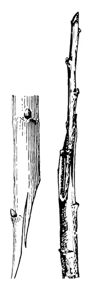
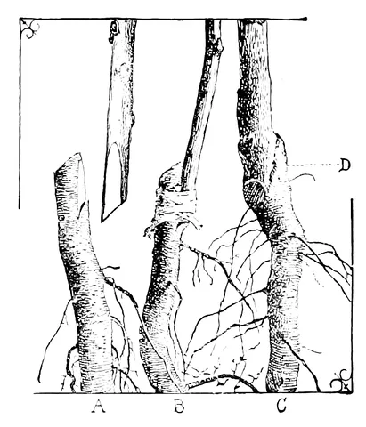
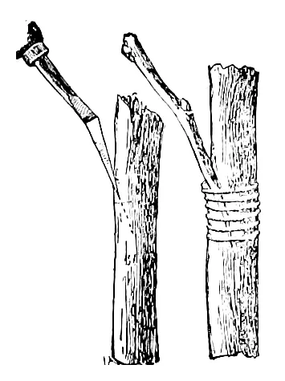
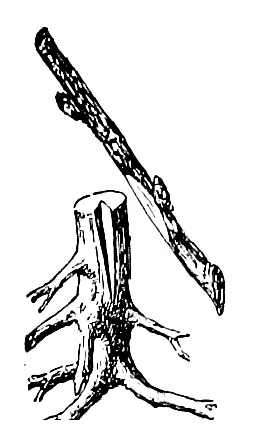
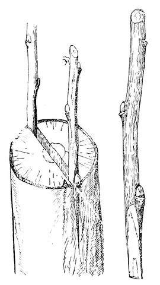
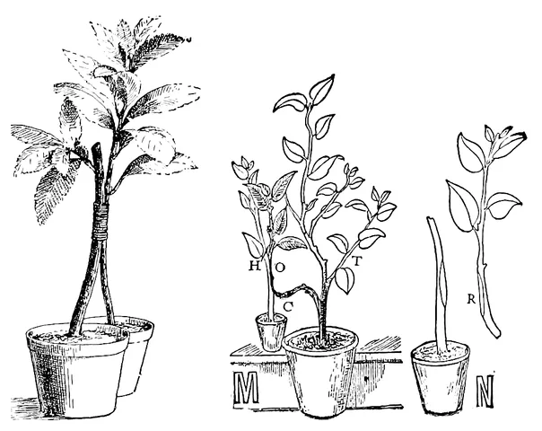
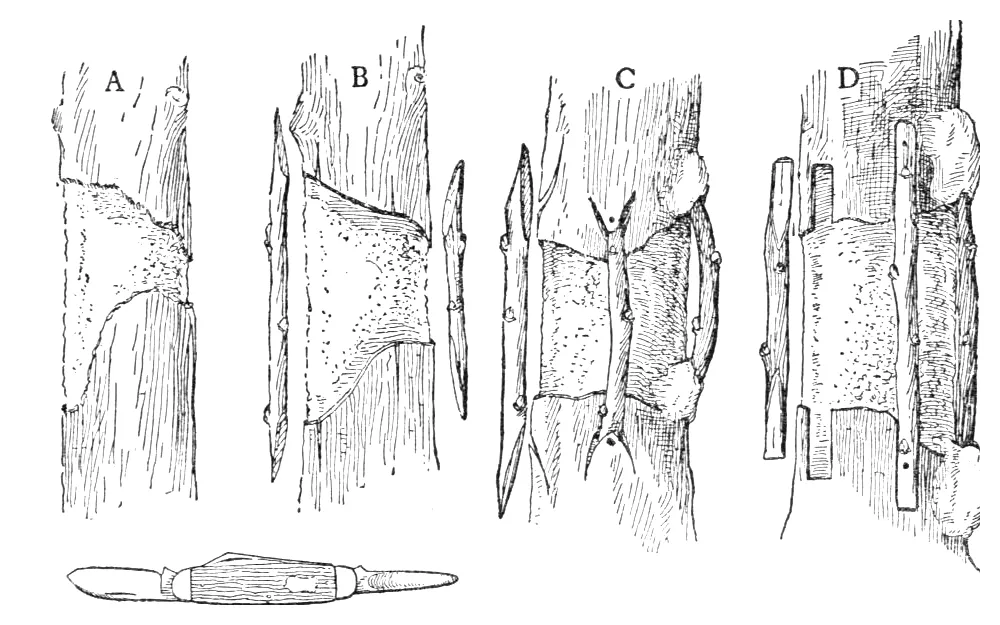

# Greffe des agrumes

Choisir un type de greffe, savoir quand la faire, puis la suivre jusqu'à la reprise : chaque contrôle pose une question, le statut n'avance que sur réponse.

Règle suivie : un fait n'est retenu que si **deux sources indépendantes** le donnent ; sinon il est marqué **une seule source**.
Curk 2022 et les fiches INRAE-Cirad viennent de la même équipe (Corse) : ensemble, elles comptent pour **une** source.
Ce qui vient du plugin lui-même est écrit **choix du plugin**. Références complètes : [Sources](#sources).

## En bref

1. **Choisir le type** selon le but (multiplier, changer de variété, réparer) et l'écorce du porte-greffe ([Types de greffe](#types-de-greffe)).
2. **Greffer à la bonne saison** : porte-greffe sorti du repos, œil du greffon pas encore débourré ; le printemps de préférence ([Quand greffer](#quand-greffer)).
3. **Saisir la greffe** : « Greffer… » sur le porte-greffe, ou « ＋ Plante » avec la multiplication « greffe » ([Dans le plugin](#dans-le-plugin)).
4. **Répondre aux contrôles** à J+21, J+42 puis 4 semaines après avoir répondu « débourré » ([Suivi et points de contrôle](#suivi-et-points-de-contrôle)).
5. **Tenir au chaud** jusqu'à la soudure (21-32 °C), puis seulement **hors gel** ; pas d'engrais hors saison ([Température, hiver, engrais](#température-hiver-engrais)).

## Types de greffe

Le type se choisit dans « Greffer… », « ＋ Plante » ou la page de l'équipement. Si la multiplication est vide, choisir un type la passe à « greffe » ;
avec une autre multiplication (semis, bouture…), le type est effacé.

| Type | Description |
|---|---|
| **Greffes d'un œil** | *pour multiplier en pépinière* |
| Écusson en T inversé | Un œil prélevé avec un peu d'écorce, glissé sous l'écorce du porte-greffe incisée en T à l'envers (⊥). La plus employée en Floride pour les jeunes plants (UF/IFAS, **une seule source**) : simple, demande moins d'habileté que le chip (HS1309). |
| Écusson en T | Même chose avec une incision en T droit. Convient aussi, moins employée. |
| Chip budding (œil en copeau) | Un copeau de bois portant l'œil, posé dans une entaille de même forme. Quand l'écorce ne se décolle plus (hors sève) ou est trop épaisse pour l'écusson. Demande plus d'habileté (HS1309). |
| Chip inversé | Variante du chip, courante sur agrumes, quand l'écorce ne se décolle pas. |
| Placage d'œil | Plaque d'écorce portant l'œil, appliquée à la place d'une plaque identique retirée du porte-greffe. Pour les écorces épaisses. À ne pas confondre avec le « placage » de la fiche INRAE-Cirad, qui est le chip. |
| **Greffes de rameau** | *pour changer de variété (surgreffage) ou réparer un arbre* |
| Fente | Le porte-greffe coupé est fendu, un greffon taillé en biseau y est inséré. Sur les charpentières, pour surgreffer. |
| Sous écorce (couronne) | Greffons glissés entre l'écorce et le bois d'une branche coupée, en sève. Surgreffage. |
| Anglaise | Porte-greffe et greffon de même diamètre, coupés en biseau et emboîtés. Peu utilisée pour les agrumes (Curk 2022 p. 194). |
| Pont | Greffons qui enjambent une plaie du tronc pour rétablir la sève. Réparation (souvent inutile si le bois n'est pas atteint, voir les [gravures](#autres-types--gravures-anciennes)). |
| Incrustation | Greffon inséré dans une entaille en V du porte-greffe. Renforcer ou réparer. |
| En approche | Deux plantes enracinées soudées côte à côte, séparées après la reprise. Renforcer ou réparer (ex. nouveau porte-greffe au pied d'un arbre). |
| Latérale | Greffon inséré sur le côté du porte-greffe, sans le couper d'abord. |
| Sur souche | Sur une souche recépée, pour repartir d'un vieil arbre. |
| **Laboratoire et pépinière spécialisée** | |
| Microgreffe d'apex in vitro | Pointe de pousse de quelques dixièmes de mm greffée en tube : assainit une variété porteuse de virus (Corse : > 80 % de reprise après regreffage, **une seule source**). |
| Minigreffe en fente | Fente sur porte-greffe de 6 mois : 75 % de réussite contre 38 % pour l'écusson en T (un essai sur orange 'Valencia', **une seule source**). |

Descriptions : relues dans HS1309 et la fiche INRAE-Cirad « Greffage » quand elles sont citées ; le reste est une synthèse de sources **non relues**
(Cirad, revue *Fruits* 1982, guide du développement rural de Polynésie française, Carimi 2001, essai colombien 2022).

## Comment greffer

Schémas dessinés pour ce plugin d'après le texte des deux fiches (pas à l'échelle). Pour les photos, voir HS1309 (fig. 5 à 8) ;
pour les dessins d'origine, la fiche INRAE-Cirad (fig. 5 à 8). Les autres types n'ont pas de marche à suivre dans nos sources relues : voir les [gravures anciennes](#autres-types--gravures-anciennes).

Pour tous : lame désinfectée avant chaque incision (HS1309, **une seule source**) ; point de greffe à 25-40 cm du collet, contre le *Phytophthora* (INRAE, **une seule source**).

### Écusson (T et T inversé)

1. **Inciser** l'écorce jusqu'au bois, dans une partie lisse entre deux nœuds : un trait vertical de 2,5 à 4 cm (HS1309), puis un trait horizontal en haut (T : HS1309, INRAE)
   ou en bas (⊥, T inversé : HS1309). Tige d'au moins 8 mm, porte-greffe en sève : l'écorce se soulève (INRAE).
2. **Lever l'écusson** sur la baguette : lame presque parallèle, depuis environ 1,3 cm au-dessus de l'œil jusque sous lui (HS1309) ; 2 à 2,5 cm de long (HS1309, INRAE).
   Bois : une mince lame (HS1309) ou aucun (INRAE) — les deux fiches divergent ; ne pas creuser l'œil. Tenir l'écusson par le reste du pétiole, sans toucher la face coupée (HS1309).
   Une épine sous l'œil : garder une languette de bois, ou la rabattre sans la couper au ras de l'œil (INRAE, **une seule source**).
3. **Glisser** l'écusson tout de suite sous l'écorce, face coupée contre le bois, entièrement dans l'incision (HS1309, INRAE) ; en T, recouper son haut au ras du trait horizontal (INRAE).
4. **Ligaturer** tout de suite, ferme sans trop serrer, toutes les coupes couvertes : ruban (HS1309) ou raphia, nœud du côté opposé à l'œil (INRAE).
   Sens : du bas vers le haut ou l'inverse (HS1309), par le haut pour ne pas faire glisser l'écusson (INRAE). Œil couvert (HS1309) ou laissé à l'air si l'air est humide (INRAE).
5. **Forcer**, une fois le lien retiré (vers J+21) et la soudure faite : couper le porte-greffe aux 2/3, du côté de l'œil, 2,5 à 4 cm au-dessus,
   et coucher le haut (ou le courber en boucle) ; quand le greffon a quelques centimètres, couper le porte-greffe à environ 1 cm au-dessus ;
   à défaut, une coupe en biais à 2,5 cm au-dessus de l'œil (HS1309, **une seule source**). Le plugin pose la question à J+42 (choix du plugin, voir [Suivi](#suivi-et-points-de-contrôle)).

### Chip budding

1. **Entailler** le porte-greffe entre deux nœuds : une coupe d'environ 2 à 2,5 cm juste dans le bois (HS1309, INRAE), terminée par une base en biseau,
   pas plus de 2 mm d'épaisseur (INRAE, **une seule source**).
2. **Prélever le copeau** portant l'œil sur la baguette, de même forme et de même taille (HS1309, INRAE).
3. **Poser** le copeau dans l'entaille, écorce contre écorce : des deux côtés quand c'est possible (HS1309), au moins sur le bord inférieur et un côté,
   jamais centré (INRAE). **Ligaturer** toutes les coupes (HS1309), ferme, l'œil peut rester en partie couvert (INRAE). Lien coupé du côté opposé à l'œil vers J+21 (INRAE).

### Couronne (sous écorce)

Une seule fiche décrit ces étapes (INRAE, **une seule source**) :
1. **Rabattre** le porte-greffe à 30 cm (Poncirus) ou 40 cm (citranges) du collet ; fendre l'écorce sur quelques centimètres depuis la coupe et la décoller.
2. **Greffon** : petite baguette de 2 ou 3 yeux, bas taillé très finement en « bec de flûte » ; retailler légèrement ses bords.
3. **Glisser** le greffon sous l'écorce, ligaturer au raphia, couvrir les coupes de mastic ; sac plastique blanc ou papier paraffiné, retiré 15 jours plus tard.

### Fente herbacée (minigreffe)

Une seule fiche décrit ces étapes (INRAE, **une seule source**) :
1. **Écimer** à 35-45 cm du sol un très jeune porte-greffe dont la tige fait au moins 5 mm de diamètre ; le fendre verticalement sur 1 cm.
2. **Greffon** : section de jeune pousse pas encore aoûtée, de même diamètre, coupée pour que son œil unique soit au milieu ; base taillée en double biseau.
3. **Enchâsser** dans la fente, ligaturer au Parafilm en couvrant aussi le sommet du greffon ; ensacher avec 2 ou 3 feuilles du porte-greffe ; sac retiré 15 jours plus tard.

### Autres types : gravures anciennes

Dessins publiés par L. H. Bailey (domaine public) : vigne, plantes en pot, arbres fruitiers ; l'espèce est rarement précisée et **aucune n'est présentée comme un agrume**. Ils montrent le geste et ne remplacent pas une marche à suivre ; les dessins seuls ne comptent pas comme source, le texte de Bailey quand il est cité compte comme **une seule source** (voir [Sources](#sources)).
Légendes traduites de l'ouvrage, échelle du dessin entre parenthèses. *The Nursery-Book*, 11ᵉ éd., 1907 ; *The Nursery-Manual*, 1920 (scans Cornell et Internet Archive).

**Anglaise** — à gauche, le greffon : coupe en biseau et languette (grandeur nature) ; à droite, greffon et porte-greffe emboîtés par leurs languettes (moitié) ; le texte ajoute un lien de raphia ou de liber.

*Bailey 1907, fig. 101-102, [p. 108](https://archive.org/details/cu31924097691087/page/108), domaine public.*

**Placage de rameau** (*veneer-grafting*, variante de la latérale selon Bailey ; à ne pas confondre avec le placage d'œil) — A : porte-greffe entaillé à travers l'écorce, une petite languette d'écorce à la base ;
au-dessus, le greffon coupé en biais, une plaque d'écorce retirée sur le grand côté ; B : greffon posé et lié au raphia ; C : la soudure faite (en D) (moitié).
Selon Bailey, inutile de rabattre le porte-greffe avant la reprise.

*Bailey 1907, fig. 111, [p. 114](https://archive.org/details/cu31924097691087/page/114), domaine public.*

**Latérale** — à droite, le greffon inséré dans une entaille oblique du porte-greffe non coupé, puis lié ; à gauche, le bas d'un ciseau à lame mince et tige coudée, en place dans l'entaille (moitié).

*Bailey 1907, fig. 113, [p. 115](https://archive.org/details/cu31924097691087/page/115), domaine public.*

**Incrustation** — porte-greffe (ici une vigne) coupé, une rainure en V taillée dans la coupe (une ou deux selon le texte), greffon taillé à la même forme (un tiers).

*Bailey 1907, fig. 116, [p. 117](https://archive.org/details/cu31924097691087/page/117), domaine public.*

**Fente** — à gauche, le porte-greffe coupé net et fendu, un greffon en coin de chaque côté ; à droite, le greffon : trois yeux, le plus bas juste au-dessus du coin (grandeur nature).

*Bailey 1907, fig. 118-119, [p. 118](https://archive.org/details/cu31924097691087/page/118), domaine public.*

**En approche** — à gauche, deux plantes en pot, tiges entaillées et liées ensemble ; à droite (M), un rameau C de la plante voisine joint en O au porte-greffe H ;
(N) la taille des surfaces accolées, en R. Bailey note que les orangers se multipliaient autrefois ainsi, mais (en 1907) plus facilement par placage.

*Bailey 1907, fig. 138-139, [p. 133](https://archive.org/details/cu31924097691087/page/133), domaine public.*

**Pont** — A : tronc annelé (écorce rongée tout autour) ; B : bords de la plaie parés, greffons biseautés aux deux bouts, à côté ;
C : greffons posés dans des entailles faites à environ 1,3 cm au-dessus et au-dessous de la plaie, jusqu'à l'aubier, et cloués ; D : variante, logements à la forme des greffons ; en bas, le canif.
Bailey (p. 161) la juge souvent inutile si l'annelure n'atteint pas le bois : un bon enduit de cire ou d'argile bandé est souvent bien meilleur (**une seule source**).

*Bailey 1920, fig. 191, [p. 161-162](https://archive.org/details/nurserymanualcom00bailrich/page/161) (lettres d'après Peck, cité par Bailey), domaine public.*

## Quand greffer

Pour tous les types :
- le porte-greffe doit être **sorti du repos** (moyenne au-dessus d'environ 13 °C) et l'œil du greffon **pas encore débourré** (fiche INRAE-Cirad « Greffage ») ;
- le **printemps** est la meilleure saison ; le **plein été** est déconseillé (la chaleur dessèche les tissus) sauf sous abri frais ; une **serre** permet de greffer
  en toute saison (Curk 2022 p. 185 et 194).

Même filiation : **une seule source** à confirmer. Printemps = mars à mai dans l'hémisphère nord, septembre à novembre dans l'hémisphère sud ;
c'est la sève du porte-greffe qui décide, pas le calendrier. La saison du type choisi est rappelée sous le type dans « Greffer… » et « ＋ Plante ».

| Type | Saison et conditions |
|---|---|
| Écusson en T, en T inversé | porte-greffe **en sève** (l'écorce se soulève), en pleine croissance : en général d'avril à novembre selon le lieu (HS1309, **une seule source**) ; en Corse dès mars-avril sous tunnel, mai dehors (INRAE) ; le printemps de préférence (Curk, **une seule source**) |
| Chip, chip inversé | quand l'écorce se soulève mal (HS1309, INRAE, qui l'appelle « placage ») ou est trop épaisse pour un écusson (HS1309, **une seule source**) ; variété épineuse, rameaux à section triangulaire (INRAE, **une seule source**) ; saison : règle générale |
| Sous écorce (couronne) | porte-greffe âgé, de gros diamètre, écorce trop épaisse pour un écusson mais qui se décolle (INRAE, **une seule source**) ; saison : règle générale |
| Minigreffe en fente | fente herbacée : très jeunes porte-greffes (tige d'environ 5 mm), greffon de jeune pousse ; sous abri presque toute l'année dans les pays plus chauds que la Corse (INRAE, **une seule source**) |
| Anglaise | peu utilisée pour les agrumes (Curk 2022 p. 194) ; sinon printemps |
| Placage d'œil, fente, incrustation, sur souche, latérale, en approche, pont | règle générale ; **aucune source relue** pour le type |
| Microgreffe in vitro | en laboratoire : toute saison |

## Dans le plugin

**Greffer…** (bas de l'onglet Fiche, administrateurs) : la plante, en général un porte-greffe, devient le greffon. Même formulaire que « ＋ Plante » :
- **greffon** choisi parmi nos plantes des autres collections (nom botanique, cultivar et caractères recopiés, nom proposé « greffon sur porte-greffe »)
  ou écrit à la main (nouveau cultivar) ;
- nouveau nom, nom botanique du greffon, collection (par défaut l'actuelle : choisir la collection du greffon), type et date de greffe ;
- le porte-greffe est déduit du nom (Poncirus, Flying Dragon, FA5…), modifiable.

C'est le **même équipement** : journal, photos, pot, emplacement, courbes et champ « Sol » sont gardés (ce sont toujours ses racines) ;
le reste de la fiche, les caractères observés et la photo d'étiquette, qui décrivaient le porte-greffe, sont vidés. Une entrée « Greffe » est ajoutée au journal.

Le suivi démarre pour une greffe de **moins de 60 jours** : par « Greffer… » (date partielle ou vide : la date du jour est écrite), ou par « ＋ Plante » avec une date complète.
Les contrôles comptent depuis la date de greffe. Regreffer une greffe pas prise efface son suivi ; « Redevenir porte-greffe… » rend toujours le porte-greffe d'origine.

**Redevenir porte-greffe…** (greffe échouée) : rend le nom, la collection et la fiche d'avant la greffe, gardés par « Greffer… ».
Greffe faite avant la version 0.10 : nom (proposé d'après le champ Porte-greffe) et collection à choisir, la fiche est vidée.

## Suivi et points de contrôle

**Statut** : *en attente* → *probablement prise* → *pousse du greffon* → *reprise*, ou *œil dormant jusqu'au printemps* (puis *pousse du greffon*),
ou *échouée* ; pont : *probablement prise* → *reprise*.

**Marche à suivre** (chaque étape est la question du contrôle) :

| Contrôle | Œil | Rameau | Côté | Pont |
|---|---|---|---|---|
| J+21 | œil vert et gonflé, sans se ratatiner ; retirer le lien | bourgeons du greffon verts et gonflés ; sac retiré | greffon vert | greffons verts |
| J+42 | l'œil a-t-il débourré ? sinon le **forcer** en rabattant le porte-greffe au-dessus, ou « Au printemps » | le greffon pousse-t-il ? retirer le lien quand les feuilles sortent | soudure faite : couper le porte-greffe au-dessus (approche : sevrer le greffon de sa plante) | greffons soudés aux deux bouts ; oui → *reprise* (rien ne doit pousser, pas de « Au printemps ») |
| Pousse (4 semaines après) | tuteurer la pousse, couper le haut du porte-greffe à environ 1 cm au-dessus de la greffe, ôter les rejets | greffon tuteuré, lien retiré, rejets ôtés | greffon tuteuré, rejets ôtés | — |

*Œil* : écussons, chip, placage ; *rameau* sur porte-greffe coupé : fente, couronne, anglaise, incrustation, sur souche, minigreffe ;
*côté* : latérale, en approche. Type de greffe inconnu : traité comme une greffe de rameau.

Sources : forcer l'œil, HS1309 et Alabama ACES (HS1309 le force dès le lien retiré ; attendre J+42 et ne forcer qu'un œil qui n'a pas débourré est un choix du plugin) ; rejets du porte-greffe à ôter dès qu'ils sortent, HS1309 et Curk 2022 p. 210 ;
tuteurer puis couper le haut du porte-greffe, HS1309 (**une seule source**) ; lien d'un œil coupé vers J+21, HS1309 (14 à 21 jours, 30 au plus) et fiche INRAE-Cirad (une vingtaine de jours) ;
lien ou sac d'un rameau retiré quand le greffon pousse, Curk 2022 p. 186 (couronne : sac retiré à 15 jours, fiche INRAE-Cirad), même filiation, **une seule source** ; latérale, approche et pont : **aucune source relue**, choix du plugin ;
contrôle de la pousse 4 semaines après la réponse « débourré », choix du plugin. Délais J+21 et J+42 d'après la vulgarisation des universités de Floride, d'Alabama et
de Californie : le bourgeon, plus que le calendrier, décide.

**Répondre** (chaque réponse est notée au journal) :
- **Oui** : étape suivante ;
- **Douteux** : revoir dans 7 jours ;
- **Au printemps** (à J+42 seulement, sauf pont) : œil vivant (vert, gonflé) laissé dormant, pour une greffe d'automne ; à J+42 la soudure est considérée comme faite (choix du plugin ; elle demande 3-4 semaines au printemps, 6-8 sinon : UC Ventura, **une seule source**) ; contrôle le 15 mars (15 septembre dans l'hémisphère sud),
  avancé jusqu'à 8 semaines si la moyenne sur 7 jours de l'emplacement dépasse déjà 13 °C (seuil réglable, sonde historisée), au plus tôt 4 semaines après la réponse (choix du plugin) ;
  au contrôle, rabattre le porte-greffe au-dessus de l'œil ;
- **Non, mort** (deux clics) : *échouée*.

Un contrôle dû remplit la commande « Greffe à contrôler », reprise par le rapport du matin.

*Yuzu greffé il y a 12 jours : contrôle prévu le 11/11 (J+21), la question à se poser, et l'avertissement de température (la serre est à 11,2 °C en moyenne). Les boutons répondent au contrôle.*

## Température, hiver, engrais

- **Avant la soudure** (*en attente*, *probablement prise*) : la moyenne sur 24 h de la sonde de l'emplacement (historisée) est comparée aux seuils
  de la configuration (21 et 32 °C par défaut, choix du plugin d'après des sources d'amateurs, réglables) ; en dehors, la fiche et la commande disent
  « trop froid (ou trop chaud) pour souder ». Sous 21 °C de jour le Poncirus s'endort (Alabama ACES, **une seule source**) et la greffe attend le printemps ; l'appliquer à la moyenne sur 24 h, nuits comprises, est un choix du plugin.
- **Œil dormant, pousse du greffon** : la soudure est faite, le seuil de 21 °C ne s'applique plus ; seul le gel compte (« gel : protéger l'œil » si la sonde
  descend sous 0 °C sur 24 h, choix du plugin).
- **En hiver** (novembre à février, mai à août dans l'hémisphère sud), le contrôle J+42 (soudure faite) ajoute : « Au printemps », au frais hors gel, sans engrais ;
  avant J+21, la greffe a besoin de chaleur pour souder. Un œil peut ne pas démarrer tant qu'on ne rabat pas le porte-greffe
  (HS1309, Alabama ACES) ; les agrumes ne poussent plus sous ≈ 13 °C (**une seule source**, voir [Fertilisation](fertilisation.md)) ; pas d'engrais
  l'hiver (2 sources). Le forcer en hiver demanderait chaleur et lumière (au moins 6 h de soleil ou une lampe horticole : Rutgers, **une seule source**) :
  **aucune source** ne traite d'une greffe forcée en hiver.
- **Engrais** : une greffe en cours de suivi compte comme un jeune plant ; elle ne reçoit pas d'engrais hors de la fenêtre des produits, même dans un
  emplacement chauffé, et sa dose est réduite les premières années (25 % à la greffe, 100 % à 3 ans par défaut) (voir [Fertilisation](fertilisation.md)).

## Sources

- **UF/IFAS HS1309** : Albrecht U., Zekri M., Williamson J., *Citrus Propagation*, HS1309, University of Florida IFAS, 2017, révisé en 2021 et 2024.
- **Alabama ACES** : Alabama Cooperative Extension System, fiches sur la greffe des agrumes (œil vert = pris, rabattre le porte-greffe ; Poncirus en
  dormance quand le jour reste sous 21 °C).
- **Curk 2022** : Curk F., Luro F., Minuto G., Nieddu G., *Les agrumes du Nord de la Méditerranée*, Alain Piazzola, 2022, doi 10.17180/m6z4-d276,
  https://hal.inrae.fr/hal-04646466
- **Fiche INRAE-Cirad « Greffage »** : CRB Citrus INRAE-Cirad, San Giuliano (Corse), *La fiche technique : le greffage* 1/4 à 4/4, d'après Jacquemond
  et al. 2013 (même organisme que Curk 2022).
- **Rutgers** : *Growing Citrus in Containers*, maître jardinier du comté de Hunterdon (reprend Mississippi State University P2542).
- **Bailey** : Bailey L. H., *The Nursery-Book*, 11ᵉ éd., Macmillan, 1907 (Internet Archive cu31924097691087) et *The Nursery-Manual*, Macmillan, 1920 (Internet Archive nurserymanualcom00bailrich), domaine public ; texte cité = **une seule source**, souvent hors agrumes.
- **UC Ventura** : University of California Cooperative Extension, comté de Ventura, conseils de greffage des agrumes (durée de la soudure) ; connue par la synthèse « Techniques de greffe », **non relue**.
- **Non relues** (citées par la synthèse « Techniques de greffe », référence complète non retrouvée) : revue *Fruits* 1982 (Cirad, placage d'œil) ; guide du service du développement rural de Polynésie française ;
  Carimi 2001 (Italie, microgreffe et embryogenèse somatique) ; essai colombien 2022 sur orange 'Valencia' (minigreffe en fente).
- **Températures de soudure (21-32 °C)** : sources d'amateurs seulement (forums, sites de jardinage), d'où des seuils réglables.
