# Bases de la botanique

Les mots de base pour comprendre une plante et le reste de la notice : bourgeon, liber, cambium, limbe, pistil, élément mobile…
Les exemples sont pris sur les agrumes quand une source en parle ; sinon, la règle est générale.

Règle suivie : un fait n'est retenu que si **deux sources indépendantes** le donnent ; sinon il est marqué **une seule source**.
Les deux manuels de base sont Shipunov 2021 et OpenStax 2018 ; Wikipédia, une encyclopédie, ne sert qu'à confirmer un mot français ou un détail.
Un mot français d'usage qu'aucun manuel n'emploie est signalé. Références complètes : [Sources](#sources).

Les images sont des gravures anciennes (domaine public, via Internet Archive / Biodiversity Heritage Library ou Wikimedia Commons) et une photo sous CC BY 2.5 :
les gravures montrent souvent une autre plante qu'un agrume, ce qui est dit sous chacune.

## En bref

1. Une plante a des **pousses** (tige, feuilles, bourgeons, fleurs) et des **racines** ([La plante](#la-plante)).
2. Sous l'écorce, le **liber** porte les sucres des feuilles vers les racines, les pousses et les fruits, le **bois** monte l'eau ; entre les deux, le **cambium** fabrique les deux ; dans une greffe, les tissus conducteurs se soudent ([Sous l'écorce](#sous-lécorce)).
3. Couper le **bourgeon du bout** réveille les bourgeons de côté : c'est la base de la taille ([La tige et les bourgeons](#la-tige-et-les-bourgeons)).
4. Une carence se lit sur **les vieilles feuilles ou les feuilles adultes** (azote, magnésium, potassium…) ou sur **les jeunes pousses** (fer, zinc, manganèse…) ([Nourrir la plante](#nourrir-la-plante) ; trois sources décrivent les mêmes signes : voir [Reconnaître une carence](fertilisation.md#reconnaître-une-carence)).
5. Le fruit est l'**ovaire** de la fleur qui a mûri ; chez les agrumes, on l'appelle **hespéride** (**une seule source**) ([La fleur et le fruit](#la-fleur-et-le-fruit)).
6. Un **pépin** d'agrume donne souvent un plant identique à la mère (pas chez le cédratier, le pamplemoussier *C. maxima*, le clémentinier ni certains hybrides de mandarinier), mais jeune et épineux pendant des années ; greffe, bouture et marcotte copient la mère et peuvent transmettre ses maladies ([Multiplier les agrumes](#multiplier-les-agrumes)).

## La plante

- Une plante a deux ensembles : les **pousses** (tige, feuilles, bourgeons, fleurs) et les **racines** (OpenStax 2018 p. 860 ; Shipunov 2021 p. 76).
- Les racines **absorbent** l'eau et les minéraux (OpenStax p. 860 ; Shipunov p. 101) et **tiennent** la plante (OpenStax p. 860, **une seule source**).
- Le **collet** est la zone de passage entre la tige et les racines (Wikipédia « Collet (botanique) », **une seule source** ; Shipunov p. 78 appelle « transition » tige/racine l'hypocotyle de la plantule).
  Le point de greffe, lui, est plus haut, sur la tige (voir [Greffe](greffe.md)).

## La tige et les bourgeons

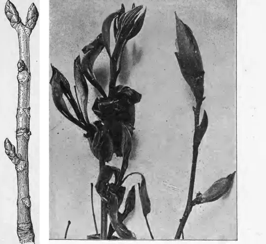

*Fig. B1 – À gauche, rameau de marronnier d'Inde : bourgeons de côté et cicatrices des feuilles (sans bourgeon du bout, ce que la légende d'origine regrette) ; à droite, bourgeons de caryer qui s'ouvrent (photo). Atkinson 1905, fig. 427 [p. 374](https://archive.org/details/collegetextbooko00atkiuoft/page/374) et fig. 431 [p. 379](https://archive.org/details/collegetextbooko00atkiuoft/page/379), domaine public.*

- **Nœud** : l'endroit où une feuille est (ou était) attachée. **Entre-nœud** : la portion de tige entre deux nœuds (OpenStax p. 862 ; Shipunov p. 91).
- **Bourgeon de côté (axillaire)** : il naît à l'**aisselle** d'une feuille, entre la feuille et la tige, et donne une branche (OpenStax p. 862 ; Shipunov p. 124) ou une fleur (OpenStax p. 862, **une seule source**).
  Le jardinier l'appelle l'**œil** ; c'est lui qu'on prélève pour un écusson. Le mot « œil » n'est pas dans ces manuels dans ce sens (sauf pour la pomme de terre, OpenStax p. 941).
- **Bourgeon du bout (terminal)** : au sommet de la pousse (OpenStax p. 862 ; Shipunov p. 78) ; il porte la zone qui fait allonger la tige (OpenStax p. 861-862, **une seule source**).
- **Dominance apicale** : le bourgeon du bout freine les bourgeons de côté ; si on le coupe, ils démarrent et donnent des branches.
  C'est la base de la taille (OpenStax p. 867 ; Shipunov p. 124).
- **Débourrement** : l'ouverture des bourgeons au printemps (Wikipédia « Débourrement » ; Atkinson 1905 p. 379, qui le décrit sans ce mot) ; « à la fin de la dormance » : Wikipédia, **une seule source**.
  Le mot n'est pas dans les deux manuels.
- **Épines** : une épine peut être un **rameau** transformé (*thorn*) ou une **feuille** transformée (*spine*) (Shipunov p. 127 ; OpenStax p. 869 et 877).
  Chez les agrumes, chaque nœud porte une feuille à une foliole sur un pétiole ailé (FoC 2008) ; l'épine est dans son aisselle (FoC 2008 ; Zhang et al. 2020),
  et à côté d'elle, au même niveau, un bourgeon dormant (Zhang et al. 2020 p. 2952 ; Leichty et Sinha 2021).
  L'épine est un **rameau transformé** (Zhang et al. 2020 ; Wikipédia « Citrus » : « épines axillaires »).
  À ne pas confondre avec l'**aiguillon** (*prickle*) du rosier, qui n'est qu'une excroissance de la surface de la tige, n'importe où (Shipunov p. 127 ; Morrow § 12.4) ;
  OpenStax p. 869 range pourtant le rosier parmi les épines.
  Chez l'ocotillo, l'épine est le pétiole, avec un bourgeon dans l'aisselle de l'épine (Morrow § 12.4, **une seule source**).
  Pour reconnaître : épine et bourgeon côte à côte à l'aisselle d'une feuille, un rameau ; bourgeon à l'aisselle de l'épine, une feuille ;
  ni l'un ni l'autre, n'importe où sur l'écorce, un aiguillon (**déduction du plugin**).

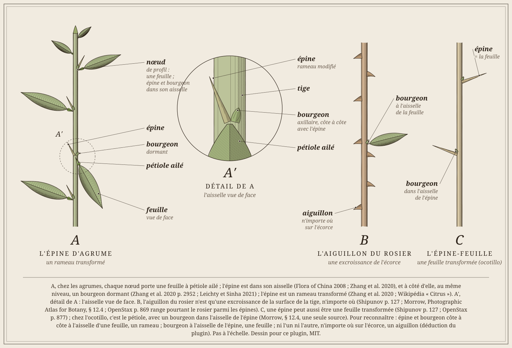

*Fig. B2 – A, épine d'agrume à l'aisselle d'une feuille, avec son bourgeon ; B, aiguillon du rosier ; C, épine issue d'une feuille. Détail et sources sur le dessin. Dessin façon gravure coloriée pour ce plugin, MIT.*

## Sous l'écorce

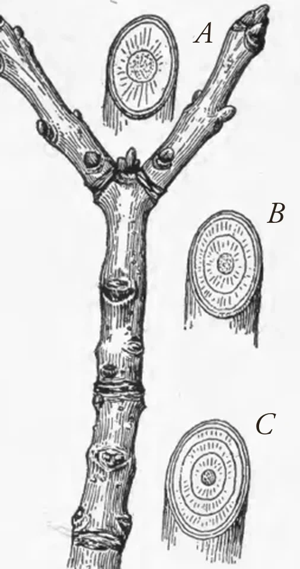

*Fig. B3 – Rameau de frêne de trois ans, coupé dans chaque pousse annuelle : un cerne de plus chaque année vers le bas. Atkinson 1905, fig. 432, [p. 381](https://archive.org/details/collegetextbooko00atkiuoft/page/381), domaine public.*

De l'extérieur vers le centre :

- **Écorce** : tout ce qui est à l'extérieur du cambium (OpenStax p. 866 ; Shipunov p. 123). Elle contient le liber et, tout à l'extérieur, le **liège** (OpenStax p. 867 ; Shipunov p. 123).
- **Liber (phloème)** : des cellules **vivantes**, côté extérieur. Il transporte les **sucres** fabriqués par les feuilles **dans tous les sens** : vers le haut (pousses, fleurs, fruits) et vers le bas (racines)
  (cellules vivantes et sucres : Shipunov p. 74 ; OpenStax p. 861 et 885 ; dans tous les sens : Shipunov p. 103). La « sève élaborée » des livres français, c'est cela ; le mot n'est pas dans les deux manuels.
- **Cambium** : une couche très fine qui fabrique du liber vers l'extérieur et du bois vers l'intérieur : la tige s'épaissit (OpenStax p. 867 ; Shipunov p. 119).
  Dans une greffe, ce sont les cambiums du greffon et du porte-greffe qui doivent se toucher (Bailey 1907 p. 78 ; Curk 2022 p. 183) ; pour un chip, des deux côtés quand c'est possible (UF/IFAS HS1309) ; les tissus conducteurs des deux plantes se soudent (OpenStax p. 942).
- **Bois (xylème)** : des cellules **mortes**, côté intérieur. Il fait **monter** l'eau et les minéraux des racines vers les feuilles, **dans un seul sens** (OpenStax p. 861 et 885 ; Shipunov p. 74).
  Le bois de l'arbre est du xylème fabriqué par le cambium (Shipunov p. 74 ; Bailey 1907 p. 78) ; le bois clair près de l'écorce, l'**aubier**, est celui qui conduit encore l'eau (Shipunov p. 121 ; Atkinson 1905 p. 381).
- **Cernes** : le cambium ne travaille pas de la même façon toute l'année ; il laisse un cerne par saison de pousse, donc un par an en climat à saisons. Sans saisons marquées, les cernes ne sont pas nets (OpenStax p. 867-868 ; Shipunov p. 120).

Ces règles valent pour les arbres en général ; qu'elles s'appliquent aux agrumes est une déduction du plugin.

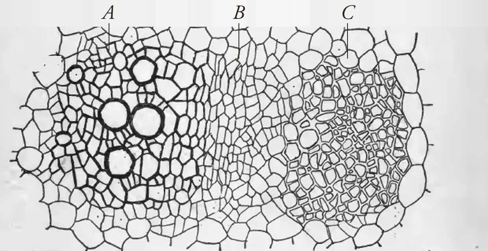

*Fig. B4 – Coupe d'un faisceau conducteur de tige de tournesol, au microscope : à gauche le **bois** (gros vaisseaux ronds), au centre le **cambium** (petites cellules en rangs), à droite le **liber**. Atkinson 1905, fig. 58, [p. 50](https://archive.org/details/collegetextbooko00atkiuoft/page/50), domaine public (légende anglaise d'origine retirée).*

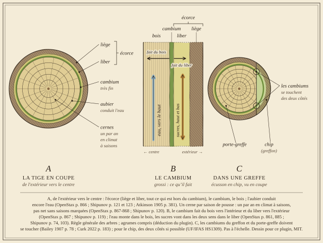

*Fig. B5 – A, de l'écorce au bois autour du cambium ; B, dans une greffe, les cambiums du greffon et du porte-greffe doivent se toucher (voir [Greffe](greffe.md)). Détail et sources sur le dessin. Dessin façon gravure coloriée pour ce plugin, MIT.*

- **Annelure** : enlever un anneau d'écorce coupe le liber, pas le bois. Les sucres ne descendent plus : ils s'accumulent au-dessus de l'anneau et manquent dans les racines (Li et al. 2003, sur l'hybride de mandarinier « Murcott », **une seule source** ; Wikipédia « Annélation » et « Girdling » confirment).
  Chez Li et al., l'accumulation au-dessus ne se voit pas sur un arbre très chargé de fruits, qui consomment les sucres.
  Un anneau complet qui ne se referme pas finit par tuer les racines, puis l'arbre (Wikipédia « Annélation » et « Girdling », **une seule source** : l'encyclopédie). Une écorce rongée tout autour peut se réparer par une [greffe en pont](greffe.md#autres-types--gravures-anciennes), souvent inutile si le bois n'est pas atteint : un anneau fait au printemps, bien bandé, se referme d'ordinaire (Bailey 1907 p. 129-130, **une seule source**, ancienne).

## La feuille

- **Limbe** : la partie plate. **Pétiole** : la queue qui l'attache à la tige (OpenStax p. 872 ; Shipunov p. 79).
- **Nervures** : les faisceaux conducteurs venus de la tige ; la nervure principale parcourt la feuille et se ramifie (Shipunov p. 85 ; OpenStax p. 873).
- **Feuille simple ou composée** : une feuille composée est divisée en **folioles** (OpenStax p. 874 ; Shipunov p. 80). Le Poncirus a 3 folioles ([Identification](identification.md)).
- **Disposition** : une feuille par nœud, c'est une disposition **alterne** (en spirale) (Shipunov p. 91) ; c'est le cas des agrumes (Wikipédia « Citrus » en anglais, **une seule source**).
- **Décrire une feuille** : sa forme, son sommet, sa base et son bord (Shipunov p. 82). Les mots que les botanistes utilisent pour les agrumes (IPGRI 1999 p. 32-33, dessins pour la forme et le bord ; les définitions entre parenthèses sont les nôtres, d'après ces dessins et Shipunov p. 82) :
  - **forme du limbe** : elliptique (large au milieu), ovée (en œuf, plus large vers la base), obovale (en œuf renversé, plus large vers le sommet), lancéolée (étroite, en fer de lance), orbiculaire (presque ronde), obcordée (en cœur renversé) ;
  - **sommet** : atténué (qui s'amincit peu à peu en pointe), acuminé (étiré brusquement en longue pointe), aigu (en angle aigu), obtus (en angle ouvert), arrondi, émarginé (échancré, avec une petite encoche) ;
  - **base** (Shipunov p. 82 ; l'IPGRI ne la décrit pas) : arrondie, tronquée (droite), cunéiforme (en coin), cordée (en cœur) ;
  - **bord** : entier (lisse), crénelé (petites dents arrondies), denté (dents pointues), sinué (à larges festons, dans le plan de la feuille).

  Ces mots se lisent dans les flores et les clés d'identification ([Identification](identification.md)) ; le plugin ne les demande pas.

*Fig. B6 – Formes du limbe, sommets, bords et bases. Dessin façon gravure coloriée pour ce plugin d'après les définitions et dessins de Shipunov p. 82 (base) et d'IPGRI 1999 p. 32-33 (aucune figure recopiée), MIT comme le plugin.*

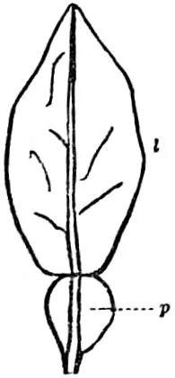

*Fig. B7 – Feuille de Citrus aurantium (oranger, au sens de 1911) : l = limbe, p = pétiole ailé, articulé au limbe. A. B. Rendle, Encyclopædia Britannica, 11ᵉ éd., 1911, vol. 16 p. 326, fig. 21, domaine public, via [Wikimedia Commons](https://commons.wikimedia.org/wiki/File:EB1911_Leaf_-_Leaf_of_Citrus_Aurantium.jpg).*

- **Feuille d'agrume** : le pétiole est **ailé** (Ballve et al. 1997, **une seule source** ; Wikipédia « Citrus » confirme) ; la largeur de l'aile change selon l'espèce, et sert même à reconnaître des hybrides (Ballve et al. 1997).
  Le limbe est **articulé** sur le pétiole (Atkinson 1905 p. 389 ; Rendle 1911, fig. B7<!-- bota-feuille-agrume -->) : la feuille d'oranger et de citronnier serait une feuille composée réduite à **une seule foliole** (Atkinson 1905 p. 389, **une seule source**, et ancienne).
- **Stomates** : de petites ouvertures de l'épiderme, par où passent les gaz et l'eau qui s'évapore (OpenStax p. 865 ; Shipunov p. 88) ; plus nombreux **sous** la feuille (Shipunov p. 90, **une seule source**).

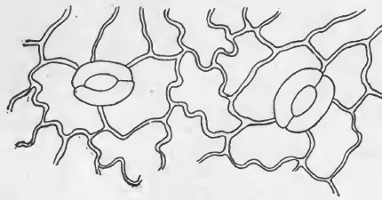

*Fig. B8 – Épiderme de feuille de lierre vu au microscope : cellules à bords ondulés, deux stomates (les ovales à deux lèvres). Atkinson 1905, fig. 53, [p. 42](https://archive.org/details/collegetextbooko00atkiuoft/page/42), domaine public.*

- **Transpiration** : la perte d'eau par évaporation à la surface des feuilles (OpenStax p. 882 ; Shipunov p. 88).
- **Photosynthèse** : avec la lumière, la feuille fabrique des **sucres** à partir du gaz carbonique de l'air et de l'eau, et rejette de l'oxygène (Shipunov p. 39 ; OpenStax p. 860 et 865).

## La racine

- **Racine pivotante** : une racine principale qui descend, avec des racines latérales (OpenStax p. 869 ; Shipunov p. 97).
- **Poils absorbants** : de très fins poils près du bout des racines ; ils augmentent la surface qui absorbe l'eau et les minéraux (OpenStax p. 896 et 902 ; Shipunov p. 101).

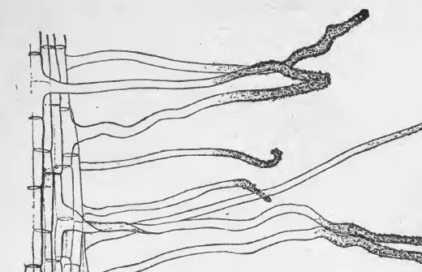

*Fig. B9 – Poils absorbants d'une plantule de maïs, avec des grains de terre collés. Atkinson 1905, fig. 44, [p. 32](https://archive.org/details/collegetextbooko00atkiuoft/page/32), domaine public.*

- Les racines **respirent** : elles ont besoin d'oxygène (Shipunov p. 97 ; OpenStax p. 878). Un bon sol a environ **moitié eau, moitié air** dans ses vides (OpenStax p. 906, **une seule source**).
  D'où le danger d'un pot détrempé : voir [Arroser juste](fertilisation.md#arroser-juste) et la [gommose](sante.md#gommose-et-pourriture-des-racines-phytophthora).

## La fleur et le fruit

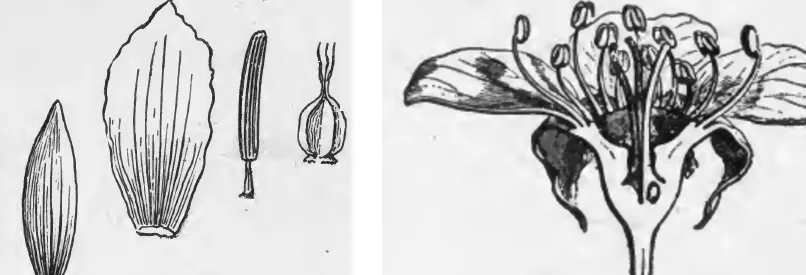

*Fig. B10 – À gauche, de Trillium : sépale, pétale, étamine, pistil ; à droite, fleur de poirier coupée en long : pétales, étamines, pistil au centre. Atkinson 1905, fig. 379 [p. 320](https://archive.org/details/collegetextbooko00atkiuoft/page/320) et fig. 570 [p. 682](https://archive.org/details/collegetextbooko00atkiuoft/page/682) (d'après Warming), domaine public.*

- De l'extérieur vers le centre : **sépales** (le calice), **pétales** (la corolle), **étamines**, **pistil** (Shipunov p. 153 ; OpenStax p. 920).
- **Étamine** : elle porte l'**anthère**, qui fait le pollen (Shipunov p. 154 ; OpenStax p. 920) ; l'anthère est au bout d'un **filet** (Shipunov p. 154 ; OpenStax p. 923).
- **Pistil** : le **stigmate** (qui reçoit le pollen), le **style** et l'**ovaire**, qui contient les ovules (OpenStax p. 920 ; Shipunov p. 155).

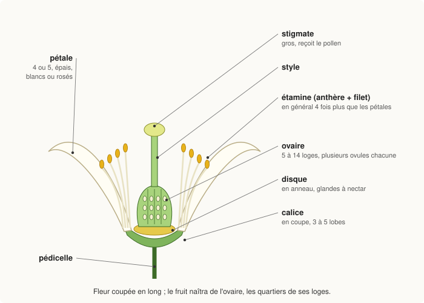

*Fig. B11 – Fleur d'agrume coupée en long : calice en coupe à 3-5 lobes, 4-5 pétales épais, étamines en général 4 fois plus nombreuses que les pétales (jusqu'à 10 fois), libres ou soudées à la base, disque à nectar en anneau, ovaire de 5 à 14 loges, gros stigmate (FoC 2008, description du genre Citrus, **une seule source**). Schéma dessiné pour ce plugin, MIT.*

- **Pollinisation** : le pollen va de l'anthère au stigmate, de la même fleur ou d'une autre (OpenStax p. 929 ; Shipunov p. 164).
- **Fécondation** : le pollen germe, traverse le style jusqu'à l'ovule ; l'ovule fécondé devient la **graine** (OpenStax p. 934-936 ; Shipunov p. 155).
- **Le fruit est l'ovaire mûri** (OpenStax p. 938 ; Shipunov p. 155 et 164). En général, seule une fleur fécondée donne un fruit (OpenStax p. 938, **une seule source**).
  La **nouaison** est ce passage de la fleur au fruit (Wikipédia « Nouaison », **une seule source**) ; le mot n'est pas dans les deux manuels.
- **Parthénocarpie** : la formation d'un fruit **sans fécondation** des ovules (Wikipédia « Parthénocarpie », qui cite la clémentine ; de Rocca Serra 1992 p. 120 emploie le mot dans ce sens). Elle est très répandue chez les agrumes (de Rocca Serra 1992 p. 120, **une seule source**).
  Sans fécondation, la fleur tombe d'ordinaire ; la parthénocarpie permet au fruit de se former quand même, et il est alors **sans pépins**. La fécondation manque quand le pollen ou les ovules sont stériles, ou par **auto-incompatibilité** : le pollen d'une variété ne féconde pas ses propres fleurs (de Rocca Serra 1992 p. 120 ; Honsho 2023, résumé : auto-incompatibilité et parthénocarpie donnent des fruits sans pépins).
  Tous les pamplemoussiers sont auto-incompatibles ; le clémentinier l'est aussi, mais seulement en partie : quelques tubes polliniques atteignent l'ovaire, un clémentinier seul peut donc donner quelques pépins (de Rocca Serra 1992 p. 120).
  Certaines variétés auto-incompatibles le sont aussi entre elles (même source). À notre avis, un clémentinier près d'une autre variété **compatible** qui fleurit en même temps peut donner des fruits à pépins (déduction du plugin).
  Les variétés **triploïdes** sont sans pépins (de Rocca Serra 1992 p. 117) ; chez elles, la formation des graines est bloquée (Honsho 2023).

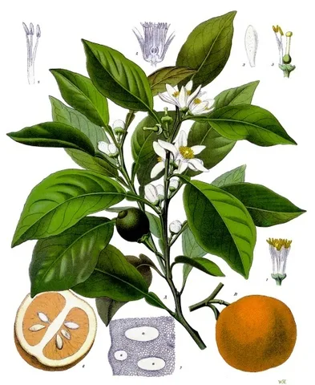

*Fig. B12 – Bigaradier (Citrus aurantium) : A rameau fleuri et fruit ; B fruit ; 1 fleur sans ses pétales ; 2 fleur coupée en long ; 3 pétale ; 4 faisceau d'étamines ; 5 pistil entouré des étamines ; 6 fruit mûr coupé (« en travers » selon la légende d'origine, le dessin semble coupé en long) ; 7 écorce de fruit vert au microscope. F. E. Köhler, Köhler's Medizinal-Pflanzen, 1897 (date de Commons), fichier n° 042, domaine public, via [Wikimedia Commons](https://commons.wikimedia.org/wiki/File:Citrus_aurantium_-_K%C3%B6hler%E2%80%93s_Medizinal-Pflanzen-042.jpg) (légende d'après la description de Wikimedia Commons).*

- **Hespéride** : le nom du fruit des agrumes, à écorce épaisse et coriace (Wikipédia « Hesperidium » et « Citrus », **une seule source** : l'encyclopédie, qui en fait une baie particulière).
  Shipunov cite l'hespéride à côté de la baie parmi les fruits charnus (p. 166), et l'orange parmi les fruits charnus (p. 164).
- **Péricarpe** : la paroi du fruit, faite de trois couches, de l'extérieur vers le centre : **exocarpe**, **mésocarpe**, **endocarpe** (OpenStax p. 939 ; Shipunov p. 164). Il vient surtout de la paroi de l'ovaire (Shipunov p. 164).
- **Zeste (flavédo)** : la couche colorée de l'écorce, avec les huiles essentielles ; c'est l'**exocarpe** (Sadka et al. 2019).
- **Albédo** : la partie blanche et spongieuse dessous ; c'est surtout du **mésocarpe** (Sadka et al. 2019).
- **Endocarpe** : les deux ou trois couches de cellules les plus internes du péricarpe (Sadka et al. 2019) ; elles bordent les quartiers (à notre avis).
- **Quartiers (loges)** : chacun est un **carpelle**, une pièce du pistil, rempli de **vésicules de jus**. Elles naissent de l'endocarpe peu après la fécondation ; certains auteurs les comptent dans l'endocarpe, d'autres non (Sadka et al. 2019).

(Hespéride, quartiers, huiles essentielles : Wikipédia « Hesperidium » et « Citrus », **une seule source** : l'encyclopédie ; couches : Sadka et al. 2019, article sans pages, **une seule source** pour les agrumes.) Les quartiers servent à l'[identification](identification.md).

*Fig. B13 – Coupe en travers : zeste (flavédo), albédo, endocarpe, quartiers remplis de vésicules de jus, pépins du côté de l'axe (couches : Sadka et al. 2019 ; pépins : FoC 2008 ; **une seule source** pour chacun). Schéma dessiné pour ce plugin, MIT.*

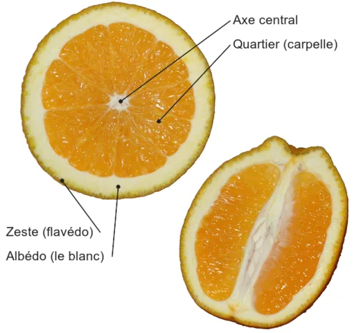

*Fig. B14 – Orange coupée en travers (à gauche) et en long (à droite). Photo Kjetil Lenes (Ekko), [Wikimedia Commons](https://commons.wikimedia.org/wiki/File:Perpendicular_orange.png), [CC BY 2.5](https://creativecommons.org/licenses/by/2.5/) ; modifiée : recadrée, réduite, légendes en français ajoutées.*

## Nourrir la plante

- Une plante a besoin d'environ **vingt éléments**. Les **macroéléments**, en grande quantité : carbone, hydrogène, oxygène, azote (N), phosphore (P), potassium (K), calcium (Ca), magnésium (Mg), soufre (S).
  Les **oligoéléments**, en très petite quantité : fer (Fe), manganèse (Mn), bore (B), molybdène (Mo), cuivre (Cu), zinc (Zn), chlore, nickel… (OpenStax p. 902-904, **une seule source**).
  Le classement « éléments secondaires » (Ca, Mg, S) des étiquettes d'engrais n'est pas dans ce manuel, qui les met avec les macroéléments.
- Un manque se voit par une pousse lente ou une **chlorose**, un jaunissement des feuilles (OpenStax p. 904, **une seule source**).
- **Éléments mobiles** : la plante les déplace vers ce qui pousse ; quand ils manquent, les **vieilles feuilles** jaunissent d'abord. Ce sont N, P, K, Mg, S (UF/IFAS HS1373).
  Pour le soufre, les sources ne s'accordent pas : HS1373 le classe parmi les mobiles (vieilles feuilles), d'autres le disent peu mobile (jeunes feuilles d'abord) ; le plugin ne propose pas de piste soufre (voir [Reconnaître une carence](fertilisation.md#reconnaître-une-carence)).
  Pour l'azote des agrumes : UF/IFAS SS420. Le nickel est mobile lui aussi (UF/IFAS SS618).
- **Éléments immobiles** : ils restent où ils sont ; le manque se voit d'abord sur les **jeunes pousses**. Ce sont Ca, Fe, Zn, Cu, Mn, B, Mo (UF/IFAS HS1373).
  Exception chez les agrumes : le manque de molybdène donne des taches jaunes (« yellow spot ») sur les **feuilles adultes** (UF/IFAS SS618, **une seule source**).
- Ces fiches viennent toutes de l'université de Floride : elles comptent pour **une seule source**. Les carences des agrumes, avec plusieurs sources, sont dans [Reconnaître une carence](fertilisation.md#reconnaître-une-carence).

## Les noms

- Les rangs vont du **règne** à l'**espèce** : embranchement, classe, ordre, famille, **genre**, espèce (OpenStax p. 514 ; Shipunov p. 20).
- Le nom d'une espèce a deux mots : le **genre**, avec une majuscule, puis l'**épithète**, en minuscule : *Citrus trifoliata* (anciennement *Poncirus trifoliata*) (Shipunov p. 23-24 ; OpenStax p. 514). Les deux s'écrivent en italique (OpenStax p. 514, **une seule source**).
- Un **hybride** se marque d'un signe × (Shipunov p. 24, **une seule source** ; exemple de Shipunov : *Prunus ×domestica*, le prunier).
- Un **cultivar** est une plante sélectionnée et nommée en culture (code international des plantes cultivées), à ne pas confondre avec la variété botanique (var.) ; c'est une catégorie sous l'espèce (Shipunov p. 23) ; OpenStax emploie aussi le mot (p. 929) ; il s'écrit entre guillemets simples (Shipunov p. 23, **une seule source**), par exemple *Citrus trifoliata* 'Flying Dragon'.
- Dans le plugin : champs « Nom botanique » et « Cultivar » de la fiche ; le nom est vérifié auprès de GBIF ([Mode d'emploi](index.md)).

## Multiplier

- **Multiplication sans graine** (asexuée) : les plants obtenus sont **identiques** au parent, des clones (OpenStax p. 940 ; Shipunov p. 58).
- Les méthodes du jardinier : **greffe**, **bouture**, **marcotte**, micropropagation (OpenStax p. 942, **une seule source**). Le champ « Multiplication » du plugin note semis, greffe, bouture, marcotte ou achat.
- **Greffe** : un **greffon** est fixé sur un **porte-greffe** enraciné ; leurs tissus conducteurs se soudent (OpenStax p. 942 ; Bailey 1907 p. 78).
  Les agrumes sont couramment greffés sur un porte-greffe choisi pour résister aux maladies (OpenStax p. 942, **une seule source**). Tout le détail : [Greffe](greffe.md).
- **Semis** : un pépin d'agrume peut donner un plant identique à la mère ; voir [Multiplier les agrumes](#multiplier-les-agrumes).

## Multiplier les agrumes

Quatre façons d'obtenir un agrume : semis, greffe, bouture, marcotte. Elles ne donnent pas le même plant :

| Méthode | Plant identique à la mère ? | Premiers fruits | Racines | Transmet les maladies de la mère ? |
|---|---|---|---|---|
| Semis | souvent (pépins à plusieurs embryons), jamais garanti | après des années | les siennes | presque jamais |
| Greffe | oui pour le greffon | plus tôt que le semis | celles du porte-greffe choisi | oui, si le greffon est malade |
| Bouture | oui | (pas de chiffre dans nos sources) | les siennes, sans pivot profond | oui, si la mère est malade |
| Marcotte aérienne | oui | moins de 12 mois (citronniers d'ornement) | les siennes | oui, si la mère est malade |

Détail et sources dans les paragraphes ci-dessous. Le tableau résume, il n'ajoute rien.

### Semis

- **Pépins à plusieurs embryons** (polyembryonnés) : chez beaucoup d'agrumes, un pépin contient en général un embryon issu de la fécondation et un ou plusieurs embryons **nucellaires**, formés à partir des tissus de la mère ; ceux-ci donnent des plants **identiques à la mère** (Curk 2022 p. 56 et lexique p. 345 ; UF/IFAS HS1309 p. 1-2 ; de Rocca Serra 1992 p. 119).
  Exception : le cédratier et le pamplemoussier (*C. maxima*) n'ont que des pépins à un seul embryon, donc des semis hybrides (de Rocca Serra 1992 p. 119 ; pépins « monoembryonnés » : Curk 2022 p. 190 et lexique) ; de même le clémentinier et certains hybrides de mandarinier (Aleza 2010 ; UC Riverside, fiche Clementine).
- Le plant issu de la fécondation est un **hybride**, différent de la mère et souvent moins vigoureux : en pépinière, on l'élimine au repiquage ou au greffage (UF/IFAS HS1309 p. 1-2 ; Curk 2022 p. 197-199 ; de Rocca Serra 1992 p. 119).
  Moins un pépin a d'embryons, plus ce risque est grand : en moyenne 1,1 à 1,5 embryon par pépin chez le citronnier Volkamer, 1,5 à 2 chez le Poncirus, 3 à 4 chez le bigaradier (principe : Curk 2022 p. 197 et de Rocca Serra 1992 p. 119 ; chiffres : Curk 2022 p. 197, **une seule source**).
  Un plant de semis peut aussi être un hybride, même chez une espèce à plusieurs embryons : c'est ainsi qu'est née la clémentine, dans un semis de pépins de mandarine (Curk 2022 p. 68, **une seule source**).
- **Germination hypogée** : chez les agrumes, les deux cotylédons, épais et charnus, restent dans le pépin, sous terre ; c'est la tige qui sort et porte les premières vraies feuilles (Hayward et Long 1942 p. 3 et 20 ; Citrus Academy, module 2 p. 7).
  La racine sort la première, par la pointe du pépin (Citrus Academy, module 2, **une seule source**) ; la tige monte ensuite, courbée en crosse tant qu'elle est sous terre (règle générale : OpenStax p. 937, **une seule source**).
  Les premières feuilles sont opposées, les suivantes alternes (Hayward et Long 1942 p. 22, **une seule source**).
  À l'inverse, chez le haricot, la germination est **épigée** : les cotylédons sont soulevés au-dessus du sol (Citrus Academy, module 2 p. 7, **une seule source**).
  Un même pépin peut donner **plusieurs plantules**, souvent deux à quatre (Hayward et Long 1942 p. 2 ; Citrus Academy, module 2) : les embryons se gênent dans le tégument, et l'un est en général plus grand et plus vigoureux que les autres (Hayward et Long 1942 p. 2, **une seule source**).
- **Phase juvénile** : un plant de semis, même nucellaire, porte des épines et fleurit tard (de Rocca Serra 1992 p. 119 ; Curk 2022 p. 187-188) ; il peut attendre des années avant ses premiers fruits (UF/IFAS HS1309).
  Selon le climat et l'espèce, 4 à 10 ans, plus longtemps en limite nord de culture comme la Corse ou la Ligurie (Curk 2022 p. 187-188, **une seule source**). Voir aussi [La tige et les bourgeons](#la-tige-et-les-bourgeons) pour les épines.
- **Plant sain** : la graine ne transmet presque jamais les maladies de la mère (de Rocca Serra 1992 p. 120 : « sauf rare exception » ; Curk 2022 p. 197 : aucune maladie de quarantaine démontrée).
  L'Union européenne restreint pourtant l'entrée de graines d'agrumes venant des zones où le HLB est présent (Curk 2022 p. 198, **une seule source**) ; à notre avis, ne pas rapporter de pépins de voyage.
- **Conserver** : graines sèches au froid, vers 4 à 10 °C (UF/IFAS HS1309 ; Curk 2022 p. 198 : environ 5 °C, plusieurs mois).
- **Semer** (UF/IFAS HS1309 p. 1-2, **une seule source** pour tout ce point) : rincer le fruit à l'eau de Javel diluée (20 %), nettoyer et sécher les pépins à l'abri du soleil ;
  semer à 0,6-1,3 cm de profondeur dans un terreau propre ; ôter le tégument ou faire tremper 8 h accélère la levée, qui vient en 2 à 3 semaines au chaud, au soleil et humide.
- Les porte-greffes sont d'ordinaire multipliés par semis (UF/IFAS HS1309 ; Curk 2022 p. 186 et 197) ; quand les pépins ne donnent surtout que des hybrides, par bouture ou in vitro (UF/IFAS HS1309 ; in vitro aussi Curk 2022 p. 199).

*Fig. B15 – A, pépin d'agrume ouvert : plusieurs embryons ; B, germination hypogée de l'agrume, le pépin reste sous terre ; C, germination épigée du haricot. Détail et sources sur le dessin. Dessin façon gravure coloriée pour ce plugin, MIT.*

### Greffe

- C'est la méthode la plus employée pour multiplier un agrume à l'identique (Curk 2022 p. 186 ; UF/IFAS HS1309 : un arbre du commerce est d'ordinaire un greffon sur un porte-greffe).
- Le greffon, pris sur un arbre adulte, fructifie **2 à 4 ans plus tôt** qu'un semis et évite ou réduit les grandes épines de la jeunesse, qui peuvent dépasser 10 cm (Curk 2022 p. 188, **une seule source**).
- Le porte-greffe apporte ses racines : sol, maladies du sol, froid, vigueur (UF/IFAS HS1309 ; Curk 2022 p. 187-190 ; froid : fiche INRAE-Cirad du Poncirus p. 3). Tout le détail : [Greffe](greffe.md).
- Le greffon transmet les maladies de l'arbre où il est pris : greffons sains indispensables (Curk 2022 p. 198 ; UF/IFAS HS1309 ; fiche INRAE-Cirad, sur le Poncirus et l'exocortis).

### Bouture

- Principe : un morceau de tige avec au moins un nœud, mis en terre humide, fait des racines (OpenStax p. 943 ; UF/IFAS HS1309 p. 5-6 pour les agrumes).
- Pour des porte-greffes (UF/IFAS HS1309 p. 5-6, **une seule source** pour la méthode) : bouture d'un seul nœud, de 2,5 cm environ, prise sur la partie déjà ligneuse (aoûtée) d'une pousse de 2 à 5 mois, d'une plante saine ; garder la feuille, réduite à 20-30 % de sa taille ;
  tremper la base dans une hormone de bouturage ; garder la bouture **à l'étouffée** (enceinte close ou brumisation) jusqu'aux racines, qui viennent en quelques semaines.
  Une mini-serre peut servir d'enceinte close (idée du plugin, non sourcée).
- Comme la greffe, la bouture et la marcotte transmettent les maladies de la plante mère : risque bien plus élevé que par la graine (Curk 2022 p. 198 ; boutures prises sur plantes saines certifiées : UF/IFAS HS1309).
- Limites : une bouture ne fait pas de pivot profond et s'ancre mal (Curk 2022 p. 186) ; la plupart des cultivars sur leurs propres racines craignent les *Phytophthora* (Curk 2022 p. 187 ; voir [Santé](sante.md)).
  En Corse, les cédratiers bouturés avaient des racines peu profondes et fragiles, au vent, au froid, aux nématodes et aux *Phytophthora* (Curk 2022 p. 95) : les deux constats viennent du même livre, **une seule source**.

### Marcotte

- **Marcotte** : une tige encore attachée à la mère fait des racines, puis on la sépare (OpenStax p. 943 ; Curk 2022, lexique p. 341).
- **Marcotte aérienne** : on retire un morceau d'écorce de la tige et on le couvre de mousse tenue par un film ; une fois les racines formées, on sépare cette partie et on la rempote (OpenStax p. 943 ; Bailey 1907 p. 40-41).
  Couramment, l'écorce est ôtée en anneau (Bailey 1907 p. 40) : c'est une [annelure](#sous-lécorce).
  Les racines partent au-dessus de l'anneau (Bailey 1907 p. 40, **une seule source**), là où s'arrêtent les sucres qui descendent (lien fait par le plugin).
- Pratiquée sur les citronniers d'ornement : plants qui portent des fruits en **moins de 12 mois** (Curk 2022 p. 188, **une seule source**). Racines propres, donc mêmes limites que la bouture (Curk 2022 p. 186-187).

*Fig. B16 – A, annelure : l'anneau ôté coupe le liber, pas le bois ; marcotte aérienne posée sur l'anneau, puis sevrée et rempotée. Détail et sources sur le dessin. Dessin façon gravure coloriée pour ce plugin, MIT.*

### Dans le plugin

- Champ « Multiplication » (semis, greffe, bouture, marcotte, achat) et sa date dans la fiche : l'âge est affiché ([Mode d'emploi](index.md#fiche-dune-plante)).
- Une plante semée, greffée, bouturée ou marcottée et datée compte comme **jeune** : rusticité diminuée les premières années, engrais réduit ([Mode d'emploi](index.md#configuration-du-plugin), [Fertilisation](fertilisation.md)).
  Un achat ou une plante sans date ne l'est pas.
  « Jeune » veut dire ici multipliée récemment : un greffon pris sur un arbre adulte n'a pas la phase juvénile d'un semis, mais le plant greffé reste fragile les premières années (lecture du plugin).
- Une greffe datée a son suivi (contrôles, température pour souder) : [Greffe](greffe.md).

## Sources

- **Shipunov 2021** : Shipunov A., *Introduction to Botany*, Minot State University, version du 7 juin 2021, 192 p., dédié au domaine public. Pages = pages du livre.
- **OpenStax 2018** : Clark M. A., Douglas M., Choi J., *Biology 2e*, OpenStax, Rice University, 2018 (impression 2026 lue), CC BY-NC-SA 4.0 (rien n'en est recopié), https://openstax.org/details/books/biology-2e. Pages = pages du livre.
- **Aleza 2010** : Aleza P., Juárez J., Ollitrault P., Navarro L., « Polyembryony in non-apomictic citrus genotypes », *Annals of Botany* 106:533-545 ([PMC2944972](https://pmc.ncbi.nlm.nih.gov/articles/PMC2944972/)).
- **UC Riverside, fiche Clementine** : University of California Riverside, Citrus Variety Collection, fiche *Clementine mandarin* (CRC 279), [citrusvariety.ucr.edu](https://citrusvariety.ucr.edu/) : pépins monoembryonnés.
- **Curk 2022** : Curk F., Luro F., Minuto G., Nieddu G., *Les agrumes du Nord de la Méditerranée*, Alain Piazzola, 2022, doi 10.17180/m6z4-d276, HAL hal-04646466. Pages = pages du livre (deux par page du PDF).
- **de Rocca Serra 1992** : de Rocca Serra D., Ollitrault P., « L'amélioration des agrumes : I - Les ressources génétiques », *Fruits*, numéro spécial Agrumes 1992, p. 115-123.
- **UF/IFAS HS1309** : Albrecht U., Zekri M., Williamson J., *Citrus Propagation*, UF/IFAS, 2017, revue en 2021 et 2024, doi 10.32473/edis-hs1309-2017.
- **Fiche INRAE-Cirad** : *Porte-greffe d’agrumes*, fiches techniques, Centre de ressources biologiques Citrus INRAE-Cirad, San Giuliano, d'après Jacquemond et al. 2013.
- **Atkinson 1905** : Atkinson G. F., *A College Text-book of Botany*, Henry Holt, 1905, Internet Archive collegetextbooko00atkiuoft (Biodiversity Heritage Library), domaine public.
- **Bailey 1907** : Bailey L. H., *The Nursery-Book*, 11ᵉ éd., Macmillan, 1907, Internet Archive cu31924097691087, domaine public.
- **UF/IFAS** (université de Floride), fiches EDIS : HS1373 *Movement of Plant Nutrients* (Vashisth T., Oswalt C., 2020, revue en 2025) ; SS420 *Macronutrient Deficiencies in Citrus* (2002, revue en 2024) ;
  SS618 *Molybdenum (Mo) and Nickel (Ni) for Citrus Trees* (2014, revue en 2025). https://edis.ifas.ufl.edu
- **Zhang et al. 2020** : Zhang F., Rossignol P., Huang T. et al. (dont Irish V. F.), *Reprogramming of Stem Cell Activity to Convert Thorns into Branches*, Current Biology 30(15), 2020, p. 2951-2961, doi 10.1016/j.cub.2020.05.068 (résumé).
- **Leichty et Sinha 2021** : Leichty A. R., Sinha N. R., *Plant development: How competing modes of growth coexist in close proximity*, Current Biology 31, 2021, p. R472-R474, doi 10.1016/j.cub.2021.03.073 (aucune figure reprise).
- **FoC 2008** : Zhang D., Mabberley D. J., *Citrus*, in *Flora of China* vol. 11 : 90-96, Science Press et Missouri Botanical Garden, 2008.
- **Morrow** : Morrow M., *A Photographic Atlas for Botany*, College of the Redwoods, LibreTexts, § 12.4 *Modified Shoots*, CC BY-NC 4.0 (lu seulement, rien n'en est repris).
- **Li et al. 2003** : Li C.-Y., Weiss D., Goldschmidt E. E., *Girdling affects carbohydrate-related gene expression in leaves, bark and roots of alternate-bearing citrus trees*, Annals of Botany 92(1), 2003, p. 137-143, doi 10.1093/aob/mcg108 (résumé).
- **IPGRI 1999** : IPGRI, *Descriptors for Citrus*, International Plant Genetic Resources Institute, Rome, 1999 (descripteurs 7.2.9 à 7.2.11, p. 32-33).
- **Sadka et al. 2019** : Sadka A., Shlizerman L., Kamara I., Blumwald E., *Primary Metabolism in Citrus Fruit as Affected by Its Unique Structure*, Frontiers in Plant Science 10:1167, 2019, doi 10.3389/fpls.2019.01167, CC BY.
- **Honsho 2023** : Honsho C., *Self-incompatibility Related to Seedless Fruit Production in Citrus Plants*, The Horticulture Journal 92(1), 2023, p. 1-12, doi 10.2503/hortj.QH-R001 (accès libre, droits réservés : rien n'en est recopié).
- **Hayward et Long 1942** : Hayward H. E., Long E. M., *The Anatomy of the Seedling and Roots of the Valencia Orange*, USDA Technical Bulletin 786, 1942, domaine public (gouvernement des États-Unis).
- **Citrus Academy** : *Citrus Nursery Workers Learning Programme*, Learner Guide Module 2, *Rootstock Propagation*, Citrus Academy (Afrique du Sud), citrusresourcewarehouse.org.za, vers 2016.
- **Ballve et al. 1997** : Ballve R. M. L., Medina-Filho H. P., Bordignon R., *Identification of reciprocal hybrids in citrus by the broadness of the leaf petiole wing*, Brazilian Journal of Genetics 20(4), 1997, doi 10.1590/S0100-84551997000400023 (texte seul, aucune figure reprise).
- **Wikipédia** (CC BY-SA), articles lus le 2 novembre 2026 : « Collet (botanique) », « Débourrement », « Nouaison », « Hespéride », « Citrus », « Annélation » (français), « Parthénocarpie » (français, lu le 3 novembre 2026) ; « Hesperidium », « Citrus », « Girdling » (anglais).
- **Images** : Atkinson 1905 ; Rendle A. B., Encyclopædia Britannica 11ᵉ éd., 1911 ; Köhler F. E., *Köhler's Medizinal-Pflanzen*, 1897 ; photo Kjetil Lenes (CC BY 2.5). Détail dans `docs/images/LICENCES.md`.
