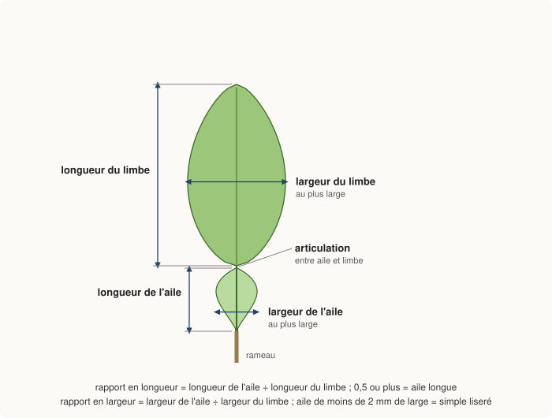
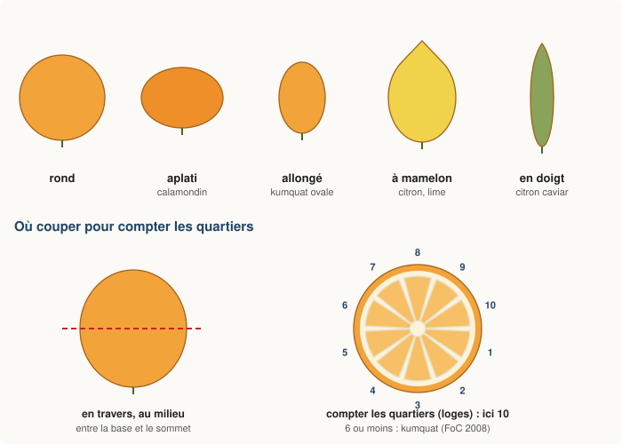
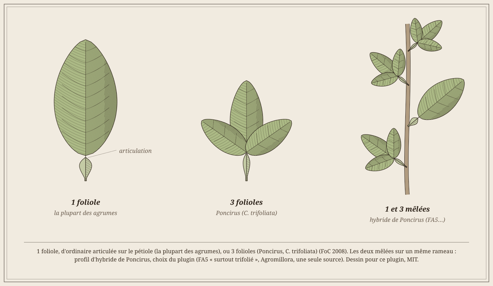
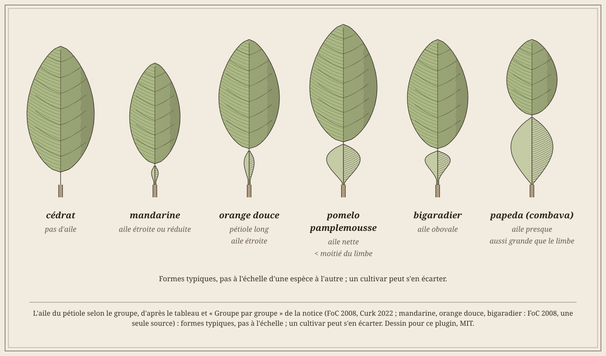

# Identification des agrumes

Reconnaître le **groupe** d'un agrume : Poncirus, hybride de Poncirus (citrange, citrumelo, FA5), kumquat, calamondin, citron caviar, yuzu, papeda, cédrat, citron, lime, mandarine, orange douce, bigaradier (bergamote comprise) ou pomelo (*C. ×paradisi*) et pamplemousse (*C. maxima*).
Le plugin donne des **pistes**, jamais le cultivar. Les agrumes se croisent facilement entre espèces (Curk 2022).
Beaucoup se multiplient aussi par leurs graines à l'identique (Curk 2022, UF/IFAS HS1309).
Aussi la Flora of China juge-t-elle impossible une clé qui couvre toutes les plantes (FoC 2008, **une seule source**).
Un hybride, en particulier, ne se reconnaît souvent avec certitude que par l'ADN, en laboratoire (déduction du plugin).

Règle suivie : un fait n'est retenu que si **deux sources indépendantes** le donnent. Sinon, il est marqué **une seule source**.
Les sources sont nommées entre parenthèses ; les références complètes sont à la fin ([Sources](#sources)).
Ce qui vient du plugin lui-même (choix, seuil, déduction) est écrit comme tel.

## Dans le plugin

### La clé des caractères
- **Fiche**, partie **Identification** : pour chaque caractère, choisir ce qu'on voit. Laisser « non observé » le reste, puis enregistrer.
  Les choix proposés sont inspirés des descripteurs de l'IPGRI et de l'UPOV (IPGRI 1999, UPOV TG/83).
- Le plugin compare ces choix aux profils des 14 groupes. Il classe les groupes : d'abord le moins de désaccords, puis le plus d'accords.
  Il affiche les trois premiers, avec les caractères d'accord et ceux qui contredisent.
- « **Probable** » : un seul groupe sans aucun désaccord, avec au moins 3 accords, et tous les autres contredits. Sinon : « **Indécis** entre … ».
- Un caractère absent du profil d'un groupe ne compte ni pour ni contre lui (choix du plugin).
- Jeunes rameaux poilus : comptent **pour** le groupe pomelo-pamplemousse (poils du pamplemousse, *C. maxima*) et le yuzu ; des rameaux glabres (sans poils) ne les excluent pas (choix du plugin, voir [Reconnaître](#reconnaître--du-caractère-au-groupe)).
- **Mesures**, organe **Feuilles** : la longueur et la largeur du limbe (la partie plate de la feuille) et de l'aile donnent l'aile, sa largeur et la longueur de la feuille.
  Organe **Fruit** : le diamètre moyen donne la taille du fruit (sauf fruit en doigt ou en main).
  Un caractère vide est rempli d'office. S'il était déjà saisi autrement, le journal note « saisi … mesuré … » et rien n'est changé.
- Seuils du plugin : aile de moins de 2 mm de large = « aucune ou simple liseré ». Sinon, **longueur** de l'aile rapportée à celle du limbe : moins d'un quart = courte, moins de la moitié = moyenne, la moitié ou plus = longue.
  Exemple : limbe de 8 × 4 cm, aile de 3 × 1,5 cm → longueur 3/8, moins de la moitié = « moyenne » ; largeur 1,5/4, moins de la moitié.
  **Largeur** de l'aile rapportée à celle du limbe : moins de ½, de ½ à ¾, ¾ ou plus (« presque aussi large »).
  La longueur de la feuille est celle du **limbe** (d'une foliole chez le Poncirus), sans le pétiole : moins de 5 cm, 5 à 10 cm, plus de 10 cm.

*Fig. I1 – Mesurer l'aile et le limbe : chaque longueur se prend le long de la nervure, chaque largeur au plus large (choix du plugin). Seuils du plugin : aile longue à partir de la moitié du limbe, simple liseré sous 2 mm de large ; aile presque aussi large que le limbe à partir des ¾ de sa largeur. Schéma dessiné pour ce plugin, MIT.*

- La pulpe se décrit en deux caractères : **Saveur** (douce, acide, amère) et **Aspect** (en vésicules, la normale ; en perles, le citron caviar ; presque absente, peau très épaisse).

### Le bouton Identifier
- En bas de la fiche (administrateurs) : « **Identifier…** ». La fenêtre réunit les photos, le nom botanique, la clé et des **propositions**.
- Photos : Pl@ntNet sur des photos déjà dans la fiche ou de nouvelles, une à cinq, avec l'organe de chaque photo ([Pl@ntNet](#plntnet)). « Retenir » une espèce la reporte dans le nom botanique.
- La clé est cochée d'après la fiche ; le groupe probable se met à jour à chaque choix.
- Tableau des propositions : champ, valeur actuelle, valeur proposée, source (score Pl@ntNet, nom botanique ou caractères). **Rien n'est coché d'office.**
- **Appliquer** écrit seulement les lignes cochées et note une observation « Identification » au journal (avant → après).
- « **＋ Plante** » propose les mêmes outils à la création d'une plante.

### Rusticité estimée
- Le plugin estime une rusticité à partir du **nom botanique** d'abord (mots reconnus : *citrange*, *citrumelo*, *×poncirus*, *trifoliata*, *japonica*, *junos*, *hystrix*, *medica*, *bergamia*, *limon*, *reticulata*, *sinensis*, *maxima*…).
  *Poncirus* ou *trifoliata* seul = Poncirus ; dans un croisement (« Citrus trifoliata × C. reticulata », « … × Poncirus ») = hybride de Poncirus.
  *limon* reconnaît aussi *×limonia* (lime Rangpur), rangée alors en citron (choix du plugin).
  Sans nom reconnu, il prend tous les groupes non contredits par les caractères et retient **le moins rustique** (choix prudent du plugin).
- Sans nom reconnu ni aucun caractère observé, pas d'estimation.
- Dans « Identifier… », elle est proposée « −3 (estimée) » si elle diffère de la fiche.
  Pour l'appliquer, il faut cocher aussi le nom ou les caractères dont elle découle ; sinon un message le demande.
- Une fiche sans rusticité utilise l'estimation pour les alertes de gel.
- Valeurs du plugin : la moins froide de ses sources quand il y en a, sinon déduite (choix du plugin).

| Groupe | Rusticité estimée | D'où vient la valeur |
|---|---|---|
| Poncirus | −15 °C | TyCitriK −16 (**une seule source**) ; −15 par prudence (choix du plugin) |
| Hybride de Poncirus | −10 °C | Chopinet et Dupouy 1951, de seconde main : citranges de Montauban −10 à −14 (André 1905, cité par Chopinet et Dupouy), satsumange −11 à −13 (Guillaumin), citrangedins et limonanges ≈ −10 (Kains, Guillaumin), citrangequat Thomasville −10 ; citranges Rusk et Willits sensibles aux coups de froid brusques. TyCitriK : C35 −10, Carrizo −11, citrumelo −12, FA5 −13 (commercial). −10 = la moins froide des deux |
| Kumquat | −6 °C | TyCitriK −10, UF/IFAS HS-123 −12, UF/IFAS 2001 ≈ −6,7 (feuilles), Fortune 1870 cité par Swingle « 10-15 °F de gel » = −5,6 à −8,3 ; −6 = choix du plugin, entre −5,6 et −6,7 |
| Citron | −5 °C | TyCitriK −5, Blondel 1986 −5/−6 |
| Yuzu | −5 °C | RHS −5 contre TyCitriK −14 (le plus prudent gardé) |
| Calamondin | −5 °C | TyCitriK, **une seule source** |
| Mandarine, orange douce, bigaradier, pomelo (*C. ×paradisi*), pamplemousse (*C. maxima*) | −5 °C | TyCitriK (noms du pépiniériste, sans nom latin) : mandarinier −6, clémentinier −7, satsuma −10, oranger −7, pamplemoussier −6, pomelo −7, bigaradier −9 ; satsuma ≈ −9,4 (UF/IFAS HS-123). −5 est un choix du plugin, plus prudent que ces valeurs (l'ordre de HS-123 le place entre calamondin et citron) ; le satsuma est donc sous-estimé |
| Lime | −3 °C | TyCitriK −4 ; UF/IFAS CH093 : bois abîmé dès −3 °C, mort sous −4 °C (lime de Tahiti) ; la lime vraie (Key lime), réputée plus frileuse encore, n’a pas de valeur sourcée ici |
| Citron caviar, papeda | −4 °C | TyCitriK, **une seule source** ; papeda −4 = combava ; l'ichang (TyCitriK −11 pour l'Ichang lemon) est pris à la même valeur par prudence (choix du plugin) |
| Bergamote | −5 °C | rangée en bigaradier (TyCitriK −5) |
| Cédrat | −3 °C | TyCitriK −3, Guo 2009 −4/−5 (feuilles) |

Ce tableau vaut pour une plante adulte en pleine terre ; le plugin ajoute les pénalités du pot et de jeunesse ([Configuration du plugin](index.md#configuration-du-plugin)).
Le limequat est rangé en lime (−3), plus prudent que TyCitriK (−6).

## Bien observer

### Quelle feuille
- Observer des **feuilles adultes, complètement développées** (IPGRI 1999, UPOV TG/83).
- Les prendre au **tiers moyen** de la dernière pousse de printemps qui a fini de pousser (UPOV TG/83, écrit pour le Poncirus et ses hybrides, appliqué ici aux autres agrumes par le plugin ; **une seule source**).
- La couleur des **jeunes feuilles** se regarde sur la pousse de printemps en pleine croissance (UPOV TG/83, **une seule source**).
- Éviter les **gourmands** : les épines y sont plus fréquentes et plus longues (Curk 2022, chez l'oranger) ; les jeunes pousses du kumquat portent des épines jusqu'à 5 cm, contre quelques millimètres sur les rameaux à fleurs (FoC 2008).
  Le plugin n'utilise pas les épines.
- **Folioles** : compter sur plusieurs feuilles adultes. Chez le Poncirus, les feuilles des jeunes plants sont **le plus souvent simples ou à une foliole** (FoC 2008, **une seule source**) : sur un semis, « 1 foliole » peut donc contredire à tort le Poncirus (déduction du plugin).
- **Aile** : c'est la partie élargie du pétiole, entre la tige et le limbe. Mesurer sa longueur et sa plus grande largeur, puis celles du limbe : la saisie dans **Mesures** fait le calcul.
- **Jeunes rameaux** : les regarder **à la loupe**, sur la pousse de l'année ; les poils sont fins (choix du plugin).
- **Mots des flores** : elliptique, obovale, émarginé, crénelé… sont expliqués dans [La feuille](guide.md#la-feuille) (onglet Botanique).

### Fleurs et fruits
- Fleurs : observer le bouton terminal, en pleine floraison ; la fleur ouverte, le premier jour (UPOV TG/83, **une seule source**).
- Fruits : à maturité, cueillis à l'extérieur de l'arbre, pas déformés (UPOV TG/83, **une seule source**).
- La peau s'observe au milieu du fruit, entre la base et le sommet ; la pulpe et les **quartiers (loges)** sur une coupe **en travers**, au milieu (UPOV TG/83, **une seule source**).

*Fig. I2 – Formes de fruit (exemples du tableau ci-dessous ; calamondin aplati : FRPS 1997, **une seule source**, voir « Groupe par groupe ») et coupe en travers pour compter les quartiers : 6 ou moins orientent vers le kumquat (FoC 2008, **une seule source**). Schéma dessiné pour ce plugin, MIT.*

- Couleur du fruit : à maturité seulement. La lime de Tahiti, par exemple, reste vert vif jusqu'à maturité puis devient jaune pâle (Morton 1987, site Purdue, **une seule source**).

### Pièges
- **Jeunesse** : un agrume issu de semis a une phase juvénile de 4 à 10 ans, sans fruit, souvent avec de grandes épines, qui peuvent dépasser 10 cm ; le greffage réduit ce caractère juvénile (Curk 2022, **une seule source**).
  Sur un jeune semis, seuls les caractères de la feuille et des rameaux sont disponibles : le résultat reste souvent « Indécis » (déduction du plugin).
- **Variabilité** : un caractère typique n'est pas présent chez tous les cultivars. La majorité des cédratiers ont des fleurs et des jeunes pousses violacées, mais pas le cédrat de Corse, dont la pulpe est en plus douce (Curk 2022).
- **Porte-greffe qui repart** : une branche à 3 folioles sous le point de greffe vient du porte-greffe, pas de la plante ([Porte-greffes et rejets](#porte-greffes-et-rejets)).
- **Semis** : beaucoup d'agrumes ont des graines à plusieurs embryons, dont des embryons « nucellaires » qui donnent des plants identiques à la mère (Curk 2022, UF/IFAS HS1309). Un plant issu de l'embryon fécondé, lui, est un hybride différent (UF/IFAS HS1309, **une seule source** pour le détail).

## Reconnaître : du caractère au groupe

*Fig. I3 – 1 foliole, d'ordinaire articulée sur le pétiole (la plupart des agrumes), ou 3 folioles (Poncirus, *C. trifoliata*) (FoC 2008). Les deux mêlées sur un même rameau : profil d'hybride de Poncirus, choix du plugin (FA5 « surtout trifolié », Agromillora, **une seule source**). Schéma dessiné pour ce plugin, MIT.*

*Fig. I4 – L'aile du pétiole selon le groupe, d'après le tableau ci-dessous et « Groupe par groupe » (FoC 2008, Curk 2022 ; mandarine, orange douce, bigaradier : FoC 2008, **une seule source**) : formes typiques, pas à l'échelle ; un cultivar peut s'en écarter. Schéma dessiné pour ce plugin, MIT.*

Les groupes de la colonne du milieu sont ceux du plugin. La colonne de droite dit ce que les sources en disent.

| Caractère observé | Groupes concernés (plugin) | Sources |
|---|---|---|
| feuillage qui tombe l'hiver | Poncirus, hybrides de Poncirus | Poncirus caduc (FoC 2008, UF/IFAS HS982) ; FA5 caduc (Agromillora, fiche commerciale) |
| 3 folioles | Poncirus, hybrides de Poncirus | Poncirus et porte-greffes issus du Poncirus à 3 folioles (FoC 2008, UF/IFAS HS982) |
| 1 et 3 folioles mélangées | hybrides de Poncirus | FA5 « surtout trifolié » (Agromillora, **une seule source**, commerciale) |
| aile longue : la moitié du limbe ou plus | papeda (combava, ichang) ; un yuzu peut l'atteindre (aile de 1 à 2,5 cm, FoC 2008), il est alors contredit à tort | aile « bien plus » que la moitié de la longueur du limbe (FoC 2008) ; aile presque aussi grande que le limbe (Curk 2022) ; combava, l'aile la plus large (Sofiyanti 2022) |
| aile presque aussi large que le limbe | papeda | combava : limbe 0,5 à 1 cm plus large que l'aile (FoC 2008, Sofiyanti 2022) |
| aile nette, moins de la moitié du limbe, bien plus étroite que lui | pomelo (*C. ×paradisi*), pamplemousse (*C. maxima*) | pamplemousse *C. maxima* : aile 2-4 × 0,5-3 cm, limbe 9-16 × 4-8 cm (FoC 2008) ; aile moyenne ou étroite, bien plus petite que le limbe (Sofiyanti 2022) |
| pas d'aile | cédrat (aussi possible : citron, lime, mandarine…) | cédrat : pétiole sans aile (FoC 2008, **une seule source**) |
| boutons et jeunes pousses teintés de pourpre ou de rose | cédrat, citron, lime ; acceptés aussi pour le pomelo et le pamplemousse, la papeda, l'orange douce et le yuzu (boutons blancs acceptés aussi pour le cédrat de Corse) | cédrat (FoC 2008, Curk 2022) ; citron (FoC 2008, **une seule source**) ; lime de Tahiti « légèrement violacée » (Purdue, **une seule source**) ; pétales rarement violacés chez l'orange douce, parfois chez le yuzu, aussi rosés chez le combava (FoC 2008, **une seule source**) |
| fruit allongé ou à mamelon | citron, cédrat, kumquat ovale, lime, orange douce, bigaradier | citron (FoC 2008) ; lime de Tahiti, court mamelon (Purdue) |
| fruit de plus de 10 cm | pomelo (*C. ×paradisi*), pamplemousse (*C. maxima*), cédrat, orange douce (la FoC dit l'orange « jusqu'à 10 cm » : choix du plugin) | pamplemousse *C. maxima*, en général plus de 10 cm (FoC 2008, **une seule source**) |
| fruit en doigt allongé | citron caviar | fruit cylindrique et fuselé (Mabberley 1998, **une seule source**) |
| peau sucrée, qui se mange | kumquat | (FoC 2008, Curk 2022) |
| peau qui se détache facilement | mandarine, calamondin, yuzu | mandarine et yuzu (FoC 2008, **une seule source**) |
| peau plus épaisse que la pulpe | cédrat, papeda | cédrat (FoC 2008, **une seule source**) ; papeda : choix du plugin ; le plugin le demande sous Aspect de la pulpe : « presque absente (peau très épaisse) » |
| peau duveteuse | Poncirus, hybrides | Poncirus : fruit duveteux comme une pêche (Wikipedia, **une seule source**) ; hybrides : choix du plugin ; peau rugueuse acceptée aussi (le FA5 a une peau épaisse un peu rugueuse, Agromillora, **une seule source**) |
| jeunes rameaux poilus (loupe) | pomelo et pamplemousse, yuzu | pamplemousse *C. maxima* (FoC 2008) ; yuzu, peu poilu (FoC 2008) ; **une seule source** |
| jeunes rameaux glabres | orange douce, bigaradier | (FoC 2008, **une seule source**) ; le pomelo *C. ×paradisi* (grapefruit) a des rameaux glabres (FoC 2008) : ne pas exclure le groupe pomelo-pamplemousse |
| 6 quartiers ou moins | kumquat | 3 à 6 loges (FoC 2008, **une seule source**) |
| aspect de la pulpe : en perles | citron caviar | choix du plugin, aucune source lue |

### Groupe par groupe
- **Poncirus** : feuilles caduques à 3 folioles, rarement 5 ; rameaux verts aplatis ; épines d'environ 4 cm ; fleurs blanches (FoC 2008, Wikipedia).
  Fruit rond, plein de graines, non comestible (UF/IFAS HS982, Wikipedia), de la taille d'une balle de golf (UF/IFAS HS982, **une seule source**).
  Le Flying Dragon a des tiges tordues et des épines plus fortes, recourbées (Wikipedia, **une seule source**).
- **Hybride de Poncirus** (citrange, citrumelo, FA5) : feuilles à 3 folioles comme le Poncirus (UF/IFAS HS982). Le FA5 est un croisement mandarinier Cléopâtre × Poncirus (Agromillora, **une seule source**).
  Le plugin accepte feuillage persistant ou caduc, 3 folioles ou mélange.
- **Kumquat** : kumquats cultivés à feuilles de 4 à 11 cm, aile étroite ; fruit de 1,5 à 3,5 cm (FoC 2008, **une seule source**). Fruit mangé avec la peau (FoC 2008, Curk 2022).
- **Calamondin** : hybride de kumquat et d'un *Citrus* (Curk 2022 : il « découlerait d'un croisement entre un *Citrus* et un *Fortunella* » ; FoC 2008).
  Que l'autre parent soit une mandarine (acide) : FoC 2008, Mabberley 1998 et FRPS 1997, une même lignée, donc **une seule source** (la Flora of China est la version anglaise révisée du 中国植物志, et Mabberley son coauteur).
  Fruit aplati de 3 à 4 cm de large, orange foncé à orange-rouge, peau qui s'enlève facilement, 8 à 9 quartiers, pulpe très acide ; fleurs et fruits toute l'année (FRPS 1997, p. 175, **une seule source**). Le plugin attend un petit fruit orange, acide, facile à éplucher, et beaucoup de quartiers.
- **Citron caviar** : feuilles de 1,5 à 6 cm, parfois 9, et épines isolées, comme les autres limes australiennes ; fruit cylindrique et fuselé, propre à l'espèce (Mabberley 1998, **une seule source**).
- **Yuzu** : jeunes rameaux et feuilles peu poilus ; aile de 1 à 2,5 cm ; fruit de 4 à 8 cm, peau rugueuse qui s'enlève, pulpe très acide et amère (FoC 2008, **une seule source**).
  Pétales parfois violacés au dos (FoC 2008, **une seule source**) : le plugin accepte des boutons blancs ou teintés de pourpre ou de rose.
- **Papeda** (combava, ichang) : aile presque aussi grande que le limbe, la feuille paraît « double » (FoC 2008, Curk 2022, Sofiyanti 2022).
  L'ichang a des boutons violet pâle (FoC 2008, **une seule source**) : le plugin accepte des boutons blancs ou teintés de pourpre ou de rose.
- **Cédrat** : pétiole sans aile, feuille de 6 à 12 cm, gros fruit à peau épaisse ; la main de Bouddha en est un cultivar (FoC 2008). Boutons et jeunes pousses violacés chez la majorité (FoC 2008, Curk 2022). Le plugin accepte aussi une pulpe douce, pour le cédrat de Corse (choix du plugin, d'après Curk 2022).
- **Citron** : jeunes feuilles et boutons teintés de pourpre ou de rose ; fruit à mamelon, peau difficile à enlever (FoC 2008, **une seule source**).
- **Lime** : fruit de 4 à 6 cm à petit mamelon, vert puis jaune pâle (FoC 2008, Purdue). Fleurs blanches (FoC 2008) ou légèrement violacées pour la lime de Tahiti (Purdue) : le plugin accepte les deux.
- **Mandarine** : peu d'épines, aile étroite ou réduite, peau qui s'enlève facilement, 7 à 14 quartiers (FoC 2008, **une seule source**).
- **Orange douce** : pétiole long et étroit, fleurs blanches, rarement violacées, 9 à 12 quartiers (FoC 2008, **une seule source**). Le plugin accepte des boutons blancs ou teintés de pourpre ou de rose.
  Conséquence : des boutons teintés de pourpre ou de rose ne séparent plus le citron du yuzu, ni le cédrat de l'orange douce ; l'épluchage, la couleur ou la forme du fruit tranchent (déduction du plugin).
- **Bigaradier** : épines jusqu'à 8 cm, aile du pétiole obovale, en œuf renversé (FoC 2008, **une seule source**). Le plugin y range la **bergamote** (choix du plugin) ; la Flora of China la classe sous le citron.
  Le plugin n'accepte que des boutons blancs, sans source (la FoC dit « blancs ou violacés » pour *C. ×aurantium* au sens large).
  Le nom *C. ×aurantium* est rangé ici, alors que dans la FoC il englobe aussi l'orange douce et le pomelo *C. ×paradisi* (choix du plugin).
- **Pomelo** (*C. ×paradisi*) **et pamplemousse** (*C. maxima*) : GBIF/WCVP 2026 rangent *C. ×paradisi* sous *C. ×aurantium* (voir « Noms des plantes », paradisi) ; le plugin garde le nom d'usage *C. ×paradisi* (choix du plugin). La FoC appelle « pomelo » le *C. maxima* et « grapefruit » le *C. ×paradisi*. Pamplemousse : jeunes rameaux et dessous des feuilles poilus (rameaux glabres chez le pomelo) ; aile large en largeur (0,5 à 3 cm) mais moins longue que la moitié du limbe ; fruit en général de plus de 10 cm, 10 à 15 quartiers (FoC 2008, **une seule source**).
  Ses boutons sont violacés ou rarement blancs (FoC 2008, **une seule source**) : le plugin accepte les deux ; des boutons teintés de pourpre ou de rose ne séparent donc pas ce groupe du citron, c'est la taille du fruit qui tranche.

## Porte-greffes et rejets
- Les porte-greffes issus du Poncirus (citranges, citrumelos) ont, comme lui, des feuilles à **3 folioles** (UF/IFAS HS982, Agromillora).
- Les pousses du porte-greffe se forment le long du tronc, surtout près du point de greffe ; elles sont à supprimer dès qu'elles apparaissent (UF/IFAS HS1309). Sur un agrume à une foliole greffé sur Poncirus ou un hybride de Poncirus (citrange, citrumelo, FA5), une branche à 3 folioles est donc un rejet (déduction du plugin).
- Des **rejets nombreux** près de la greffe peuvent signaler une incompatibilité entre porte-greffe et greffon (Curk 2022, NSW DPI).
  Un pli au point de greffe, ou un porte-greffe qui grossit plus que le greffon, aussi (NSW DPI, **une seule source**).
  Mais sur Poncirus, un tronc en goulot de bouteille autour de la greffe est normal et sans danger (Curk 2022).
  Ses fentes d'écorce laissent toutefois entrer les spores de Phytophthora chez une variété sensible : Curk conseille un point de greffe à 40 cm au moins au-dessus du sol, contre les éclaboussures (Curk 2022 p. 195, **une seule source**).

*Fig. I5 – Rejet à 3 folioles né sous le point de greffe, à couper (UF/IFAS HS1309) ; goulot de bouteille autour de la greffe, normal sur Poncirus avec la plupart des variétés, sans dépérissement ; ses fentes d'écorce laissent entrer les spores de Phytophthora chez une variété sensible, d'où une greffe à 40 cm au moins du sol (Curk 2022 p. 195, **une seule source**). Schéma dessiné pour ce plugin, MIT.*

- Les pucerons installés sur les rejets du porte-greffe font craindre la tristeza (INRAE-Cirad, fiche technique porte-greffe, **une seule source**).
- Distinguer un **Poncirus** d'un **hybride de Poncirus** par la seule feuille : le plugin reste souvent « Indécis ». Le feuillage persistant ou un mélange de 1 et 3 folioles orientent vers l'hybride (choix du plugin).
- Quand un œil du greffon a débourré (après « **Greffer…** »), les caractères du porte-greffe sont remplacés par ceux saisis pour le greffon (vides sinon) : la clé doit décrire le greffon, pas le porte-greffe (choix du plugin).

## Pl@ntNet
- Service en ligne d'identification par photo. Le plugin l'interroge avec la clé personnelle enregistrée sur la box ; 500 identifications par jour avec l'offre gratuite.
- Limites du plugin (et non de Pl@ntNet) : une à cinq photos par demande, au format JPEG, PNG ou WebP, 15 Mo au plus par photo et 40 Mo au total. Pour chaque photo, indiquer l'organe : feuille, fleur, fruit, écorce ou automatique.
- Pl@ntNet renvoie les cinq espèces les plus proches, avec un score en %. « Aucune espèce reconnue » s'il ne trouve rien.
- Le nom retenu est vérifié dans le référentiel GBIF à l'enregistrement.
- Limites (déduction du plugin, aucune documentation de Pl@ntNet lue) : Pl@ntNet propose des **espèces** ; il ne reconnaît pas un cultivar, un porte-greffe ni un hybride récent (citrange, FA5). Un score faible ou cinq propositions proches se lisent comme un « Indécis ».
  Le mieux est de croiser sa réponse avec la clé : si les deux disent le même groupe, la piste est solide.

## Limites
- Le plugin donne un **groupe**, jamais un cultivar. Les hybrides et les plantes multipliées à l'identique brouillent les limites (FoC 2008, Curk 2022).
- Les profils sont recoupés surtout avec la Flora of China. Beaucoup de caractères n'ont qu'une source ([tableau](#reconnaître--du-caractère-au-groupe)) ; les protocoles UPOV complets et la clé de Swingle et Reece (1967) n'ont pas été relus.
- Écarts connus entre les sources et les profils du plugin :
  bergamote rangée en bigaradier par le plugin, sous le citron dans la Flora of China ;
  fruit duveteux du Poncirus attendu par le plugin, mais absent de la Flora of China (qui cite seulement un ovaire poilu) ;
  seuil du papeda : « bien plus que la moitié » (FoC 2008), la moitié ou plus pour le plugin, comme la clé du 中国植物志 (« au moins la moitié », FRPS 1997, même lignée que la FoC).
- La couleur des cotylédons (les deux premières feuilles de la graine, visibles quand on l'ouvre), verte ou blanc laiteux, sert dans la clé de la Flora of China.
  Ses propres descriptions (pamplemousse *C. maxima*, citron, bigaradier) contredisent sa clé : le plugin ne l'utilise pas.
- Le plugin n'utilise ni les épines, ni l'odeur de la feuille froissée, ni les graines.

## Erreurs à éviter
- Observer une feuille de **gourmand** ou de **jeune semis** : épines et feuilles y sont juvéniles ([Bien observer](#bien-observer)).
- Prendre un **rejet** du porte-greffe pour la plante ([Porte-greffes et rejets](#porte-greffes-et-rejets)).
- Cocher par habitude : laisser « non observé » ce qui n'a pas été vu. Un mauvais choix contredit le bon groupe.
- Juger la couleur ou le goût d'un fruit **pas mûr**.
- Lire « Probable » comme une certitude : c'est un groupe compatible avec ce qui a été coché, rien de plus.
- Appliquer une rusticité « estimée » sans regarder d'où elle vient (nom ou caractères).

## Sources
Lues en entier ou sur les passages utiles. Deux sources du même organisme ne comptent que pour une : Mabberley est coauteur de la Flora of China ; la fiche du CPVO reprend le texte de l'UPOV.
Non relus : les clés KeyBase (pages vides), la clé de Swingle et Reece 1967 (en ligne seulement ; seule la citation de Fortune sur le kumquat est reprise) et la documentation de Pl@ntNet.
- **Agromillora** : Agromillora, fiche commerciale « Forner-Alcaide 5 » (porte-greffe FA5), agromillora.com.
- **Blondel 1986** : Blondel L. et al., citronnier en Corse, *Fruits* 41(10), 1986 (INRA Corse).
- **Chopinet et Dupouy 1951** : Chopinet R., Dupouy J., Résistance au froid de certains citrus et de leurs hybrides, *Fruits* 6(4), 1951 (reprend Kains 1945 et Guillaumin pour les citrangedins et limonanges).
- **Curk 2022** : Curk F., Luro F., Minuto G., Nieddu G., *Les agrumes du Nord de la Méditerranée*, Alain Piazzola, 2022, doi 10.17180/m6z4-d276, https://hal.inrae.fr/hal-04646466
- **FoC 2008** : Zhang D., Mabberley D. J., *Citrus*, in *Flora of China* vol. 11 : 90-96, Science Press et Missouri Botanical Garden, 2008.
- **FRPS 1997** : 中国植物志 (*Flora Reipublicae Popularis Sinicae*), vol. 43(2), Rutacées, p. 175-178 (calamondin, genre *Citrus*, clé des espèces), Science Press, 1997 ; relu sur le scan le 2026-11-02.
- **Guo 2009** : Guo et al., *Acta Horticulturae Sinica* 36(1) : 81, 2009 (résumé seulement).
- **INRAE-Cirad, fiche technique porte-greffe** : INRAE-Cirad, fiche technique sur les porte-greffes des agrumes (même organisme que Curk 2022).
- **IPGRI 1999** : IPGRI, *Descriptors for Citrus*, International Plant Genetic Resources Institute, Rome, 1999.
- **Mabberley 1998** : Mabberley D. J., Australian Citreae with notes on other Aurantioideae (Rutaceae), *Telopea* 7(4) : 333-344, 1998.
- **NSW DPI** : NSW Department of Primary Industries, *Selecting citrus rootstocks*.
- **Purdue** : Morton J., Tahiti lime, in *Fruits of Warm Climates*, 1987, site de l'université Purdue (hort.purdue.edu).
- **RHS** : Royal Horticultural Society, fiche *Citrus × junos* (rusticité H3), rhs.org.uk.
- **Sofiyanti 2022** : Sofiyanti N., Iriani D., Wahyuni P. I., Idani N., Lestari P., Identification, morphology of *Citrus* L. and its traditional uses in Riau Province, Indonesia, *Biodiversitas* 23(2) : 1038-1047, 2022, doi 10.13057/biodiv/d230247.
- **Swingle et Reece 1967** : *The Citrus Industry* vol. 1, chap. 3 (citation de Fortune 1870 sur le kumquat).
- **TyCitriK 2023** : tableau des rusticités par porte-greffe et par cultivar, et fiche FA5 (pépiniériste, commercial).
- **UF/IFAS 2001** : Zekri M., *Citrus Industry Agents* (bulletin), décembre 2001, University of Florida IFAS : feuilles de kumquat tenant jusqu'à 20 °F ≈ −6,7 °C (même organisme que HS982).
- **UF/IFAS CH093** : *Tahiti Lime Growing in the Florida Home Landscape*, CH093, University of Florida IFAS, [ask.ifas.ufl.edu](https://ask.ifas.ufl.edu/publication/CH093) (même organisme que HS982).
- **UF/IFAS HS-123** : Jackson L. K., Fasulo T. R., *Cold Hardy Citrus*, HS-123, University of Florida IFAS, 1994 (même organisme que HS982).
- **UF/IFAS HS982** : Ferguson J. J., Chaparro J., *Dwarfing and Freeze Hardiness Potential of Trifoliate Orange Rootstocks*, HS982, University of Florida IFAS, 2004.
- **UF/IFAS HS1309** : Albrecht U., Zekri M., Williamson J., *Citrus Propagation*, HS1309, University of Florida IFAS, 2017, révisé en 2021 et 2024 (même organisme que HS982).
- **UPOV TG/83** : UPOV, *Citrus L. – Group 5, Trifoliate Orange*, TG/83/4 Rev. Corr., 2003-2020 ; repris par le CPVO, CPVO-TP/083/1, 2004.
- **Wikipedia** : article « Poncirus » (encyclopédie collaborative, à prendre comme un résumé).
