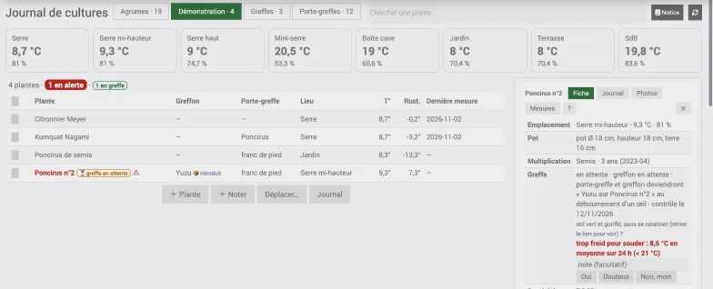
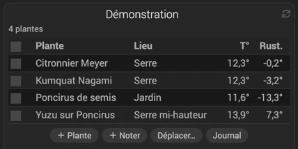
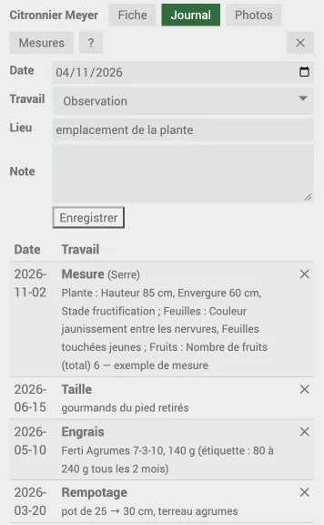
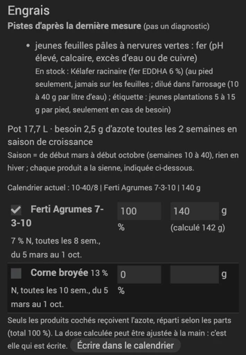
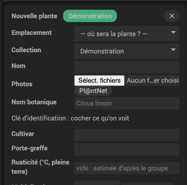
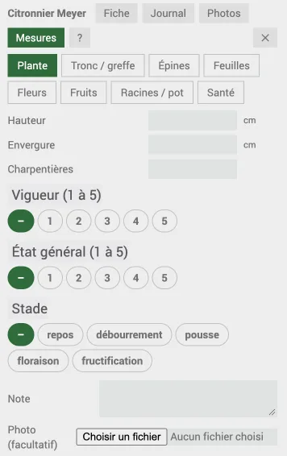
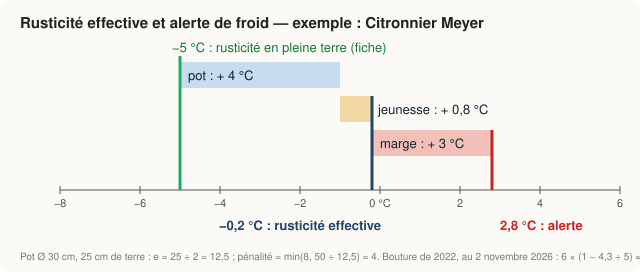

# Journal de cultures

Noter simplement la vie des plantes de la maison et du jardin, même quand elles changent de place au fil des saisons.

Les captures de cette notice viennent d'une collection de démonstration (plantes et données fictives).

## Prise en main
- **Configuration du plugin** : décrire les emplacements et leurs sondes (voir [Configuration du plugin](#configuration-du-plugin)), cocher « Page plein écran dans le menu Accueil ».
- **Créer une collection** (page du plugin, « Ajouter », type « Collection ») et la placer dans un objet : c'est la tuile.
- **＋ Plante** pour chaque plante : emplacement, collection, nom ; le reste peut attendre (voir [Nouvelle plante](#nouvelle-plante)).
- Au fil des jours : **＋ Noter** les travaux, l'onglet **Mesures** pour la croissance, **Déplacer…** quand les plantes changent de place.

*Page plein écran (Accueil → Journal de cultures) : un onglet par collection, les emplacements avec leur température et humidité, la liste des plantes ; la fiche s'ouvre à droite. Le bouton Notice ouvre ce texte.*

*La tuile de la collection sur le dashboard : T° = température de l'emplacement, Rust. = rusticité effective de la plante (voir [Configuration du plugin](#configuration-du-plugin)).*

## Principe
- **Collection** (ex. Agrumes, Porte-greffes, Plantes de la maison) : c'est la tuile. Elle affiche le tableau de ses plantes
  (emplacement, température, rusticité effective, engrais à donner, alerte).
- **Plante** : un équipement sans tuile, rangé dans une collection. Il porte la fiche, le pot, l'emplacement et les commandes.
- **Journal unique** : toutes les entrées (travaux, déplacements, mesures, engrais) dans une table ; Sélénoculture y lit et y écrit.
- **Commandes d'une plante** (utilisables dans les scénarios) : Emplacement, Température de l'emplacement, Rusticité effective, Alerte froid, Raison de l'alerte, Engrais de la semaine, Hauteur, Diamètre du tronc, Nombre de feuilles, Nombre de fruits (historisées), Greffe à contrôler (non historisée).
- **Commandes d'une collection** : Plantes en alerte, Engrais à donner, Résumé des alertes.

## Tuile
- Cliquer une plante : fenêtre **Fiche** (avec liens POWO, GBIF si le nom y a été trouvé, Tela Botanica, PFAF), **Journal**, **Photos**, **Mesures** (et courbes) ; **?** ouvre cette notice.
- **Journal** (bouton sous le tableau) : le journal de toutes les plantes de la collection.
- Administrateurs : cocher des plantes, puis **＋ Noter** (une entrée pour chacune ; sans plante cochée, une entrée libre avec un champ Plante)
  ou **Déplacer…** (changer l'emplacement, la collection, ou les deux : rentrée à la serre en un geste, noté au journal) ; **✓** à côté de 🌱 = engrais donné.
- **⚠** : sonde muette ou emplacement inconnu, la température n'est pas à jour.

*Onglet Journal : une entrée par travail (date, travail, lieu, note), la plus récente en haut ; ✕ supprime une entrée, sans confirmation (administrateurs).*

## Page plein écran
Cocher « Page plein écran dans le menu Accueil » dans la configuration du plugin. Même page sur ordinateur, tablette et téléphone ;
sur grand écran la fiche s'ouvre à côté de la liste. Champ « Chercher une plante… », colonnes Porte-greffe et Dernière mesure en plus de la tuile.
Relue toutes les 5 minutes (bouton ↻ pour tout de suite).

## Fiche d'une plante
La fiche se modifie dans la page du plugin (équipement de la plante) ; l'onglet Fiche de la tuile l'affiche.
- **Nom botanique** : vérifié auprès de GBIF à l'enregistrement (nom retenu, famille, statut).
- **Rusticité** : température supportée en pleine terre, en °C (« −7 » ou « -7 (FA5) » acceptés). Vide : estimée d'après le groupe
  (voir [Rusticité estimée](identification.md#rusticité-estimée)) et utilisée pour les alertes.
- **Pot** : forme (rond ou carré), diamètre ou côté, hauteur, hauteur de terre, ou pleine terre. Pour la rusticité, un pot carré de 30 cm de côté
  compte comme un pot rond de 30 cm de Ø ; pour le volume (engrais), on compte bien côté × côté.
- **Multiplication** (semis, greffe…) et sa date (`2024`, `2024-05` ou `2024-05-12` ; un autre format est ignoré, comme sans date) : l'âge est affiché dans la fiche
  (« ≈ » quand seule l'année est connue). Pour une greffe, préciser le type (voir [Types de greffe](greffe.md#types-de-greffe)).
- **Engrais** : `semaines | produit | dose` par ligne, semaines ISO : `10-40/2`, `12,16,20`, `48-8`. Un apport prévu n'est annoncé que si l'emplacement est en pousse (sans sonde historisée : calendrier seul) ; sauté par temps froid, il est rattrapé quand la moyenne remonte (voir [Géographie](#géographie)).
- **Plan d'engrais** (partie Engrais) : dose = volume du pot × besoin × intervalle ÷ % N, partagée entre les produits **cochés** (aucun d'office,
  sauf ceux déjà au calendrier) ; un produit à dose d'étiquette garde la sienne (litres × g/L) et les autres se partagent l'azote restant.
  La dose en grammes peut être ajustée à la main avant d'écrire ; celle déjà au calendrier est reprise. « Écrire dans le calendrier » remplace
  les lignes de ces produits, garde les autres (fer, magnésium, lignes à la main) et le note au journal. Détails : [Fertilisation](fertilisation.md).
- **Pistes de carence** et **Santé** : d'après la dernière mesure, jamais un diagnostic (voir [Santé](sante.md)).
- **Sources et points à vérifier** : où vient chaque information, et ce qui reste à confirmer.

*Partie Engrais : pot de 17,7 L × 0,07 g d'azote par litre et par semaine × 8 semaines ÷ 7 % d'azote = 142 g de Ferti Agrumes toutes les 8 semaines (arrondi ici à 140 g à la main). Au-dessus, une piste de carence d'après la dernière mesure.*

## Nouvelle plante
**＋ Plante** (tuile ou page plein écran, administrateurs) :
- d'abord où sera la plante (emplacement) et dans quelle collection ;
- puis nom, nom botanique, cultivar, porte-greffe, rusticité, multiplication (et type de greffe), pot ;
- pour trouver le nom botanique : Pl@ntNet (« Retenir » remplit le nom botanique, et le nom s'il est vide) ou la clé des caractères ;
  le groupe probable et la rusticité estimée s'affichent à chaque choix ;
- les photos choisies sont rangées dans la plante créée ; le reste de la fiche se complète dans la page du plugin.

**Pl@ntNet** (« ＋ Plante » et « Identifier… ») : choisir une ou plusieurs photos, donner à chacune son type (feuille, fleur, fruit, écorce, ou auto),
cocher celles à envoyer (5 au plus) puis « Pl@ntNet » : une seule demande pour toutes, plus sûre qu'une photo seule.

*Début du formulaire « ＋ Plante » : emplacement et collection d'abord.*

## Mesures
Onglet **Mesures** de la fenêtre d'une plante (administrateurs) : choisir l'organe (Plante, Tronc / greffe, Épines, Feuilles, Fleurs, Fruits,
Racines / pot, Santé), saisir ce qu'on a mesuré, une note et, au besoin, une photo. Tout part au journal en une entrée « Mesure ».
- Les champs vides sont ignorés ; plusieurs Ø de fruits séparés par des espaces, virgule décimale : `32 35,5 41`.
- **Rapports calculés** : aile / limbe en longueur (≥ 0,5 = aile très large, typique des papedas) et en largeur (mesurés au plus large) ;
  greffon / porte-greffe (bourrelet, incompatibilité).
- **Courbes** : hauteur, Ø du tronc (greffon, ou tronc d'une plante non greffée), nombre de feuilles, nombre de fruits
  (le total saisi, sinon la somme si noués, en croissance et mûrs sont tous saisis).
- **Rempotage** : organe « Racines / pot », champs « Nouveau pot » (forme, Ø ou côté, hauteur, hauteur de terre) ou « Pleine terre » :
  ils remplacent le pot de la fiche, la rusticité effective est recalculée et « ancien → nouveau pot » est noté au journal.
- **Santé** : signe observé, ravageur ou maladie, intensité ; les pistes s'affichent dans la fiche (voir [Santé](sante.md)).
- Les mesures complètent les caractères d'identification vides (aile de moins de 2 mm de large = simple liseré ; pas de taille de fruit
  pour les fruits en doigt ou en main) ; un désaccord est noté au journal.

*Onglet Mesures : un organe à la fois (ici « Plante ») ; « – » = non mesuré.*

## Photos
- Onglet **Photos** : ajouter une photo (administrateurs) ; ✕ puis « Confirmer ✕ » la supprime ; Pl@ntNet sur une photo, avec son organe.
- **☆ étiquette** sous une photo (administrateurs) : elle devient la photo de l'étiquette, affichée en tête de la fiche ; **★** la retire.
- Gardées dans le dossier `data` du plugin (non servi directement, lues par la tuile après contrôle des droits).

## Greffe
Tout est dans l'onglet [Greffe](greffe.md) : types, saison de chaque type, marche à suivre et points de contrôle, température, hiver, sources.
- **Greffer…** (bas de l'onglet Fiche, administrateurs) : le porte-greffe devient le greffon, sur le même équipement (journal, photos, pot gardés).
- **Suivi** (greffe de moins de 60 jours) : contrôles à J+21, J+42 puis 4 semaines après avoir répondu « débourré » ; le statut n'avance que sur réponse (**Oui**, **Douteux**,
  **Au printemps**, **Non, mort**) ; un contrôle dû remplit la commande « Greffe à contrôler », reprise par le rapport du matin.
- **Température** : 21-32 °C jusqu'à la soudure (réglable), puis seulement hors gel.
- **Redevenir porte-greffe…** : annule une greffe échouée.

## Identification (agrumes)
- **Clé des caractères** (fiche de la plante, dans la page du plugin) : choisir ce qui est observé (folioles, aile du pétiole, boutons floraux, fruit…),
  laisser « non observé » le reste, enregistrer. Le plugin classe les groupes du plus au moins compatible et nomme les caractères en désaccord ;
  « Probable » : un seul groupe sans désaccord, avec au moins 3 accords, tous les autres contredits ; sinon « Indécis entre… ».
  Groupe seulement, jamais la variété.
- **Identifier…** (bas de la fiche, administrateurs) : Pl@ntNet sur des photos, puis la clé ; un tableau montre chaque champ qui changerait
  (actuel, proposé, source). Rien n'est coché d'office ; **Appliquer** n'écrit que les lignes cochées et le note au journal.
- Sur un agrume à une foliole greffé sur Poncirus ou un hybride, une pousse à 3 folioles sous la greffe est un rejet du porte-greffe,
  à couper (déduction du plugin).

Comment observer, chaque caractère groupe par groupe, la rusticité estimée et les limites : voir la page [Identification](identification.md).

## Géographie
Le plugin lit dans Jeedom (Réglages → Système → Configuration) la **latitude** et le **pays** ; rien d'autre à régler.
- **Saison de l'engrais** : fenêtre de chaque produit (nord : début mars → début octobre) **et** moyenne sur 7 jours de l'emplacement au-dessus du zéro de végétation (≈ 13 °C) ;
  un apport sauté par temps froid est rattrapé quand la moyenne remonte ; deux jours chauds en hiver ne changent rien. Au sud, fenêtre décalée de 6 mois (saisie toujours en semaines du nord ; plan déjà écrit : le réécrire). Détail : [La saison](fertilisation.md#la-saison).
- **Emplacement chauffé** (salle de bains, véranda chauffée…) : hors de la fenêtre du produit, l'engrais continue au même rythme **à demi-dose** (dose du calendrier divisée par 2 dans l'annonce), tant que la moyenne sur 7 jours de la pièce atteint le zéro de végétation (sonde historisée nécessaire). Pas pour un jeune plant (moins d'un an, ou greffe en cours de suivi) : rien hors de la fenêtre, même au chaud (pas d'engrais l'hiver : 2 sources ; excès d'azote nuisible au jeune plant : Niu 2024, une seule source). Choix du plugin : aucune de nos sources ne traite d'un agrume en pièce chauffée l'hiver.
- **Repos hivernal au frais** (case de la plante) : pas d'engrais hors de la fenêtre des produits (toute l'année), même en emplacement chauffé ; de novembre à février (mai à août au sud), la plante est signalée ⚠ (liste et fiche, pas le rapport du matin) si elle est dans un emplacement marqué chauffé. Choix du plugin.
- **Greffe « Au printemps »** : contrôle le 15 mars au nord, le 15 septembre au sud, avancé si l'emplacement est déjà assez chaud (choix du plugin).
- **Santé** : statuts de présence donnés pour la France, périodes pour l'hémisphère nord ; ailleurs, la fiche le signale. Détail : [Santé](sante.md).
- **Rusticité et alertes froid** : mesurées par les sondes de chaque emplacement, donc valables partout.
Latitude ou pays absents : le plugin fait comme pour la France, hémisphère nord (pays : `FR`, `FRA` ou `France`).

## Configuration du plugin
- **Emplacements** : `Nom | température | humidité | température minimale prévue | chauffé`, une ligne chacun. Sans sonde, pas d'alerte.
  Le 5ᵉ champ, facultatif (un mot quelconque, ex. `chauffé`), marque une pièce chauffée l'hiver : voir [Géographie](#géographie).
- **Page plein écran dans le menu Accueil** : voir [Page plein écran](#page-plein-écran).
- **Marge** (3 °C) : alerte quand la température mesurée ou prévue descend à la rusticité effective + la marge.
- **Pénalité du pot** : en pot, la rusticité est relevée de `min(maximum, k / e)`, `e` = demi-épaisseur de la motte en cm
  (le plus petit du diamètre et de la hauteur de terre, divisé par 2 ; hauteur de terre vide = hauteur du pot ; pot sans dimensions = pénalité maximale).
  Par défaut k = 50 et maximum = 8 °C (choix du plugin). Modèle volontairement simple (ni durée du froid, ni vent, ni pot isolé) : à ajuster selon vos observations.
- **Pénalité de jeunesse** : une plante semée, greffée, bouturée ou marcottée, avec sa date, est moins rustique : rusticité relevée de x °C
  à 0 an, puis linéairement jusqu'à 0 à n ans (par défaut 6 °C et 5 ans, choix du plugin : greffe d'un an → +4,8 °C ; date « 2024 » seule = milieu d'année).
  Repères généraux sur les jeunes agrumes (vulgarisation des universités de Floride, de Louisiane et de Géorgie : jeunes arbres
  à protéger dès 0 °C, < 5 ans), pas de chiffre propre aux greffes : à ajuster. Achat ou sans date : aucune pénalité, 0 pour la retirer.
- **Engrais d'un jeune plant** (25 % / 3 ans) : même principe pour l'engrais, besoin en azote réduit à 25 % à 0 an, puis 100 % à 3 ans (choix du plugin, voir [la dose en pot](fertilisation.md#combien--la-dose-en-pot)) ; % à 0 ou 100, ou durée à 0, pour la retirer. S'applique au plan recalculé, pas à une dose déjà au calendrier.
- **Greffe : température pour souder** (21 / 32 °C) : voir [Température, hiver, engrais](greffe.md#température-hiver-engrais).
- **Zéro de végétation** (13 °C) : moyenne sur 7 jours de l'emplacement en dessous de laquelle les apports d'engrais attendent ; voir [Géographie](#géographie).
- **Produits en stock** : `Nom | % N | toutes les n semaines | saison | éléments | remarque | dose de l'étiquette (g/L, facultatif)` ;
  pas à pas : [Ajouter un engrais ou un produit](fertilisation.md#ajouter-un-engrais-ou-un-produit). Un produit avec % N et intervalle peut entrer
  dans le plan d'azote ; les éléments (N P K Mg Fe S Zn Mn) servent aux pistes de carence.
- **Azote par litre de pot** : 0,07 g par semaine par défaut (choix du plugin, dans la fourchette 0,10-0,16 g toutes les 2 semaines,
  voir [la dose](fertilisation.md#combien--la-dose-en-pot)) ; 0, négatif ou 1 et plus : 0,07.
- Dans tous ces réglages, la virgule ou le point conviennent (2,5 = 2.5) ; un texte ou une case vide = valeur par défaut.
- **Clé Pl@ntNet** (facultative) : compte gratuit sur my.plantnet.org, 500 identifications par jour.

*Rusticité effective = rusticité en pleine terre + pénalité du pot + pénalité de jeunesse ; l'alerte part à la rusticité effective + la marge. Mêmes chiffres que le Citronnier Meyer des captures, au 2 novembre 2026 (la pénalité de jeunesse baisse avec le temps).*
