# Santé des agrumes

Maladies et ravageurs des agrumes **en pot**, rentrés l'hiver sous une serre ou une véranda (Île-de-France), classés du plus important au moins important.
Le plugin donne des **pistes**, jamais un diagnostic : la plupart des cochenilles, par exemple, ne se distinguent qu'au microscope (COCHORTI 2021).
Pour une identification sûre, montrer un échantillon à un spécialiste (FREDON, pépiniériste).

Règle suivie : un geste n'est retenu que si **deux sources indépendantes** le donnent. Sinon, il est marqué **une seule source**.
Les bulletins de santé du végétal (BSV) de Corse et de PACA comptent pour deux sources (rédacteurs différents, même réseau).
Les sources sont nommées entre parenthèses ; les références complètes sont à la fin ([Sources](#sources)).
Ce qui vient du plugin lui-même (précaution, déduction) est écrit comme tel.

**Géographie** : les présences et absences (HLB, tristeza, mal secco, aleurode épineux) sont celles de **la France** ;
les périodes de risque (mois, saisons) viennent de sources de l'**hémisphère nord** (Corse, PACA, Italie, Californie, Floride).
Le plugin lit le pays et la latitude dans Jeedom (Réglages → Système → Configuration) :
- pays autre que la France : ces quatre statuts deviennent « statut à vérifier pour ce pays » (l'aleurode épineux reste en rouge) ;
- latitude au sud : la fiche rappelle de décaler les périodes citées de 6 mois (déduction du plugin : les saisons sont inversées) ;
- pays non renseigné : traité comme la France.
Les services et démarches cités (DRAAF-SRAL, FREDON, déclaration obligatoire) sont ceux de la France : ailleurs, s'adresser au service de protection des végétaux du pays.
La Corse n'est pas distinguée du continent : les statuts propres à la Corse sont donnés dans le texte.

## Dans le plugin
- **Mesures**, organe **Santé** : noter le **signe observé** (tableau ci-dessous), le ravageur ou la maladie s'ils sont connus, et l'intensité.
  Ravageurs proposés : mineuse, cochenille, acarien, puceron, aleurode, autre ; maladies : gommose, fumagine, autre.
  Organe **Tronc / greffe** : une écorce « gomme » ou « lésions » fait penser à la gommose.
- **Fiche**, partie **Santé** : pistes d'après la dernière mesure qui parle de santé, chacune avec ses gestes, du plus doux au plus fort.
  En dessous, la liste repliable des **problèmes surveillés, par priorité**.
- Le mal secco n'est proposé comme probable que pour les citronniers et les limes (le cédratier, aussi très sensible, n'est pas reconnu) ; ailleurs il est noté « peu probable ».
- Un substrat noté « détrempé » est signalé avec la gommose : c'est la condition qui la favorise.

## Reconnaître : du signe au problème

| Signe observé | Penser d'abord à |
|---|---|
| feuilles collantes (miellat) | [cochenilles](#cochenilles), [aleurodes](#aleurodes-mouches-blanches), [pucerons](#pucerons) |
| dépôt noir qui s'essuie | [fumagine](#fumagine) (puis chercher l'insecte qui fait le miellat) |
| boucliers ou amas cotonneux blancs | [cochenilles](#cochenilles) |
| petites mouches blanches qui s'envolent | [aleurodes](#aleurodes-mouches-blanches) |
| toiles fines, feuilles piquetées ou bronzées | [acariens](#acariens-araignées-rouges-tétranyques) |
| galeries sinueuses argentées | [mineuse](#mineuse-des-agrumes) |
| points noirs épineux sous les feuilles | [aleurode épineux](#aleurode-épineux-aleurocanthus-spiniferus) (à signaler) |
| gomme ou écorce brune au collet | [gommose](#gommose-et-pourriture-des-racines-phytophthora) |
| racines molles, écorce qui part (fil blanc) | [gommose](#gommose-et-pourriture-des-racines-phytophthora) |
| rameaux qui sèchent depuis la pointe | [mal secco](#mal-secco-citronniers-limes-cédratiers), [gommose](#gommose-et-pourriture-des-racines-phytophthora) |
| marbrures jaunes asymétriques | [HLB](#hlb-greening-absent) (absent : faire d'abord le test de symétrie) |

Feuilles jaunes **sans** insecte ni lésion : penser d'abord à une carence ou à un excès d'eau (voir [Reconnaître une carence](fertilisation.md#reconnaître-une-carence)).

## Bonnes pratiques

### Surveiller
- Regarder **les deux faces des jeunes feuilles**, à la loupe : c'est là que commencent acariens, pucerons et aleurodes (BSV PACA 2020, **une seule source**, qui ne parle des deux faces que pour les acariens ; la loupe est un choix du plugin).
- Les pousses tendres sont les plus attaquées par les pucerons ; une feuille ferme et coriace convient mal aux grosses colonies (Brun 1990, **une seule source**).
- Des **fourmis** qui montent et descendent signalent un insecte à miellat ; elles défendent les cochenilles contre leurs ennemis (BSV PACA 2020, **une seule source**).
  Les écarter est une déduction du plugin : aucune méthode efficace contre les fourmis n'est connue (BSV Corse 2024).

### Prévenir
- **Plants sains** : la principale voie d'arrivée du Phytophthora est un plant déjà infesté (Savita 2012, **une seule source**) ; plants et greffons d'origine contrôlée contre les virus (Vogel 1990, Sáenz Pérez 2019).
  Précaution du plugin : garder une plante qui arrive à l'écart des autres quelques semaines et la regarder de près.
- **Arrosage** : laisser le substrat ressuyer entre deux arrosages, un pot qui draine (UC IPM, BSV PACA 2020, NHB, UF/IFAS HS261) ; ne pas mouiller le tronc (NHB, Savita 2012).
- **Collet et point de greffe jamais enterrés** (UC IPM, Sáenz Pérez 2019, Savita 2012, Whiteside 1971).
- **Pas de blessure au pied** : pas de grattage ni de binage contre le tronc, pas de racines arrachées (Savita 2012, Whiteside 1971, Oliveira 1981).
- **Pas d'excès d'engrais** : il favorise les acariens (BSV PACA 2020). Voir [Fertilisation](fertilisation.md).
- **Préserver les auxiliaires** (coccinelles, chrysopes, syrphes, acariens prédateurs, petites guêpes parasites) : ils règlent souvent le problème seuls (voir chaque ravageur).

### Traiter sans abîmer la plante
Du plus doux au plus fort : enlever à la main, couper, laver, auxiliaires, puis seulement un produit.
- **Produits** : un particulier n'a droit qu'aux produits marqués « emploi autorisé dans les jardins » (loi Labbé), et à la dose de leur étiquette.
- **Huile, savon** : arroser la veille, jamais aux heures chaudes (Cloyd 2016, Brun 1990) ; huile seulement entre environ 5 et 24 °C (Cloyd 2016, **une seule source**).
  Précaution du plugin : essayer d'abord sur quelques feuilles, et pas en même temps que du cuivre ou du soufre.
- Une pulvérisation qui mouille tue aussi les larves de coccinelles et de chrysopes (Cloyd 2016, **une seule source**) : pas de traitement juste après avoir lâché des auxiliaires.

## Problèmes, par priorité

### Gommose et pourriture des racines (Phytophthora)
**Priorité 1.** La maladie la plus grave des agrumes en Corse (Vogel 1990, **une seule source**) ; en pot, c'est surtout la pourriture des racines dans un substrat qui reste mouillé.

**Signes** : gomme, écorce brune qui se fend au collet ou au point de greffe ; feuilles vert pâle à nervures jaunes (atteinte sévère), qui tombent ;
racines fines molles dont l'écorce part en laissant un fil blanc (Savita 2012, UC IPM).

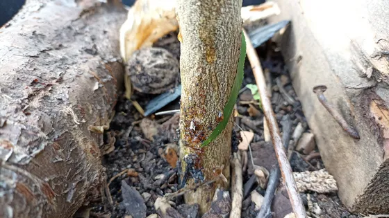

*Fig. S1 – Gomme qui suinte au pied d'un citronnier (gommose du collet, Phytophthora probable selon l'auteur). Photo Eiku, [Wikimedia Commons](https://commons.wikimedia.org/wiki/File:Lemon_tree_with_phytophtora_02_-_foot_rot_gummosis.jpg), [CC BY-SA 4.0](https://creativecommons.org/licenses/by-sa/4.0/).*

**Pourquoi** : *Phytophthora* est un oomycète (proche des algues brunes, longtemps classé parmi les champignons) ; il vit dans le sol et nage dans l'eau. Il entre par les **plaies** : une plaie fraîche est envahie le plus facilement,
rarement plus de 10 jours après ; l'écorce intacte et subérisée n'a pas été pénétrée, mais les **jeunes tiges** encore sans liège, si ;
et couvrir de terre le bas du tronc favorisait la maladie (Whiteside 1971). Les jeunes plants en pot sont donc les plus exposés (déduction du plugin).
Le travail mécanique du sol donnait le plus de gommose, sans doute par les blessures (Oliveira 1981).
Savita 2012 dit qu'une plaie reste sensible jusqu'à 14 jours, sans référence ; un essai sur l'avocatier donne un chiffre proche (El-Hamalawi et Menge 1994).

**Gestes**, dans l'ordre :
- arroser moins, laisser ressuyer, pot qui draine (UC IPM, BSV PACA 2020, NHB, UF/IFAS HS261) ; ne pas mouiller le tronc (NHB, Savita 2012) ;
- collet et point de greffe hors de la terre (UC IPM, Sáenz Pérez 2019, Savita 2012, Whiteside 1971) ;
- ne pas blesser le bas du tronc ni les racines (Savita 2012, Whiteside 1971, Oliveira 1981) ;
- lésion de **moins de la moitié** du tour du tronc : enlever l'écorce brune et une bande d'écorce saine autour, laisser sécher, revoir pendant quelques mois (UC IPM, NHB, TNAU) ;
- badigeon de cuivre (bouillie bordelaise) sur la plaie et le bas du tronc (UC IPM, NHB) ; sur l'avocatier, la bouillie bordelaise n'a pas freiné les chancres (El-Hamalawi et Menge 1994).
  En pot, le cuivre s'accumule dans le substrat ; un excès de cuivre est aussi une cause de manque de fer (voir [Reconnaître une carence](fertilisation.md#reconnaître-une-carence)) ;
- en dernier, un fongicide autorisé au jardin, s'il en existe un pour cet usage (vérifier sur ephy.anses.fr), à la dose et pour l'usage de l'étiquette (les professionnels utilisent phosphonates ou fosétyl-Al : UC IPM, Vogel 1990, NHB, Sáenz Pérez 2019, Savita 2012) ;
- **plus de la moitié** du tour du tronc : le déclin se voit dans le feuillage et le grattage ne suffit plus (UF/IFAS HS261, TNAU) ; remplacer la plante est un conseil économique
  de UC IPM, pas un résultat d'essai.

**Porte-greffe** : la sensibilité dépend du porte-greffe. Les bigaradiers, le Poncirus, les citranges et le citrumelo résistent (UF/IFAS HS261, Boccas et Laville 1976).
Le Volkameriana donne des résultats contradictoires : résistant (UF/IFAS HS261), selon le clone (Boccas et Laville 1976), très sensible dans l'essai de Vanderweyen 1980, où le cultivar greffé change aussi la sensibilité.
Un porte-greffe résistant et une greffe haute sont la meilleure prévention (Vogel 1990, Vanderweyen 1980).

### Cochenilles
**Priorité 2.** Fréquentes sous serre, toute l'année.

**Signes** : boucliers bruns ou noirs, amas cotonneux blancs sur les rameaux et le long des nervures ; miellat, fumagine, fourmis.

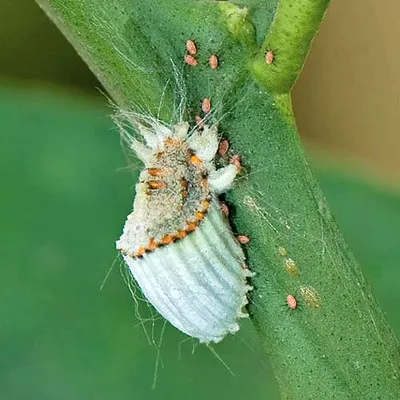

*Fig. S2 – Cochenille australienne (Icerya purchasi) et son sac à œufs blanc cannelé, sur un rameau de citronnier, en Inde. Photo Vijay Cavale, [Wikimedia Commons](https://commons.wikimedia.org/wiki/File:Icerya_purchasi_feeding_on_Citrus.jpg), [CC BY-SA 3.0](https://creativecommons.org/licenses/by-sa/3.0/).*

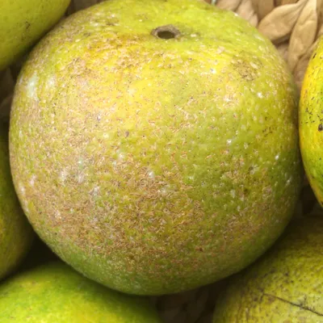

*Fig. S3 – Petits boucliers bruns sur un agrume vendu au marché, à Hawaï : probablement la cochenille virgule (Lepidosaphes beckii) selon l'auteur. Quelle que soit l'espèce, à repérer : boucliers bruns ou noirs collés à l'écorce, sur les rameaux et le long des nervures, ici sur le fruit ; miellat, fumagine, fourmis. Photo Scot Nelson, [Wikimedia Commons](https://commons.wikimedia.org/wiki/File:Scale_insects_on_locally_grown_citrus_fruit.jpg), CC0 (domaine public).*

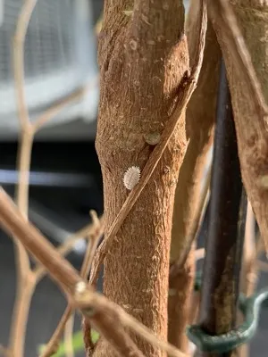

*Fig. S4 – Cochenille farineuse des agrumes (Planococcus citri) : corps ovale couvert de cire blanche, bordé de courts filaments, ici seule sur une tige ligneuse. À repérer : amas cotonneux blancs sur les rameaux et le long des nervures. Photo Mikhail Khokhlov, [Wikimedia Commons](https://commons.wikimedia.org/wiki/File:Planococcus_citri_on_a_plant.jpg), [CC BY-SA 4.0](https://creativecommons.org/licenses/by-sa/4.0/) ; réduite.*

**Gestes** :
- enlever à la main celles qu'on atteint, couper les rameaux très touchés (BSV JEVI Corse 2025, conseil donné pour le figuier, **une seule source**) ;
- écarter les fourmis, qui les défendent (déduction du plugin ; voir [Surveiller](#surveiller)) ;
- auxiliaires : la coccinelle *Cryptolaemus montrouzieri* et la petite guêpe *Anagyrus vladimiri* contre les cochenilles farineuses,
  la coccinelle *Rodolia cardinalis* contre la cochenille australienne (BSV Corse 2024, BSV PACA 2020, Brun 1990, COCHORTI 2021) ;
- huile (blanche ou de colza), qui asphyxie, en couvrant tout le feuillage (Brun 1990, BSV JEVI Corse 2025).

**Non retenu** : le mélange savon noir + huile végétale + alcool (5 cl de chaque par litre d'eau) du BSV JEVI Corse 2025 est un conseil donné pour le figuier ;
ce n'est pas un produit autorisé, il contient 5 % d'huile (contre 1,5 à 2 % pour les huiles d'été, chiffre non sourcé ici) et **aucune étude publiée** n'a été trouvée sur les agrumes. Seul essai sur l'alcool : des vêtements, pas des plantes (UF/IFAS 2022).

### Acariens (araignées rouges, tétranyques)
**Priorité 3.**

**Signes** : feuilles piquetées, jaunies, blanchies ou bronzées, petites toiles, surtout sur les jeunes feuilles ; les acariens se voient à peine à l'œil nu.

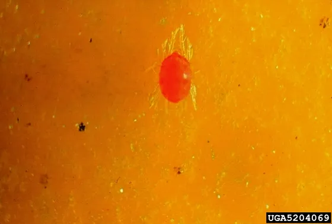

*Fig. S5 – Acarien rouge des agrumes (Panonychus citri) adulte, sur citronnier Meyer. À repérer : à peine visible à l'œil nu, il se cherche à la loupe sur les deux faces des jeunes feuilles, qui se piquettent puis jaunissent ou bronzent. Photo Jim Baker, North Carolina State University, [Bugwood.org](https://www.ipmimages.org/browse/detail.cfm?imgnum=5204069), [CC BY 3.0 US](https://creativecommons.org/licenses/by/3.0/us/).*

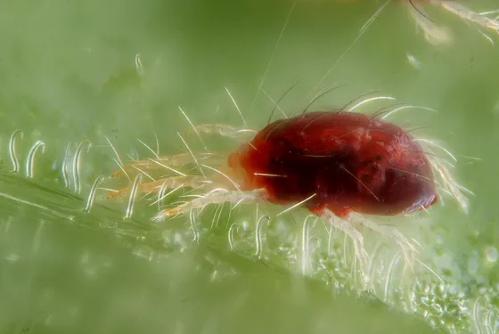

*Fig. S6 – Tétranyque tisserand (Tetranychus urticae), femelle et deux fils de soie, sur une feuille de haricot. Sur un agrume, mêmes signes : feuilles piquetées, petites toiles nettes, surtout sur les jeunes feuilles ; loupe nécessaire. Photo Gilles San Martin, [Wikimedia Commons](https://commons.wikimedia.org/wiki/File:Tetranychus_urticae_with_silk_threads.jpg), [CC BY-SA 2.0](https://creativecommons.org/licenses/by-sa/2.0/).*

**Pourquoi le climat compte** : les sources ne parlent pas du même acarien.

| Espèce | Optimum | Humidité | Sources |
|---|---|---|---|
| Tétranyque tisserand (*Tetranychus urticae*) | vers 30 °C | supporte l'air sec | réseau d'alerte d'Andalousie ; BSV PACA 2020 pour l'air sec |
| Acarien rouge des agrumes (*Panonychus citri*) | vers 25 °C ; à 35 °C, 76 % meurent sans pondre | modérée (Kasap n'a testé que 65 %) ; très chaud et sec défavorable | Andalousie, Kasap 2009 ; NC State pour le chaud et sec |

Saison de *Panonychus citri* : l'hiver en Tunisie (Chouikhi 2022, **une seule source**) ; la fiche NC State ne donne pas de saison (elle signale seulement des invasions au printemps et à l'automne sur les agrumes de véranda). Sous serre, les deux sont possibles ; des toiles nettes font penser à *T. urticae* (déduction du plugin).

**Gestes** :
- regarder les deux faces des jeunes feuilles à la loupe (BSV PACA 2020, **une seule source**) ;
- pas d'excès d'engrais (BSV PACA 2020, **une seule source**) ;
- préserver les auxiliaires : acariens prédateurs (*Neoseiulus californicus*, *Phytoseiulus persimilis*, *Euseius stipulatus*), coccinelles *Stethorus* (Brun 1990, Chouikhi 2022) ;
- huile blanche en couvrant bien (Brun 1990, **une seule source**).

### Aleurodes (mouches blanches)
**Priorité 4.**

**Signes** : petites mouches blanches qui s'envolent quand on secoue la plante ; larves plates sous les feuilles ; miellat, fumagine.

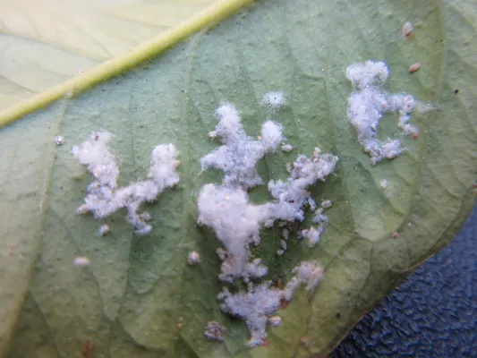

*Fig. S7 – Aleurode floconneux (Aleurothrixus floccosus) : flocons cireux blancs sur une feuille de citronnier. À repérer : sous les feuilles ; les adultes, petites mouches blanches, s'envolent quand on secoue la plante ; miellat, fumagine. Photo VictorCegarra, [Wikimedia Commons](https://commons.wikimedia.org/wiki/File:Aleurothrixus_floccosus.JPG), [CC BY-SA 4.0](https://creativecommons.org/licenses/by-sa/4.0/).*

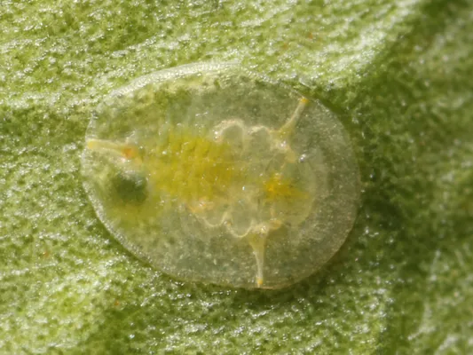

*Fig. S8 – Larve plate de l'aleurode des agrumes (Dialeurodes citri) sur une feuille d'agrume, en Californie. À repérer : sous les feuilles, collée au limbe. Photo Kaldari, [Wikimedia Commons](https://commons.wikimedia.org/wiki/File:Dialeurodes_citri_larva.jpg), domaine public.*

**Gestes** :
- **aleurode floconneux** : la petite guêpe *Cales noacki* le parasite parfois à 100 % ; traiter est rarement nécessaire (Brun 1990, Soto 2001, Barbagallo 1992) ;
- **aleurode des agrumes** (*Dialeurodes citri*) : *Encarsia* le parasite à 70-80 % en Italie (Barbagallo 1992), à moins de 20 % le plus souvent à Valence (Soto 2001) : résultat variable ;
- huile blanche contre les larves, sous les feuilles (Brun 1990, **une seule source** pour les agrumes ; essai sur d'autres aleurodes : Liu et Stansly 2000) ;
  plus efficace contre *D. citri* que contre l'aleurode floconneux (étude turque de 1996, citée de seconde main).

### Pucerons
**Priorité 5.**

**Signes** : colonies sur les jeunes pousses tendres, feuilles enroulées ; miellat.

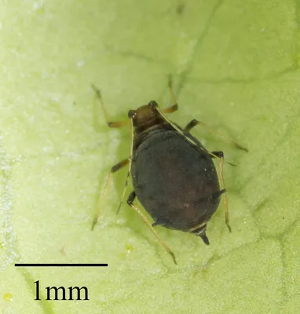

*Fig. S9 – Puceron noir de l'oranger (Aphis aurantii, ancien Toxoptera aurantii) ; le trait mesure 1 mm. À repérer : colonies sur les jeunes pousses tendres, feuilles enroulées, miellat. Photo Jesse Rorabaugh, [Wikimedia Commons](https://commons.wikimedia.org/wiki/File:Toxoptera_aurantii.jpg), CC0 (domaine public).*

**Gestes** :
- surveiller les pousses tendres au moment des poussées ; sur pomelo (*C. ×paradisi*), il est rarement nécessaire d'intervenir (Brun 1990, **une seule source**) ;
- favoriser les auxiliaires (coccinelles, surtout les petites *Scymnus*, chrysopes, syrphes) : la taille et la durée des colonies dépendent de la date d'arrivée des prédateurs,
  il faut qu'ils soient là **dès les premières colonies** (Gómez-Marco 2016, J. Econ. Entomol. 2019).

### Fumagine
**Priorité 6.** Des champignons noirs qui poussent sur le miellat d'un insecte ; ils salissent et freinent la photosynthèse, mais n'attaquent pas la feuille.

**Signes** : dépôt noir comme de la suie, qui s'essuie, sur les feuilles et les fruits.

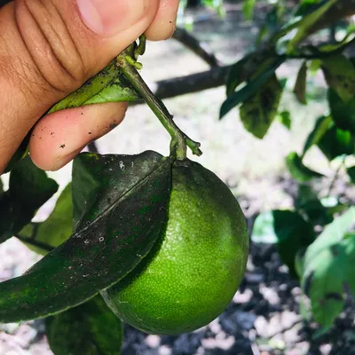

*Fig. S10 – Fumagine (selon l'auteur) : taches noires sur les feuilles d'un agrume, quelques points sur le fruit. À repérer : un dépôt noir comme de la suie, qui s'essuie (une tache qui ne part pas est autre chose) ; chercher au-dessus l'insecte qui fait le miellat (cochenille, aleurode, puceron). Photo EdilEGrand2000, [Wikimedia Commons](https://commons.wikimedia.org/wiki/File:Enfermedades_en_citr%C3%ADcos.jpg), [CC BY-SA 4.0](https://creativecommons.org/licenses/by-sa/4.0/).*

**Gestes** :
- trouver l'insecte qui fait le miellat (cochenille, aleurode, puceron) et le traiter : la fumagine part ensuite d'elle-même (NHB, BSV PACA 2020, Brun 1990) ;
- laver les feuilles à l'eau savonneuse (BSV JEVI Corse 2025, **une seule source**).

### Mineuse des agrumes
**Priorité 7.** Surtout dehors, sur les pousses d'été.

**Signes** : galeries sinueuses argentées dans les jeunes feuilles, qui se crispent et s'enroulent.

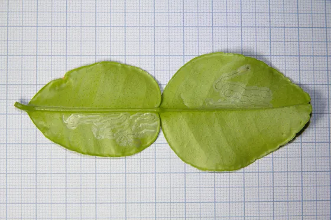

*Fig. S11 – Galeries de la mineuse des agrumes (Phyllocnistis citrella) sous une feuille de combava, avec deux larves. À repérer : galeries sinueuses argentées dans les jeunes feuilles, qui se crispent et s'enroulent. Photo A. Ariosti, [Wikimedia Commons](https://commons.wikimedia.org/wiki/File:Larve_di_su_Phyllocnistis_citrella_su_Citrus_hystrix.jpg), [CC BY-SA 4.0](https://creativecommons.org/licenses/by-sa/4.0/).*

**Gestes** :
- sur une plante adulte, dégâts surtout esthétiques (BSV PACA 2020) ; risque réel pour les jeunes plantes (BSV Corse 2024) ;
- couper les jeunes pousses atteintes (BSV PACA 2020, **une seule source**) ;
- si besoin, un produit de biocontrôle (BSV Corse 2024, **une seule source**).

### Mal secco (citronniers, limes, cédratiers)
**Priorité 8.** Champignon des vaisseaux (*Plenodomus tracheiphilus*, ancien *Phoma tracheiphila*), surtout destructeur sur citronnier (Migheli 2009, Nigro 2011) ;
organisme réglementé (liste A2 de l'OEPP) ; dans l'Union européenne, organisme réglementé non de quarantaine (ORNQ) : il vise les plants vendus, la déclaration n'est pas obligatoire chez un particulier. Présent en France (continent et Corse), de façon limitée (OEPP 2026).

**Signes** : feuilles qui tombent depuis la pointe des rameaux, rameaux qui sèchent, bois coloré saumon à rouge carotte sous l'écorce.

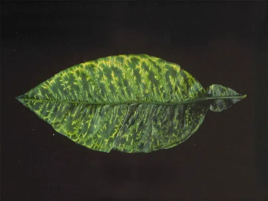

*Fig. S12 – Feuille de citronnier jaunie autour des nervures (mal secco). Photo Liberato, Cacciola et Magnano di San Lio 2006, PaDIL, [Wikimedia Commons](https://commons.wikimedia.org/wiki/File:Leaf_symptoms.jpg), [CC BY 3.0](https://creativecommons.org/licenses/by/3.0/).*

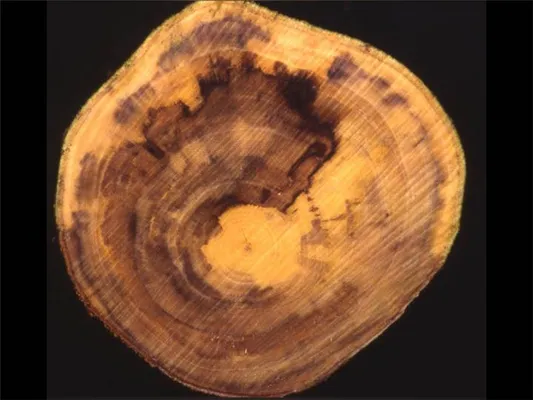

*Fig. S13 – Rameau malade coupé en travers : le bois est coloré. Mêmes auteurs, PaDIL, [Wikimedia Commons](https://commons.wikimedia.org/wiki/File:Mal_Secco_Disease_Branch_Cross_Section.jpg), [CC BY 3.0](https://creativecommons.org/licenses/by/3.0/).*

**Pourquoi** : il entre par les **blessures**, colonise le bois puis toute la plante (Catane 2022-2023, OEPP 2024) ; toute lésion, quelle qu'en soit l'origine, favorise l'infection (Spina et Cutuli 1983).
Les infections ont lieu surtout de novembre à février, avec un pic en janvier ; les organes qui produisent les spores apparaissent dès 5 °C pour Chapot (1963), vers 10 °C pour l'OEPP, qui situe l'infection entre 14 et 28 °C (OEPP 2024) : **les deux sources ne s'accordent pas**.
Très sensibles : citronnier, lime vraie, cédratier (Chapot 1963) ; l'OEPP cite aussi la bergamote et le bigaradier. Le plugin ne le propose que pour les citronniers et les limes.

**Gestes** :
- couper jusqu'au bois sain, sans coloration ; déchets en sac fermé à la déchetterie, jamais au compost (Chapot 1963, Catane 2022-2023 ; Chapot dit brûler, ce qui est interdit aux particuliers aujourd'hui) ;
- désinfecter les outils entre deux coupes : **alcool à 70°** (choix du plugin) ; Chapot les trempait dans du sulfate de cuivre à 5 % ;
- protéger les plaies au cuivre : hors des pratiques culturales, la lutte chimique repose sur le cuivre (Chapot 1963, Spina et Cutuli 1983) ;
- éviter toute blessure l'hiver (déduction du plugin, d'après Chapot 1963).

La sensibilité comparée des espèces vient d'observations au champ, pas toujours confirmées par des tests (OEPP 2024).

### Aleurode épineux (Aleurocanthus spiniferus)
**Priorité 9. Organisme de quarantaine** de l'Union européenne : on ne le traite pas seul, on le **signale**.

**Signes** : points noirs épineux sous les feuilles (larves et nymphes noires hérissées d'épines), miellat, fumagine, fourmis.

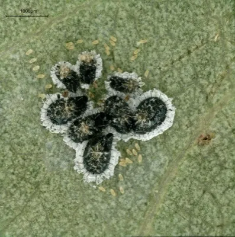

*Fig. S14 – Aleurode épineux (Aleurocanthus spiniferus) : pupes noires bordées de cire blanche et œufs jaunâtres, sous la loupe (le trait mesure 1 mm). Spécimens du premier foyer français, 2023. Photo Rossi J.-P., Streito J.-C., INRAE, 2023, [Recherche Data Gouv](https://doi.org/10.57745/WOHBMY), [Licence Ouverte Etalab 2.0](https://www.etalab.gouv.fr/licence-ouverte-open-licence/) ; réduite, sans autre modification. Autres stades : même lien.*

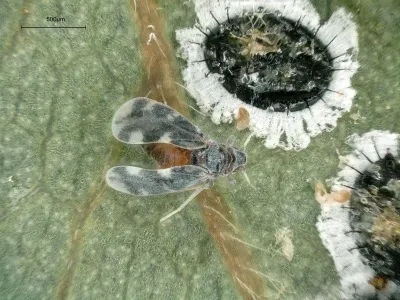

*Fig. S15 – Adulte : petite mouche aux ailes gris-bleu tachées de blanc, à côté d'une pupe (le trait mesure 0,5 mm). Même foyer, 2023. Photo Rossi J.-P., Streito J.-C., INRAE, 2023, [Recherche Data Gouv](https://doi.org/10.57745/WOHBMY), [Licence Ouverte Etalab 2.0](https://www.etalab.gouv.fr/licence-ouverte-open-licence/) ; réduite, sans autre modification.*

**Gestes** :
- photographier le dessous des feuilles et signaler à la DRAAF-SRAL (service de l'État) ou à la FREDON de sa région, photos jointes (fiche SORE, **une seule source**) ;
- en attendant, ne pas déplacer ni donner la plante (précaution du plugin).

Présent en France depuis 2023 : premier foyer confirmé dans le Gard (et Lunel, Hérault) en juin 2023 (OEPP RS 2023/160), puis à Menton (OEPP RS 2024/217) ; aujourd'hui en France continentale et en Corse, en Italie, en Grèce, en Croatie et ailleurs autour de la Méditerranée (OEPP 2026) ; en Italie depuis 2008, dans les Pouilles (fiche OEPP, d'après Porcelli 2008).
Savons et mouillants ne le contrôlent qu'en partie (Cioffi 2013, **une seule source**).

### Tristeza (présente en Haute-Corse)
**Priorité 10. Présente en France, en Haute-Corse seulement** : déclarée en 2018, des souches européennes y sont établies et ne peuvent plus être éradiquées ; jamais trouvée en Corse-du-Sud (OEPP 2026). En 1990, l'interdiction d'importer des plants la tenait encore hors de Corse (Vogel 1990).
Dans l'Union européenne : organisme de quarantaine pour les souches venues d'ailleurs, organisme réglementé non de quarantaine (ORNQ) pour les plants vendus (règlement 2019/2072, OEPP 2026). Hors de Corse, le risque vient d'un plant ou d'un greffon importé.
Virus transmis par des pucerons et par le matériel végétal (Sáenz Pérez 2019) ; il fait mourir les arbres greffés sur bigaradier (Vogel 1990, Sáenz Pérez 2019) ; aucun moyen curatif contre les virus (Vogel 1990).
Le pomelo (*C. ×paradisi*, grapefruit), très sensible, peut aussi décliner sur les autres porte-greffes (Vogel 1990, **une seule source**).

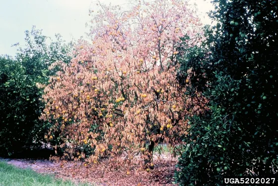

*Fig. S16 – Agrume dépérissant, classé « symptômes de tristeza » par Bugwood, sans autre description. Un dépérissement seul ne suffit pas à reconnaître la tristeza (déduction du plugin) ; ce qui doit alerter : un arbre greffé sur bigaradier qui décline (Vogel 1990, Sáenz Pérez 2019). Photo Florida Division of Plant Industry, Florida Department of Agriculture and Consumer Services, [Bugwood.org](https://www.ipmimages.org/browse/detail.cfm?imgnum=5202027), [CC BY 3.0 US](https://creativecommons.org/licenses/by/3.0/us/).*

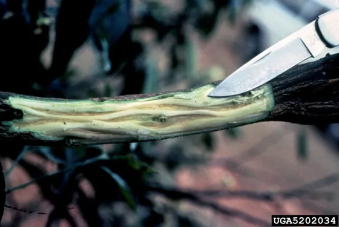

*Fig. S17 – Rameau d'agrume écorcé, classé « symptômes de tristeza » par Bugwood, sans autre description : le bois creusé de sillons ressemble, à notre avis, au bois piqueté (« stem pitting ») ; Sáenz Pérez 2019 parle de « stem bite » sur la tige, sans photo ni détail. Photo Florida Division of Plant Industry, Florida Department of Agriculture and Consumer Services, [Bugwood.org](https://www.ipmimages.org/browse/detail.cfm?imgnum=5202034), [CC BY 3.0 US](https://creativecommons.org/licenses/by/3.0/us/).*

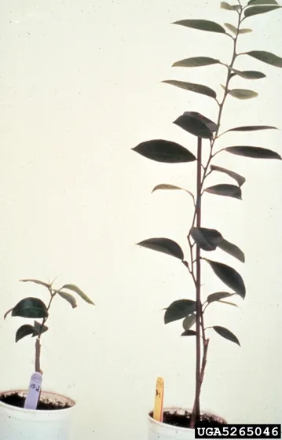

*Fig. S18 – Virus de la tristeza sur de jeunes orangers doux greffés sur bigaradier : sévère à gauche, faible à droite (selon Bugwood, sans autre précision). Photo Florida Division of Plant Industry, Florida Department of Agriculture and Consumer Services, [Bugwood.org](https://www.ipmimages.org/browse/detail.cfm?imgnum=5265046), [CC BY 3.0 US](https://creativecommons.org/licenses/by/3.0/us/).*

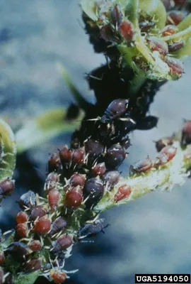

*Fig. S19 – Puceron brun des agrumes (Aphis citricidus, ancien Toxoptera citricida) sur une jeune pousse. Photo Florida Division of Plant Industry, Florida Department of Agriculture and Consumer Services, [Bugwood.org](https://www.ipmimages.org/browse/detail.cfm?imgnum=5194050), [CC BY 3.0 US](https://creativecommons.org/licenses/by/3.0/us/).*

**Gestes** : plants et greffons d'origine contrôlée (Vogel 1990, Sáenz Pérez 2019).
Contre la tristeza, Sáenz Pérez 2019 conseille un porte-greffe tolérant plutôt que le bigaradier (Volkameriana, Cléopâtre…). Mais sous serre la **gommose est le risque n° 1**.
Contre la tristeza : Poncirus résistant, citranges et citrumelo tolérants ; tous trois résistants à la gommose. Face à la gommose, le Volkameriana donne des résultats contradictoires (voir [Gommose](#gommose-et-pourriture-des-racines-phytophthora)). Choisir le porte-greffe d'abord pour la gommose.

### HLB (greening, absent)
**Priorité 11. Absent de France métropolitaine.** Bactérie transmise par des psylles. Deux psylles vecteurs sont déjà dans l'Union européenne : *Trioza erytreae* en Espagne et au Portugal (BSV JEVI Corse 2025), *Diaphorina citri* à Chypre (BSV JEVI Corse 2025, OEPP 2026), de passage en Grèce et seulement intercepté en France (OEPP 2026). Aucun traitement n'existe (BSV JEVI Corse 2025, Sáenz Pérez 2019).

**Signes** : marbrures jaunes **asymétriques** des feuilles, fruits déformés qui se colorent à l'envers, psylles sur les jeunes pousses.

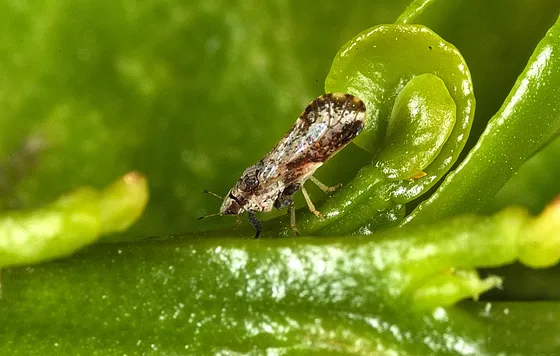

*Fig. S20 – Psylle asiatique des agrumes (Diaphorina citri), adulte de 2 à 3 mm, sur une jeune feuille. Photo David Hall, USDA ARS, [Wikimedia Commons](https://commons.wikimedia.org/wiki/File:Asian_Citrus_Psyllid_adult.jpg), domaine public.*

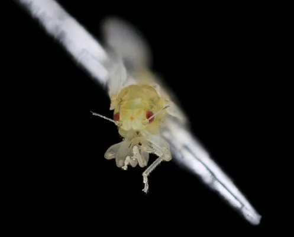

*Fig. S21 – Psylle asiatique vu de face, adulte tout juste émergé : encore blanc, yeux rouges, antennes fines (spécimen photographié au laboratoire, sur fond noir). Photo USGS Bee Inventory and Monitoring Lab, [USGS](https://www.usgs.gov/media/images/citrus-psyllid-u-recently-emerged-2-head-ft-detrick), domaine public ; réduite.*

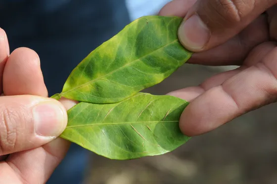

*Fig. S22 – Marbrure (« blotchy mottle ») causée par le HLB sur des feuilles d'agrume, dans un verger d'orangers doux au Texas. À repérer : le jaune n'est pas le même des deux côtés de la nervure centrale (voir le test de symétrie). Photo David Bartels, USDA, [Wikimedia Commons](https://commons.wikimedia.org/wiki/File:Citrus_Greening_%2820120120-APHIS-DB-0064%29.jpg), domaine public.*

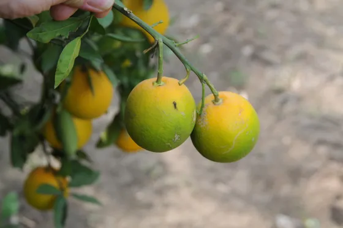

*Fig. S23 – Fruits d'agrume qui se colorent à l'envers à cause du HLB, au Texas. Photo David Bartels, USDA, [Wikimedia Commons](https://commons.wikimedia.org/wiki/File:Citrus_Greening_%2820120120-APHIS-DB-0065%29.jpg), domaine public.*

**Test de symétrie** : un jaunissement pareil des deux côtés de la nervure centrale est une carence (zinc, magnésium…) ; asymétrique, il est suspect (UF/IFAS PP328, **une seule source** ; les décolorations asymétriques sont aussi décrites par BSV JEVI Corse 2025).
Le HLB peut se confondre avec un manque de zinc (Sáenz Pérez 2019).
Asymétrique avec des psylles : signaler à la DRAAF-SRAL (service de l'État) ou à la FREDON de sa région.

## Sources
Lues en entier, sauf : Whiteside 1971, El-Hamalawi et Menge 1994, Liu et Stansly 2000, Gómez-Marco 2016, J. Econ. Entomol. 2019, Chouikhi 2022, Nigro 2011 (résumés seulement), Migheli 2009 (notice), et l'étude turque de 1996 (connue par la fiche « vérification des sources »). Deux sources du même organisme ne comptent que pour une ; les bulletins de santé du végétal (BSV) sont rédigés par des organismes différents (FREDON PACA, Chambre d'agriculture de Corse, FREDON Corse) mais dans le même réseau.
- **Barbagallo 1992** : Barbagallo S. et al., lutte biologique contre les aleurodes des agrumes en Italie, *Boll. Zool. Agr. Bachic.*
- **Boccas et Laville 1976** : Boccas B., Laville E., *Les maladies à Phytophthora des agrumes*, Fruits.
- **Catane 2022-2023** : même équipe (université de Catane), un seul groupe : Aiello D., Leonardi G. R., Di Pietro C., Vitale A., Polizzi G., *Plants* 11(3):446, 2022 (essai de *Bacillus amyloliquefaciens*) ; Leonardi G. R. et al., *Plants* 12(9):1735, 2023.
- **Brun 1990** : Brun P., ravageurs des agrumes en Corse (partie I), *Fruits* 45. Même série que Vogel 1990.
- **BSV Corse 2024** : Bulletin de santé du végétal, agrumes, Corse, août 2024.
- **BSV JEVI Corse 2025** : Bulletin de santé du végétal, jardins et espaces végétalisés, Corse, juin 2025.
- **BSV PACA 2020** : Bulletin de santé du végétal, zones non agricoles, PACA, novembre 2020.
- **Chapot 1963** : Chapot H., *Le mal secco*, *Al Awamia* 9:89-125.
- **Chouikhi 2022** : Chouikhi S. et al., *Panonychus citri* en Tunisie.
- **Cioffi 2013** : Cioffi M., Cornara D., Corrado I., Jansen M. G. M., Porcelli F., *Bulletin of Insectology* 66:273-281.
- **Spina et Cutuli 1983** : Spina P., Cutuli G., mal secco, *Fruits* 38(7-8):541-544.
- **Cloyd 2016** : Cloyd R. A., *Greenhouse Management*, 4 octobre 2016 (vulgarisation).
- **COCHORTI 2021** : projet COCHORTI (Valhor, INRAE), identification des cochenilles.
- **Étude turque 1996** : connue seulement par la fiche « Agrumes — vérification des sources », référence complète non retrouvée.
- **EFSA 2018** : EFSA Panel on Plant Health, *Pest categorisation of Aleurocanthus spp.*, *EFSA Journal* 16(10):e05436.
- **El-Hamalawi et Menge 1994** : *Plant Disease* 78:700 (avocatier).
- **Gómez-Marco 2016** : Gómez-Marco F. et al., *J. Pest Sci.* 89:69-79.
- **J. Econ. Entomol. 2019** : micro-coccinelles *Scymnus* et pucerons des agrumes ; auteurs non relevés (à compléter) : si c'est l'équipe de Gómez-Marco 2016, les deux ne comptent que pour une source.
- **Kasap 2009** : Kasap İ., *Turkish J. Agric. For.* 33:593-600.
- **Liu et Stansly 2000** : *Pest Management Science* 56:861.
- **Migheli 2009** : Migheli Q. et al., *Plant Disease* 93:852-867.
- **NC State** : fiche *Citrus red mite* (*Panonychus citri*), NC State University : très chaud et sec défavorable ; aucune saison de pullulation.
- **NHB** : National Horticulture Board (Inde), fiche fumagine et maladies des agrumes.
- **Nigro 2011** : Nigro F., Ippolito A., Salerno M. G., *Journal of Plant Pathology* 93(3):523-560.
- **OEPP 2024** : fiche de l'Organisation européenne et méditerranéenne pour la protection des plantes (mal secco) : pycnides vers 10 °C, infection entre 14 et 28 °C.
- **OEPP, fiche aleurode épineux** ([gd.eppo.int/taxon/ALECSN/datasheet](https://gd.eppo.int/taxon/ALECSN/datasheet)) : premier signalement en Italie en 2008 dans les Pouilles (Porcelli 2008).
- **OEPP 2026** : base de données de l'OEPP ([gd.eppo.int](https://gd.eppo.int)), répartition et statut réglementaire consultés le 3 novembre 2026 : tristeza (CTV000), aleurode épineux (ALECSN), *Diaphorina citri* (DIAACI), mal secco (DEUTTR).
- **OEPP RS 2023/160, RS 2024/217** : Service d'information de l'OEPP, premier signalement de l'aleurode épineux en France ([2023/160](https://gd.eppo.int/reporting/article-7642)), puis à Menton.
- **Oliveira 1981** : Oliveira et al., Embrapa, *Pesquisa Agropecuária Brasileira* 16(6).
- **Réseau d'alerte d'Andalousie** : relayé par la presse (Agronews Castilla y León).
- **Rossi et Streito 2023** : Rossi J.-P., Streito J.-C., *Pictures of Aleurocanthus spiniferus from French outbreak in 2023*, INRAE, Recherche Data Gouv, [doi:10.57745/WOHBMY](https://doi.org/10.57745/WOHBMY), Licence Ouverte Etalab 2.0.
- **Sáenz Pérez 2019** : Sáenz Pérez C. A. et al., principales maladies des agrumes, *Revista Mexicana de Ciencias Agrícolas* 10(7) (université autonome de Tamaulipas ; revue de l'INIFAP).
- **Savita 2012** : Savita et al., *Citrus diseases caused by Phytophthora species*, GERF Bull. Biosci. 3(1):18-27.
- **Fiche SORE** : fiche de diagnostic *Aleurocanthus spiniferus*, plateforme ESV.
- **Soto 2001** : Soto A. et al., *Bol. San. Veg. Plagas* 27:3-20.
- **TNAU** : Tamil Nadu Agricultural University, maladies des agrumes.
- **UC IPM** : University of California, *Pest Management Guidelines: Citrus*, fiche *Phytophthora gummosis*.
- **UF/IFAS HS261, PP328** : University of Florida (HS261 : Futch et Graham, *Field Diagnosis and Management of Phytophthora Diseases* ; PP328 : test du stylo, HLB ou carence). **UF/IFAS 2022** : alcool sur les cochenilles farineuses (vêtements).
- **Vanderweyen 1980** : influence du cultivar greffé sur la sensibilité du porte-greffe à la gommose.
- **Vogel 1990** : Vogel R., maladies des agrumes en Corse (partie II), *Fruits* 45.
- **Règlement 2019/2072** : règlement d'exécution (UE) 2019/2072 de la Commission, annexes II (organismes de quarantaine) et IV (ORNQ), [eur-lex.europa.eu](https://eur-lex.europa.eu/eli/reg_impl/2019/2072/oj).
- **Whiteside 1971** : Whiteside J. O., *Phytopathology* 61:1233-1238.
